# Galería de OmniEvents

Una imagen por capacidad de OmniEvents: qué ve un jugador cuando una regla la usa. **No son capturas del cliente oficial**: cada imagen es un render de lo que recibió del servidor un cliente real (un bot de mineflayer conectado a Paper 1.21.4 con el plugin), dibujado con la fuente, el HUD y el idioma (es_mx) de Minecraft 1.21.4; el mundo es la vista 3D de prismarine-viewer desde los ojos del bot. Lo que esa vista no puede mostrar con fidelidad (relámpagos, partículas, sonidos, ítems tirados) queda como texto.

Se regenera sola: `npm --prefix tests-e2e run capturas` (spec [004](../sdd/specs/004-fabrica-capturas-en-juego/spec.md)). No edites este archivo a mano.

## Índice

- **[Ejemplos](#ejemplos)**: [`bienvenida`](#ejemplo-bienvenida) · [`recompensa_diaria`](#ejemplo-recompensa_diaria) · [`diamantes_contados`](#ejemplo-diamantes_contados) · [`bloque_protegido` · `cancel`](#ejemplo-bloque_protegido) · [`suerte_minera`](#ejemplo-suerte_minera) · [`filtro_palabras`](#ejemplo-filtro_palabras) · [`menciones`](#ejemplo-menciones) · [`spawn_vip`](#ejemplo-spawn_vip) · [`monedas`](#ejemplo-monedas) · [`sumar_monedas` (`call`)](#ejemplo-sumar_monedas) · [`golpe_critico`](#ejemplo-golpe_critico) · [`cazador`](#ejemplo-cazador) · [`mensaje_de_muerte`](#ejemplo-mensaje_de_muerte) · [`huevo_sin_pollitos` · `custom` · `set_event`](#ejemplo-huevo_sin_pollitos) · [`sol_del_desierto` · `timer`](#ejemplo-sol_del_desierto) · [`anuncio`](#ejemplo-anuncio) · [`mensaje_noche`](#ejemplo-mensaje_noche) · [`sin_caida_vip`](#ejemplo-sin_caida_vip) · [`arranque` · `server_start` · `log`](#ejemplo-arranque)
- **[Comandos de /omni](#comandos-de-omni)**: [`/omni help`](#comando-help) · [`/omni reload`](#comando-reload) · [`/omni validate`](#comando-validate) · [`/omni list [filtro]`](#comando-list) · [`/omni info <regla>`](#comando-info) · [`/omni enable | disable <regla>`](#comando-enable) · [`/omni debug <regla|all|off>`](#comando-debug) · [`/omni eval <expresión>`](#comando-eval) · [`/omni call <regla> [jugador] [k=v…]`](#comando-call) · [`/omni var get | set | del <jugador|global> <nombre> [valor]`](#comando-var) · [`/omni var list <jugador|global>`](#comando-var-list) · [`/omni cooldown reset <regla> [jugador|global]`](#comando-cooldown) · [`/omni limit reset <regla> [jugador|global]`](#comando-limit) · [`/omni stats`](#comando-stats) · [`/omni triggers`](#comando-triggers) · [`/omni actions`](#comando-actions) · [`/omni item save | list | delete <nombre>`](#comando-item) · [`/omni import conditionalevents`](#comando-import) · [`/omni selftest`](#comando-selftest)
- **[Acciones · Mensajes](#acciones--mensajes)**: [`message`](#accion-message) · [`broadcast`](#accion-broadcast) · [`actionbar`](#accion-actionbar) · [`title`](#accion-title) · [`bossbar`](#accion-bossbar) · [`sound`](#accion-sound) · [`stop_sound`](#accion-stop_sound) · [`console_message`](#accion-console_message)
- **[Acciones · Comandos](#acciones--comandos)**: [`console`](#accion-console) · [`command`](#accion-command) · [`chat`](#accion-chat) · [`send_to_server`](#accion-send_to_server)
- **[Acciones · Jugador](#acciones--jugador)**: [`teleport`](#accion-teleport) · [`heal`](#accion-heal) · [`damage`](#accion-damage) · [`set_food`](#accion-set_food) · [`feed`](#accion-feed) · [`gamemode`](#accion-gamemode) · [`fly`](#accion-fly) · [`effect`](#accion-effect) · [`remove_effect`](#accion-remove_effect) · [`fire`](#accion-fire) · [`freeze`](#accion-freeze) · [`velocity`](#accion-velocity) · [`launch`](#accion-launch) · [`give_item`](#accion-give_item) · [`drop_item`](#accion-drop_item) · [`remove_item`](#accion-remove_item) · [`clear_inventory`](#accion-clear_inventory) · [`close_inventory`](#accion-close_inventory) · [`give_exp`](#accion-give_exp) · [`give_level`](#accion-give_level) · [`kick`](#accion-kick)
- **[Acciones · Mundo](#acciones--mundo)**: [`set_block`](#accion-set_block) · [`summon`](#accion-summon) · [`explosion`](#accion-explosion) · [`lightning`](#accion-lightning) · [`particle`](#accion-particle)
- **[Acciones · Evento](#acciones--evento)**: [`set_join_message`](#accion-set_join_message) · [`set_damage`](#accion-set_damage) · [`set_message`](#accion-set_message) · [`set_quit_message` · `player_quit`](#accion-set_quit_message) · [`set_death_message` · `player_death`](#accion-set_death_message) · [`keep_inventory`](#accion-keep_inventory) · [`cancel_drops` · `entity_death`](#accion-cancel_drops) · [`deny_join` · `player_pre_login`](#accion-deny_join)
- **[Acciones · Control de flujo](#acciones--control-de-flujo)**: [`if`](#accion-if) · [`repeat`](#accion-repeat) · [`while`](#accion-while) · [`for_each`](#accion-for_each) · [`random`](#accion-random) · [`delay`](#accion-delay) · [`wait_ticks`](#accion-wait_ticks) · [`stop`](#accion-stop) · [`set`](#accion-set) · [`unset`](#accion-unset) · [`no_cooldown`](#accion-no_cooldown) · [`reset_cooldown` · `cooldown` · `on_cooldown`](#accion-reset_cooldown)
- **[Opciones de una regla](#opciones-de-una-regla)**: [`limit` · `on_limit`](#opcion-limit)
- **[Disparadores · Jugador](#disparadores--jugador)**: [`player_respawn`](#disparador-player_respawn) · [`player_command`](#disparador-player_command) · [`player_move`](#disparador-player_move) · [`player_teleport`](#disparador-player_teleport) · [`player_world_change`](#disparador-player_world_change) · [`player_sneak`](#disparador-player_sneak) · [`player_sprint`](#disparador-player_sprint) · [`player_jump`](#disparador-player_jump) · [`player_level_change`](#disparador-player_level_change) · [`player_gamemode_change`](#disparador-player_gamemode_change) · [`player_toggle_flight`](#disparador-player_toggle_flight) · [`player_bed_enter`](#disparador-player_bed_enter) · [`player_fish`](#disparador-player_fish) · [`player_regain_health`](#disparador-player_regain_health) · [`player_food_change`](#disparador-player_food_change) · [`player_advancement`](#disparador-player_advancement) · [`player_swap_hands`](#disparador-player_swap_hands) · [`player_armor_change`](#disparador-player_armor_change) · [`player_portal`](#disparador-player_portal) · [`player_kick`](#disparador-player_kick) · [`player_resource_pack`](#disparador-player_resource_pack)
- **[Disparadores · Combate](#disparadores--combate)**: [`player_damage`](#disparador-player_damage) · [`player_attack`](#disparador-player_attack) · [`player_kill`](#disparador-player_kill) · [`player_shoot`](#disparador-player_shoot) · [`projectile_hit`](#disparador-projectile_hit)
- **[Disparadores · Bloques](#disparadores--bloques)**: [`block_place`](#disparador-block_place) · [`block_interact`](#disparador-block_interact) · [`sign_change`](#disparador-sign_change) · [`bucket_fill`](#disparador-bucket_fill) · [`bucket_empty`](#disparador-bucket_empty)
- **[Disparadores · Ítems](#disparadores--ítems)**: [`player_interact`](#disparador-player_interact) · [`item_interact`](#disparador-item_interact) · [`item_consume`](#disparador-item_consume) · [`item_craft`](#disparador-item_craft) · [`item_drop`](#disparador-item_drop) · [`item_pickup`](#disparador-item_pickup) · [`item_held`](#disparador-item_held) · [`item_enchant`](#disparador-item_enchant) · [`item_break`](#disparador-item_break)
- **[Disparadores · Inventario](#disparadores--inventario)**: [`inventory_open`](#disparador-inventory_open) · [`inventory_click`](#disparador-inventory_click) · [`inventory_close`](#disparador-inventory_close)
- **[Disparadores · Entidades](#disparadores--entidades)**: [`entity_interact`](#disparador-entity_interact) · [`entity_spawn`](#disparador-entity_spawn) · [`entity_death`](#disparador-entity_death)
- **[Disparadores · Servidor](#disparadores--servidor)**: [`console_command`](#disparador-console_command) · [`timer`](#disparador-timer) · [`clock`](#disparador-clock) · [`server_stop`](#disparador-server_stop)

## Por nombre

- **Disparadores**: [`block_break`](#ejemplo-diamantes_contados) · [`block_interact`](#disparador-block_interact) · [`block_place`](#disparador-block_place) · [`bucket_empty`](#disparador-bucket_empty) · [`bucket_fill`](#disparador-bucket_fill) · [`call`](#ejemplo-sumar_monedas) · [`clock`](#disparador-clock) · [`command`](#ejemplo-monedas) · [`console_command`](#disparador-console_command) · [`custom`](#ejemplo-huevo_sin_pollitos) · [`entity_death`](#disparador-entity_death) · [`entity_interact`](#disparador-entity_interact) · [`entity_spawn`](#disparador-entity_spawn) · [`inventory_click`](#disparador-inventory_click) · [`inventory_close`](#disparador-inventory_close) · [`inventory_open`](#disparador-inventory_open) · [`item_break`](#disparador-item_break) · [`item_consume`](#disparador-item_consume) · [`item_craft`](#disparador-item_craft) · [`item_drop`](#disparador-item_drop) · [`item_enchant`](#disparador-item_enchant) · [`item_held`](#disparador-item_held) · [`item_interact`](#disparador-item_interact) · [`item_pickup`](#disparador-item_pickup) · [`player_advancement`](#disparador-player_advancement) · [`player_armor_change`](#disparador-player_armor_change) · [`player_attack`](#disparador-player_attack) · [`player_bed_enter`](#disparador-player_bed_enter) · [`player_chat`](#ejemplo-filtro_palabras) · [`player_command`](#disparador-player_command) · [`player_damage`](#disparador-player_damage) · [`player_death`](#accion-set_death_message) · [`player_fish`](#disparador-player_fish) · [`player_food_change`](#disparador-player_food_change) · [`player_gamemode_change`](#disparador-player_gamemode_change) · [`player_interact`](#disparador-player_interact) · [`player_join`](#ejemplo-bienvenida) · [`player_jump`](#disparador-player_jump) · [`player_kick`](#disparador-player_kick) · [`player_kill`](#ejemplo-cazador) · [`player_kill`](#disparador-player_kill) · [`player_level_change`](#disparador-player_level_change) · [`player_move`](#disparador-player_move) · [`player_portal`](#disparador-player_portal) · [`player_pre_login`](#accion-deny_join) · [`player_quit`](#accion-set_quit_message) · [`player_regain_health`](#disparador-player_regain_health) · [`player_resource_pack`](#disparador-player_resource_pack) · [`player_respawn`](#disparador-player_respawn) · [`player_shoot`](#disparador-player_shoot) · [`player_sneak`](#disparador-player_sneak) · [`player_sprint`](#disparador-player_sprint) · [`player_swap_hands`](#disparador-player_swap_hands) · [`player_teleport`](#disparador-player_teleport) · [`player_toggle_flight`](#disparador-player_toggle_flight) · [`player_world_change`](#disparador-player_world_change) · [`projectile_hit`](#disparador-projectile_hit) · [`server_start`](#ejemplo-arranque) · [`server_stop`](#disparador-server_stop) · [`sign_change`](#disparador-sign_change) · [`timer`](#disparador-timer)
- **Acciones**: [`actionbar`](#accion-actionbar) · [`bossbar`](#accion-bossbar) · [`broadcast`](#accion-broadcast) · [`call`](#ejemplo-sumar_monedas) · [`cancel`](#ejemplo-bloque_protegido) · [`cancel_drops`](#accion-cancel_drops) · [`chat`](#accion-chat) · [`clear_inventory`](#accion-clear_inventory) · [`close_inventory`](#accion-close_inventory) · [`command`](#accion-command) · [`console`](#accion-console) · [`console_message`](#accion-console_message) · [`damage`](#accion-damage) · [`delay`](#accion-delay) · [`deny_join`](#accion-deny_join) · [`drop_item`](#accion-drop_item) · [`effect`](#accion-effect) · [`explosion`](#accion-explosion) · [`feed`](#accion-feed) · [`fire`](#accion-fire) · [`fly`](#accion-fly) · [`for_each`](#accion-for_each) · [`freeze`](#accion-freeze) · [`gamemode`](#accion-gamemode) · [`give_exp`](#accion-give_exp) · [`give_item`](#accion-give_item) · [`give_level`](#ejemplo-cazador) · [`give_level`](#accion-give_level) · [`heal`](#accion-heal) · [`if`](#accion-if) · [`keep_inventory`](#accion-keep_inventory) · [`kick`](#accion-kick) · [`launch`](#accion-launch) · [`lightning`](#accion-lightning) · [`log`](#ejemplo-arranque) · [`message`](#accion-message) · [`no_cooldown`](#accion-no_cooldown) · [`particle`](#accion-particle) · [`random`](#accion-random) · [`remove_effect`](#accion-remove_effect) · [`remove_item`](#accion-remove_item) · [`repeat`](#accion-repeat) · [`reset_cooldown`](#accion-reset_cooldown) · [`send_to_server`](#accion-send_to_server) · [`set`](#accion-set) · [`set_block`](#accion-set_block) · [`set_damage`](#accion-set_damage) · [`set_death_message`](#accion-set_death_message) · [`set_event`](#ejemplo-huevo_sin_pollitos) · [`set_food`](#accion-set_food) · [`set_join_message`](#accion-set_join_message) · [`set_message`](#accion-set_message) · [`set_quit_message`](#accion-set_quit_message) · [`sound`](#accion-sound) · [`stop`](#accion-stop) · [`stop_sound`](#accion-stop_sound) · [`summon`](#accion-summon) · [`teleport`](#accion-teleport) · [`title`](#accion-title) · [`unset`](#accion-unset) · [`velocity`](#accion-velocity) · [`wait_ticks`](#accion-wait_ticks) · [`while`](#accion-while)
- **Subcomandos de /omni**: [`actions`](#comando-actions) · [`call`](#comando-call) · [`cooldown`](#comando-cooldown) · [`debug`](#comando-debug) · [`disable`](#comando-enable) · [`enable`](#comando-enable) · [`eval`](#comando-eval) · [`help`](#comando-help) · [`import`](#comando-import) · [`info`](#comando-info) · [`item`](#comando-item) · [`limit`](#comando-limit) · [`list`](#comando-list) · [`reload`](#comando-reload) · [`selftest`](#comando-selftest) · [`stats`](#comando-stats) · [`triggers`](#comando-triggers) · [`validate`](#comando-validate) · [`var`](#comando-var)
- **Reglas de ejemplo**: [`anuncio`](#ejemplo-anuncio) · [`arranque`](#ejemplo-arranque) · [`bienvenida`](#ejemplo-bienvenida) · [`bloque_protegido`](#ejemplo-bloque_protegido) · [`cazador`](#ejemplo-cazador) · [`despedida`](#accion-set_quit_message) · [`diamantes_contados`](#ejemplo-diamantes_contados) · [`filtro_palabras`](#ejemplo-filtro_palabras) · [`golpe_critico`](#ejemplo-golpe_critico) · [`huevo_sin_pollitos`](#ejemplo-huevo_sin_pollitos) · [`menciones`](#ejemplo-menciones) · [`mensaje_de_muerte`](#ejemplo-mensaje_de_muerte) · [`mensaje_noche`](#ejemplo-mensaje_noche) · [`monedas`](#ejemplo-monedas) · [`recompensa_diaria`](#ejemplo-recompensa_diaria) · [`sin_caida_vip`](#ejemplo-sin_caida_vip) · [`sol_del_desierto`](#ejemplo-sol_del_desierto) · [`spawn_vip`](#ejemplo-spawn_vip) · [`suerte_minera`](#ejemplo-suerte_minera) · [`sumar_monedas`](#ejemplo-sumar_monedas)

## Ejemplos

<a id="ejemplo-bienvenida"></a>

### `bienvenida`

La primera vez que Ana entra: anuncio para todos, pan de bienvenida y, dos segundos después, el título.


Regla (`plugins/omnievents/src/main/resources/rules/ejemplos/bienvenida.yml`):

```yaml
bienvenida:
  trigger: player_join
  actions:
    - set_join_message: "<gray>[<green>+</green>] {player.name}"
    - if: "first_join"
      then:
        - broadcast: "<gold>¡Démosle la bienvenida a <yellow>{player.name}</yellow>, es su primera vez!"
        - give_item: "BREAD;8;<yellow>Pan de bienvenida;<gray>Para el primer día"
        - set: "pvar.monedas = 100"
      else:
        - message: "<green>¡Hola de nuevo, {player.name}! Tienes <yellow>{default(pvar.monedas, 0)}</yellow> monedas."
    - delay: 2s
    - title: "<gold>Bienvenido;<gray>{online} jugadores en línea"
    - sound: ENTITY_PLAYER_LEVELUP;1;1.2
```

<a id="ejemplo-recompensa_diaria"></a>

### `recompensa_diaria`

Un uso por jugador por día (`limit: 1` y `limit_reset: daily`): cinco segundos después de entrar llega la recompensa.


Regla (`plugins/omnievents/src/main/resources/rules/ejemplos/bienvenida.yml`):

```yaml
recompensa_diaria:
  trigger: player_join
  limit: 1
  limit_reset: daily
  actions:
    - delay: 5s
    - set: "pvar.monedas += 25"
    - message: "<green>Recompensa diaria: <yellow>+25 monedas</yellow> <gray>(total {pvar.monedas})."
```

<a id="ejemplo-diamantes_contados"></a>

### `diamantes_contados`

Al romper mena de diamante en supervivencia se suma `pvar.diamantes` y se muestra en la barra de acción.


Regla (`plugins/omnievents/src/main/resources/rules/ejemplos/mineria.yml`):

```yaml
diamantes_contados:
  trigger: block_break
  worlds: [world]
  conditions:
    - "block.type in ['DIAMOND_ORE', 'DEEPSLATE_DIAMOND_ORE']"
    - "player.gamemode == 'survival'"
  actions:
    - set: "pvar.diamantes += 1"
    - if: "pvar.diamantes % 10 == 0"
      then:
        - broadcast: "<aqua>{player.name}</aqua> <gray>ya minó <aqua>{pvar.diamantes}</aqua> diamantes."
        - particle: TOTEM_OF_UNDYING;40;0.5;1;0.5;0.3
    - actionbar: "<aqua>Diamantes: {pvar.diamantes}"
```

<a id="ejemplo-bloque_protegido"></a>

### `bloque_protegido` · `cancel`

Una condición con `||`, `&&`, `!` y paréntesis. `cancel` anula el evento: la roca madre sigue en su lugar.

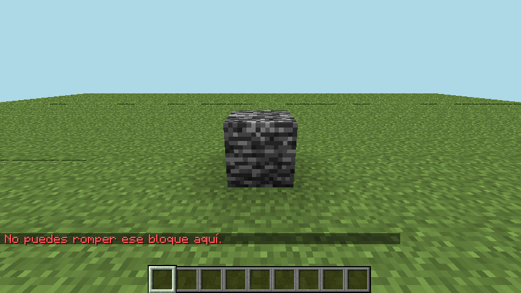

Regla (`plugins/omnievents/src/main/resources/rules/ejemplos/mineria.yml`):

```yaml
bloque_protegido:
  trigger: block_break
  conditions: "block.type == 'BEDROCK' || (block.y < -60 && !player.hasPermission('omnievents.mineria.fondo'))"
  actions:
    - cancel
    - message: "<red>No puedes romper ese bloque aquí."
```

<a id="ejemplo-suerte_minera"></a>

### `suerte_minera`

> **Solo texto.** Depende del azar: `chance(2)` (2 % de las piedras) y después un `random` ponderado. No se puede provocar a propósito sin cambiar el ejemplo. Cuando sale, el jugador ve en el chat «¡Encontraste hierro escondido!» (70 %), «¡Una pepita de oro!» (25 %) o, para todos, «<jugador> encontró un diamante de la suerte.» (5 %).

Regla (`plugins/omnievents/src/main/resources/rules/ejemplos/mineria.yml`):

```yaml
suerte_minera:
  trigger: block_break
  conditions: "block.type ~= 'stone' && chance(2)"
  cooldown: 30s
  actions:
    - random:
        - weight: 70
          do:
            - give_item: IRON_INGOT;2
            - message: "<gray>¡Encontraste hierro escondido!"
        - weight: 25
          do:
            - give_item: GOLD_INGOT;1
            - message: "<gold>¡Una pepita de oro!"
        - weight: 5
          do:
            - give_item:
                material: DIAMOND
                name: "<aqua>Diamante de la suerte"
                lore: ["<gray>Minado por {player.name}"]
                glow: true
            - broadcast: "<aqua>{player.name}</aqua> <gray>encontró un diamante de la suerte."
```

<a id="ejemplo-filtro_palabras"></a>

### `filtro_palabras`

El mensaje no llega a nadie (`cancel` en el chat asíncrono) y el autor recibe el aviso. A la tercera, `console: kick`.

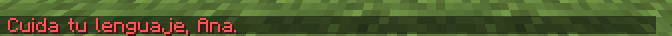

Regla (`plugins/omnievents/src/main/resources/rules/ejemplos/chat.yml`):

```yaml
filtro_palabras:
  trigger: player_chat
  conditions: "lower(message) matches '.*\\b(tonto|idiota)\\b.*'"
  actions:
    - cancel
    - message: "<red>Cuida tu lenguaje, {player.name}."
    - set: "pvar.avisos += 1"
    - if: "pvar.avisos >= 3"
      then:
        - console: "kick {player.name} Lenguaje inapropiado"
        - set: "pvar.avisos = 0"
```

<a id="ejemplo-menciones"></a>

### `menciones`

Beto ve en su barra de acción que Ana lo mencionó (y oye un sonido). El texto de Ana nunca se interpreta como MiniMessage.

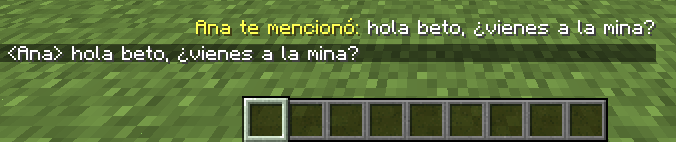

Regla (`plugins/omnievents/src/main/resources/rules/ejemplos/chat.yml`):

```yaml
menciones:
  trigger: player_chat
  actions:
    - for_each: all
      do:
        - if: "player.name != source.name && lower(message) contains lower(player.name)"
          then:
            - sound: BLOCK_NOTE_BLOCK_PLING;1;2
            - actionbar: "<yellow>{source.name} te mencionó: <white>{message}"
```

<a id="ejemplo-spawn_vip"></a>

### `spawn_vip`

Comando real `/spawnvip` (alias `/svip`): avisa, espera 3 s con `delay`, teletransporta. El segundo intento cae en el enfriamiento de 1 minuto (`on_cooldown`). Varía: los segundos que faltan dependen de cuánto tardó la escena.

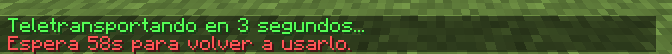

Regla (`plugins/omnievents/src/main/resources/rules/ejemplos/comandos.yml`):

```yaml
spawn_vip:
  trigger: command
  command:
    name: spawnvip
    aliases: [svip]
    permission: omnievents.cmd.spawnvip
    description: Ir al spawn VIP
    usage: /spawnvip
  cooldown: 1m
  on_cooldown:
    - message: "<red>Espera {var.cooldown_left}s para volver a usarlo."
  actions:
    - if: "player == null"
      then:
        - message: "Solo los jugadores pueden usar este comando."
        - stop
    - message: "<green>Teletransportando en 3 segundos..."
    - delay: 3s
    - teleport: "world;0.5;100;0.5"
    - sound: ENTITY_ENDERMAN_TELEPORT
```

<a id="ejemplo-monedas"></a>

### `monedas`

Un comando real con autocompletado (`tab`) y subcomandos resueltos con `if`.

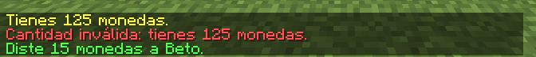

Regla (`plugins/omnievents/src/main/resources/rules/ejemplos/comandos.yml`):

```yaml
monedas:
  trigger: command
  command:
    name: monedas
    description: Ver o dar monedas
    usage: /monedas [ver | dar <jugador> <cantidad>]
    tab: [["ver", "dar"], ["{players}"]]
  actions:
    - if: "player == null"
      then:
        - message: "Solo los jugadores tienen monedas."
        - stop
    - if: "args.size == 0 || args[0] == 'ver'"
      then:
        - message: "<yellow>Tienes {default(pvar.monedas, 0)} monedas."
        - stop
    - if: "args[0] == 'dar' && args.size >= 3"
      then:
        - if: "!online(args[1]) || args[1] ~= player.name"
          then:
            - message: "<red>{args[1]} no está conectado (o eres tú)."
            - stop
        - if: "num(args[2]) <= 0 || num(args[2]) > default(pvar.monedas, 0)"
          then:
            - message: "<red>Cantidad inválida: tienes {default(pvar.monedas, 0)} monedas."
            - stop
        - set: "pvar.monedas -= num(args[2])"
        - call: "sumar_monedas; jugador=args[1]; cantidad=num(args[2])"
        - message: "<green>Diste {args[2]} monedas a {args[1]}."
      else:
        - message: "<gray>Uso: /monedas [ver | dar <jugador> <cantidad>]"
```

<a id="ejemplo-sumar_monedas"></a>

### `sumar_monedas` (`call`)

Lo que ve Beto cuando Ana le da monedas: `monedas` llama a `sumar_monedas` con `call`, y sus argumentos llegan como `var.jugador` y `var.cantidad`.

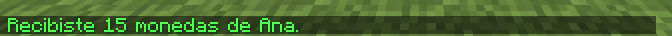

Regla (`plugins/omnievents/src/main/resources/rules/ejemplos/comandos.yml`):

```yaml
sumar_monedas:
  trigger: call
  args: [jugador, cantidad]
  actions:
    - for_each: "player(var.jugador)"
      do:
        - set: "pvar.monedas += var.cantidad"
        - message: "<green>Recibiste {var.cantidad} monedas de {source.name}."
```

<a id="ejemplo-golpe_critico"></a>

### `golpe_critico`

Con espada, un 15 % de los golpes (`chance(15)`) hace el doble de daño con `set_damage: 200%`. La escena golpea hasta que sale. Varía: cuántos golpes hacen falta es azar, y cada golpe empuja a la vaca.

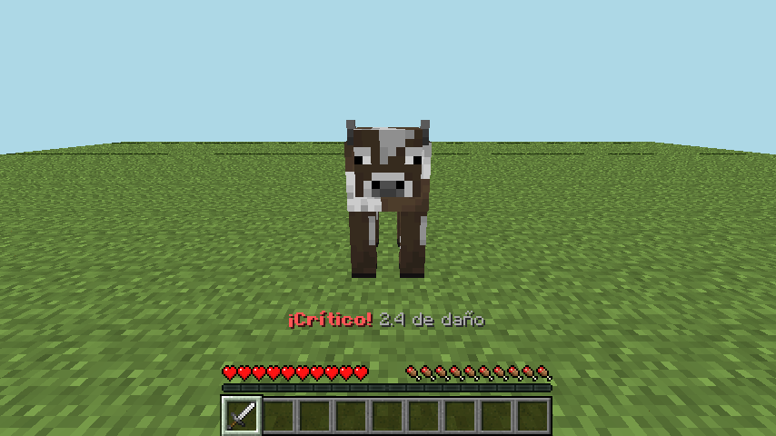

Regla (`plugins/omnievents/src/main/resources/rules/ejemplos/combate.yml`):

```yaml
golpe_critico:
  trigger: player_attack
  conditions:
    - "!target.is_player"
    - "item.type endsWith '_SWORD'"
    - "chance(15)"
  actions:
    - set_damage: "200%"
    - particle: CRIT;20
    - actionbar: "<red><bold>¡Crítico!</bold> <gray>{round(event.damage, 1)} de daño"
```

<a id="ejemplo-cazador"></a>

### `cazador`

Cada 50 monstruos se anuncia y se dan 5 niveles (`give_level`). La escena deja `pvar.monstruos` en 49 y Ana caza una creeper.

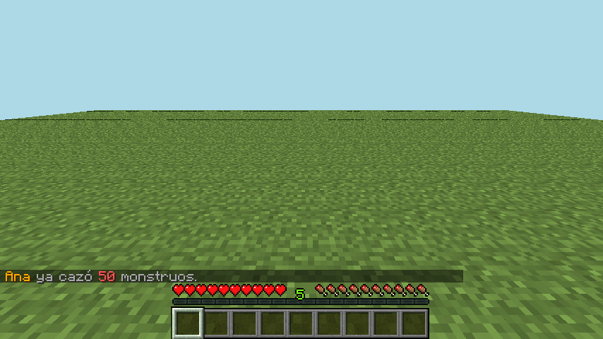

Regla (`plugins/omnievents/src/main/resources/rules/ejemplos/combate.yml`):

```yaml
cazador:
  trigger: player_kill
  conditions: "target.type in ['ZOMBIE', 'SKELETON', 'CREEPER', 'SPIDER']"
  actions:
    - set: "pvar.monstruos += 1"
    - if: "pvar.monstruos % 50 == 0"
      then:
        - broadcast: "<gold>{player.name}</gold> <gray>ya cazó <red>{pvar.monstruos}</red> monstruos."
        - give_level: 5
```

<a id="ejemplo-mensaje_de_muerte"></a>

### `mensaje_de_muerte`

Cuando a Ana la mata Beto, el ejemplo cambia el mensaje de muerte con `set_death_message`.

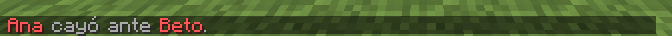

Regla (`plugins/omnievents/src/main/resources/rules/ejemplos/combate.yml`):

```yaml
mensaje_de_muerte:
  trigger: player_death
  conditions: "killer != null"
  actions:
    - set_death_message: "<red>{player.name}</red> <gray>cayó ante <red>{killer.name}</red>."
    - message: "<gray>{killer.name} está en {round(killer.x)}, {round(killer.y)}, {round(killer.z)}."
```

<a id="ejemplo-huevo_sin_pollitos"></a>

### `huevo_sin_pollitos` · `custom` · `set_event`

Cualquier evento de Bukkit por su clase (`PlayerEggThrowEvent`); `set_event: "hatching = false"` usa su setter. El ejemplo viene apagado: la escena lo enciende con `/omni enable`.

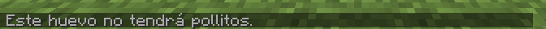

Regla (`plugins/omnievents/src/main/resources/rules/ejemplos/combate.yml`):

```yaml
huevo_sin_pollitos:
  trigger: custom
  event: org.bukkit.event.player.PlayerEggThrowEvent
  enabled: false
  actions:
    - set_event: "hatching = false"
    - message: "<gray>Este huevo no tendrá pollitos."
```

<a id="ejemplo-sol_del_desierto"></a>

### `sol_del_desierto` · `timer`

`timer` por jugador cada 5 s: en el desierto, de día y en supervivencia, aplica Hambre y avisa. La escena convierte la plataforma en desierto con `/fillbiome`.

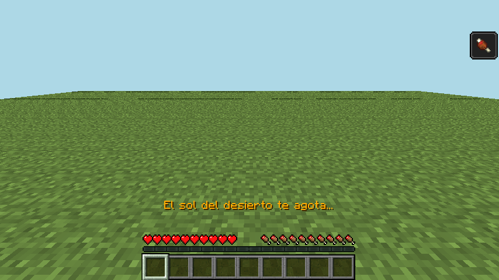

Regla (`plugins/omnievents/src/main/resources/rules/ejemplos/temporizadores.yml`):

```yaml
sol_del_desierto:
  trigger: timer
  every: 5s
  conditions:
    - "player.location.biome == 'DESERT'"
    - "player.gamemode == 'survival'"
    - "world.day"
  actions:
    - effect: HUNGER;6;1;false
    - actionbar: "<gold>El sol del desierto te agota..."
```

<a id="ejemplo-anuncio"></a>

### `anuncio`

> **Solo texto.** Es un `timer` global cada 10 minutos: la escena no espera tanto. Cuando corre, todos ven en el chat uno de los dos consejos al azar («Consejo: usa /monedas para ver tus monedas.»). El disparador `timer` tiene su imagen más abajo.

Regla (`plugins/omnievents/src/main/resources/rules/ejemplos/temporizadores.yml`):

```yaml
anuncio:
  trigger: timer
  every: 10m
  per_player: false
  conditions: "online > 0"
  actions:
    - random:
        - do: [{broadcast: "<gold>Consejo:</gold> <gray>usa <yellow>/monedas</yellow> para ver tus monedas."}]
        - do: [{broadcast: "<gold>Consejo:</gold> <gray>cada 10 diamantes se anuncia en el chat."}]
```

<a id="ejemplo-mensaje_noche"></a>

### `mensaje_noche`

> **Solo texto.** Es un `clock` a las 22:00 (hora del servidor): la escena no puede adelantar el reloj sin cambiar el ejemplo. Todos ven en el chat «Son las 22:00. ¡No olvides descansar!». El disparador `clock` tiene su imagen más abajo.

Regla (`plugins/omnievents/src/main/resources/rules/ejemplos/temporizadores.yml`):

```yaml
mensaje_noche:
  trigger: clock
  at: ["22:00"]
  actions:
    - broadcast: "<dark_aqua>Son las 22:00. ¡No olvides descansar!"
```

<a id="ejemplo-sin_caida_vip"></a>

### `sin_caida_vip`

> **Solo texto.** Cancela el daño por caída de quien tiene el permiso `omnievents.vip`. No muestra nada: lo que se nota es que la vida no baja.

Regla (`plugins/omnievents/src/main/resources/rules/ejemplos/combate.yml`):

```yaml
sin_caida_vip:
  trigger: player_damage
  permission: omnievents.vip
  conditions: "cause == 'FALL'"
  actions:
    - cancel
```

<a id="ejemplo-arranque"></a>

### `arranque` · `server_start` · `log`

Al arrancar el servidor se suma `gvar.arranques` y se escribe en el log. **No lo ve un jugador**: la imagen es la consola del servidor. Varía: el número de arranque crece en cada corrida.

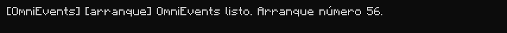

Regla (`plugins/omnievents/src/main/resources/rules/ejemplos/temporizadores.yml`):

```yaml
arranque:
  trigger: server_start
  actions:
    - set: "gvar.arranques += 1"
    - log: "OmniEvents listo. Arranque número {gvar.arranques}."
```

## Comandos de /omni

<a id="comando-help"></a>

### `/omni help`

Cada jugador ve solo los subcomandos que su permiso le deja usar (`omnievents.command.<sub>`).


Comando: `/omni help`

<a id="comando-reload"></a>

### `/omni reload`

Recarga config, mensajes y reglas sin reiniciar. Varía: muestra cuánto tardó.

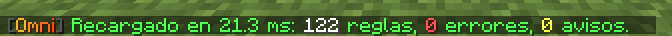

Comando: `/omni reload`

<a id="comando-validate"></a>

### `/omni validate`

Cada error dice archivo, ruta y causa, con «¿quisiste decir…?». La escena agrega una regla con errores a propósito; las reglas con errores no se cargan y el resto sigue funcionando.


Comando: `/omni validate`

Regla (`tests-e2e/omnievents/capturas-errores/roto.yml`):

```yaml
saludo_roto:
  trigger: player_joim
  actions:
    - mesage: "<green>Hola {player.name}"
    - title: "<gold>Bienvenido;{player.level >= }"
```

<a id="comando-list"></a>

### `/omni list [filtro]`

Filtra por nombre, disparador o archivo. Cada regla se puede pulsar para ver su detalle.


Comando: `/omni list ejemplos/`

<a id="comando-info"></a>

### `/omni info <regla>`

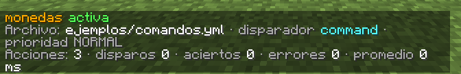

Comando: `/omni info monedas`

<a id="comando-enable"></a>

### `/omni enable | disable <regla>`


Comando: `/omni disable menciones · /omni enable menciones`

<a id="comando-debug"></a>

### `/omni debug <regla|all|off>`

En cada disparo se ve cada condición con sus valores, la rama que se tomó y cada acción. Aquí, con el ejemplo `diamantes_contados` al romper una mena. Varía: el fondo es el bloque recién roto.


Comando: `/omni debug diamantes_contados`

Regla (`plugins/omnievents/src/main/resources/rules/ejemplos/mineria.yml`):

```yaml
diamantes_contados:
  trigger: block_break
  worlds: [world]
  conditions:
    - "block.type in ['DIAMOND_ORE', 'DEEPSLATE_DIAMOND_ORE']"
    - "player.gamemode == 'survival'"
  actions:
    - set: "pvar.diamantes += 1"
    - if: "pvar.diamantes % 10 == 0"
      then:
        - broadcast: "<aqua>{player.name}</aqua> <gray>ya minó <aqua>{pvar.diamantes}</aqua> diamantes."
        - particle: TOTEM_OF_UNDYING;40;0.5;1;0.5;0.3
    - actionbar: "<aqua>Diamantes: {pvar.diamantes}"
```

<a id="comando-eval"></a>

### `/omni eval <expresión>`

Evalúa cualquier expresión con el contexto de quien la escribe y dice el tipo del resultado.


Comando: `/omni eval player.name + ' está en ' + player.world.name · /omni eval player.gamemode == 'SURVIVAL' && player.health > 10 · /omni eval max(3, 7) * 2 + 1`

<a id="comando-call"></a>

### `/omni call <regla> [jugador] [k=v…]`

Ejecuta una regla `trigger: call` con argumentos; aquí el ejemplo `sumar_monedas`.

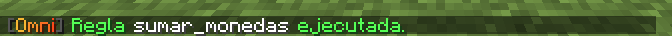

Comando: `/omni call sumar_monedas Beto jugador="Beto" cantidad=5`

<a id="comando-var"></a>

### `/omni var get | set | del <jugador|global> <nombre> [valor]`

Variables por jugador (`pvar`) y globales (`gvar`), persistentes.

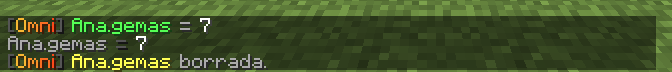

Comando: `/omni var set Ana gemas 7 · /omni var get Ana gemas · /omni var del Ana gemas`

<a id="comando-var-list"></a>

### `/omni var list <jugador|global>`

Todas las variables de un jugador o del servidor. Varía: `arranques` crece en cada corrida.

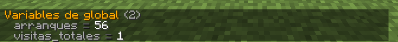

Comando: `/omni var list global`

<a id="comando-cooldown"></a>

### `/omni cooldown reset <regla> [jugador|global]`

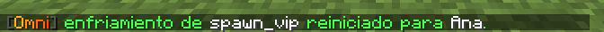

Comando: `/omni cooldown reset spawn_vip Ana`

<a id="comando-limit"></a>

### `/omni limit reset <regla> [jugador|global]`

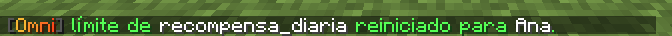

Comando: `/omni limit reset recompensa_diaria Ana`

<a id="comando-stats"></a>

### `/omni stats`

Disparos, aciertos, errores y tiempo promedio y máximo por regla; oyentes y tareas activos. Varía: los tiempos cambian en cada corrida.


Comando: `/omni stats`

<a id="comando-triggers"></a>

### `/omni triggers`


Comando: `/omni triggers`

<a id="comando-actions"></a>

### `/omni actions`


Comando: `/omni actions`

<a id="comando-item"></a>

### `/omni item save | list | delete <nombre>`

Guarda el ítem de la mano para usarlo con `give_item: saved:<nombre>`.

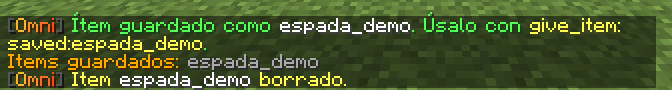

Comando: `/omni item save espada_demo · /omni item list · /omni item delete espada_demo`

<a id="comando-import"></a>

### `/omni import conditionalevents`

Convierte los eventos de ConditionalEvents a `rules/importado/`. La escena pone una configuración de ConditionalEvents de dos eventos.

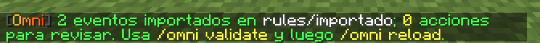

Comando: `/omni import conditionalevents`

<a id="comando-selftest"></a>

### `/omni selftest`

Casos incorporados del motor que se prueban en el servidor vivo.


Comando: `/omni selftest`

## Acciones · Mensajes

<a id="accion-message"></a>

### `message`

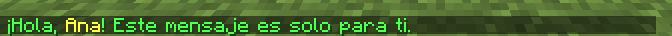

Regla (`tests-e2e/omnievents/capturas/acciones.yml`):

```yaml
cap_message:
  trigger: call
  actions:
    - message: "<green>¡Hola, <yellow>{player.name}</yellow>! Este mensaje es solo para ti."
```

<a id="accion-broadcast"></a>

### `broadcast`

Lo que ve Beto cuando Ana dispara el anuncio.

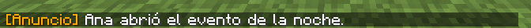

Regla (`tests-e2e/omnievents/capturas/acciones.yml`):

```yaml
cap_broadcast:
  trigger: call
  actions:
    - broadcast: "<gold>[Anuncio]</gold> <white>{player.name} abrió el evento de la noche."
```

<a id="accion-actionbar"></a>

### `actionbar`

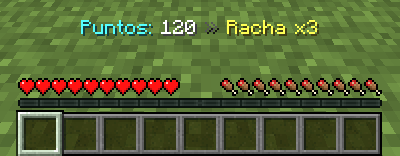

Regla (`tests-e2e/omnievents/capturas/acciones.yml`):

```yaml
cap_actionbar:
  trigger: call
  actions:
    - actionbar: "<aqua>Puntos: <white>120</white> <dark_gray>»</dark_gray> <yellow>Racha x3"
```

<a id="accion-title"></a>

### `title`

`título;subtítulo;entrada;permanencia;salida` (en ticks).


Regla (`tests-e2e/omnievents/capturas/acciones.yml`):

```yaml
cap_title:
  trigger: call
  actions:
    - title: "<gold><bold>¡Victoria!;<gray>Ganaste la ronda 3;10;70;20"
```

<a id="accion-bossbar"></a>

### `bossbar`

`texto;segundos;color;progreso`.


Regla (`tests-e2e/omnievents/capturas/acciones.yml`):

```yaml
cap_bossbar:
  trigger: call
  actions:
    - bossbar: "<red>El Guardián del Bosque;4;RED;0.65"
```

<a id="accion-sound"></a>

### `sound`

> **Solo texto.** El sonido no se ve. El bot recibe el paquete de sonido (la suite en el juego lo comprueba por su tono), pero una imagen no puede mostrarlo.

<a id="accion-stop_sound"></a>

### `stop_sound`

> **Solo texto.** El sonido no se ve. El bot recibe el paquete de sonido (la suite en el juego lo comprueba por su tono), pero una imagen no puede mostrarlo.

<a id="accion-console_message"></a>

### `console_message`

Escribe en la consola del servidor. **No lo ve un jugador**: la imagen es la consola.

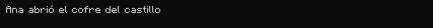

Regla (`tests-e2e/omnievents/capturas/acciones.yml`):

```yaml
cap_console_message:
  trigger: call
  actions:
    - console_message: "<gold>{player.name} abrió el cofre del castillo"
```

## Acciones · Comandos

<a id="accion-console"></a>

### `console`

Un comando de consola; aquí `say`, que todos ven en el chat.

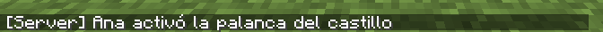

Regla (`tests-e2e/omnievents/capturas/acciones.yml`):

```yaml
cap_console:
  trigger: call
  actions:
    - console: "say {player.name} activó la palanca del castillo"
```

<a id="accion-command"></a>

### `command`

Un comando como si lo escribiera el jugador: aquí `/monedas`.

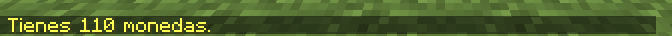

Regla (`tests-e2e/omnievents/capturas/acciones.yml`):

```yaml
cap_command:
  trigger: call
  actions:
    - command: "monedas"
```

<a id="accion-chat"></a>

### `chat`

El jugador «dice» el texto en el chat: lo ve todo el servidor (aquí, Beto).

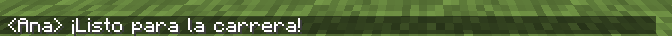

Regla (`tests-e2e/omnievents/capturas/acciones.yml`):

```yaml
cap_chat:
  trigger: call
  actions:
    - chat: "¡Listo para la carrera!"
```

<a id="accion-send_to_server"></a>

### `send_to_server`

> **Solo texto.** Manda al jugador a otro servidor de la red: necesita un proxy (Velocity o BungeeCord), que el servidor de prueba no tiene.

## Acciones · Jugador

<a id="accion-teleport"></a>

### `teleport`

`mundo;x;y;z;yaw;pitch` (con `~` para relativo). Ana sube a la torre y mira la plataforma.

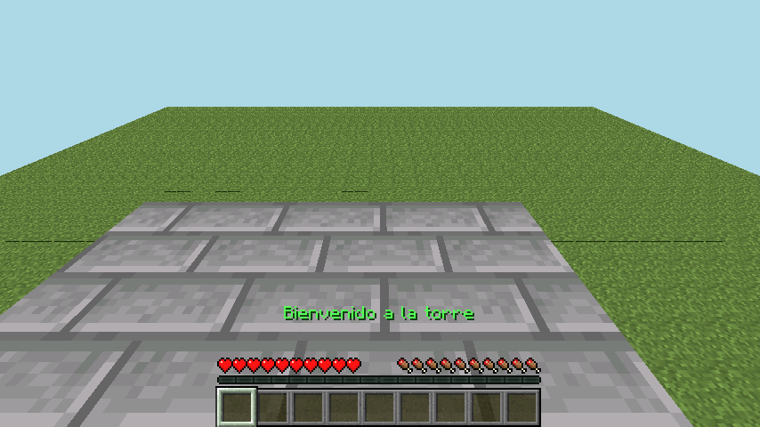

Regla (`tests-e2e/omnievents/capturas/acciones.yml`):

```yaml
cap_teleport:
  trigger: call
  actions:
    - teleport: "world;12.5;104;6.5;0;35"
    - actionbar: "<green>Bienvenido a la torre"
```

<a id="accion-heal"></a>

### `heal`

Ana tenía 10 de vida (la escena la daña por consola) y `heal: 6` la deja en 16.

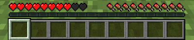

Regla (`tests-e2e/omnievents/capturas/acciones.yml`):

```yaml
cap_heal:
  trigger: call
  actions:
    - heal: 6
```

<a id="accion-damage"></a>

### `damage`

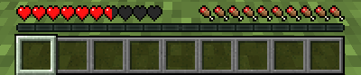

Regla (`tests-e2e/omnievents/capturas/acciones.yml`):

```yaml
cap_damage:
  trigger: call
  actions:
    - damage: 7
```

<a id="accion-set_food"></a>

### `set_food`

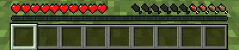

Regla (`tests-e2e/omnievents/capturas/acciones.yml`):

```yaml
cap_set_food:
  trigger: call
  actions:
    - set_food: 7
```

<a id="accion-feed"></a>

### `feed`

Ana tenía 7 de comida (con `set_food`) y `feed: 6` la deja en 13.

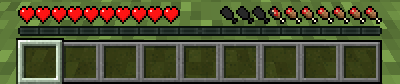

Regla (`tests-e2e/omnievents/capturas/acciones.yml`):

```yaml
cap_feed:
  trigger: call
  actions:
    - feed: 6
```

<a id="accion-gamemode"></a>

### `gamemode`

En creativo no hay vida, hambre ni experiencia en el HUD.

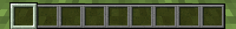

Regla (`tests-e2e/omnievents/capturas/acciones.yml`):

```yaml
cap_gamemode:
  trigger: call
  actions:
    - gamemode: creative
```

<a id="accion-fly"></a>

### `fly`

Permite volar en supervivencia. Ana despega con doble salto. Varía: la altura depende del tiempo de vuelo.

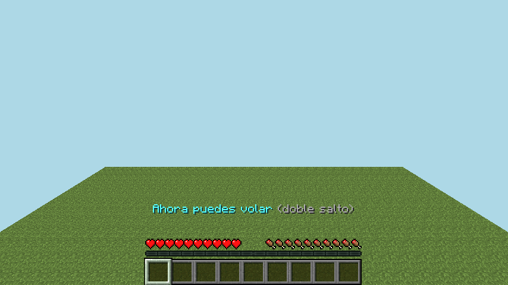

Regla (`tests-e2e/omnievents/capturas/acciones.yml`):

```yaml
cap_fly:
  trigger: call
  actions:
    - fly: true
    - actionbar: "<aqua>Ahora puedes volar <gray>(doble salto)"
```

<a id="accion-effect"></a>

### `effect`

`EFECTO;segundos;nivel;partículas`. Arriba a la derecha, los efectos buenos y, debajo, los malos.

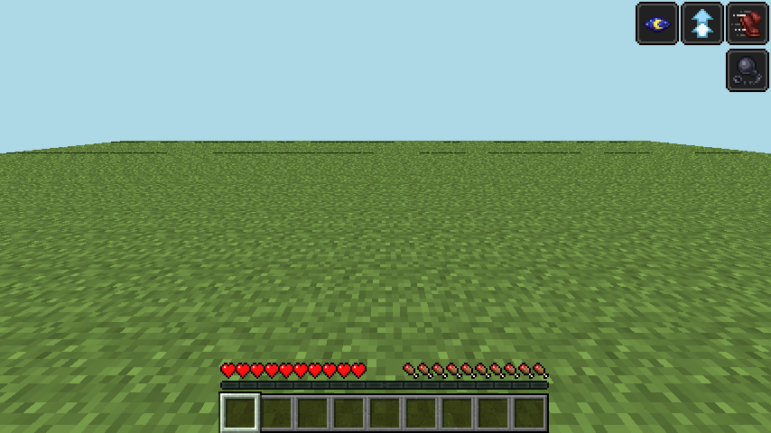

Regla (`tests-e2e/omnievents/capturas/acciones.yml`):

```yaml
cap_effect:
  trigger: call
  actions:
    - effect: SPEED;60;2;false
    - effect: JUMP_BOOST;60;1;false
    - effect: NIGHT_VISION;60;1;false
    - effect: SLOWNESS;60;1;false
```

<a id="accion-remove_effect"></a>

### `remove_effect`

Después de `cap_effect`, `remove_effect: SLOWNESS` quita solo la lentitud.

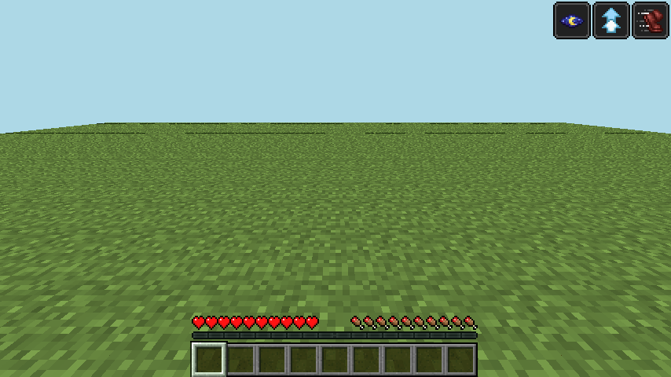

Regla (`tests-e2e/omnievents/capturas/acciones.yml`):

```yaml
cap_effect:
  trigger: call
  actions:
    - effect: SPEED;60;2;false
    - effect: JUMP_BOOST;60;1;false
    - effect: NIGHT_VISION;60;1;false
    - effect: SLOWNESS;60;1;false
```

Regla (`tests-e2e/omnievents/capturas/acciones.yml`):

```yaml
cap_remove_effect:
  trigger: call
  actions:
    - remove_effect: SLOWNESS
```

<a id="accion-fire"></a>

### `fire`

> **Solo texto.** Las llamas en pantalla las dibuja el cliente; el bot solo recibe la marca «en llamas» de la entidad, y el render no la dibuja. Lo que sí se ve es la vida que baja.

<a id="accion-freeze"></a>

### `freeze`

> **Solo texto.** La escarcha en pantalla la dibuja el cliente a partir de los ticks de congelamiento; el render no la dibuja.

<a id="accion-velocity"></a>

### `velocity`

`x;y;z`: aquí un impulso hacia arriba. Varía: la foto se toma en el aire.

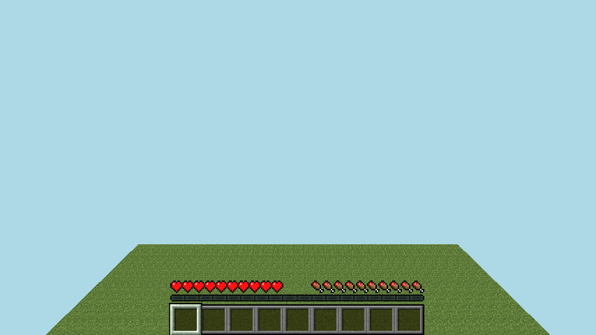

Regla (`tests-e2e/omnievents/capturas/acciones.yml`):

```yaml
cap_velocity:
  trigger: call
  actions:
    - velocity: "0;1.2;0"
```

<a id="accion-launch"></a>

### `launch`

Lanza hacia donde mira el jugador (aquí, hacia adelante y abajo, a ras del suelo). Varía: la foto se toma en movimiento.

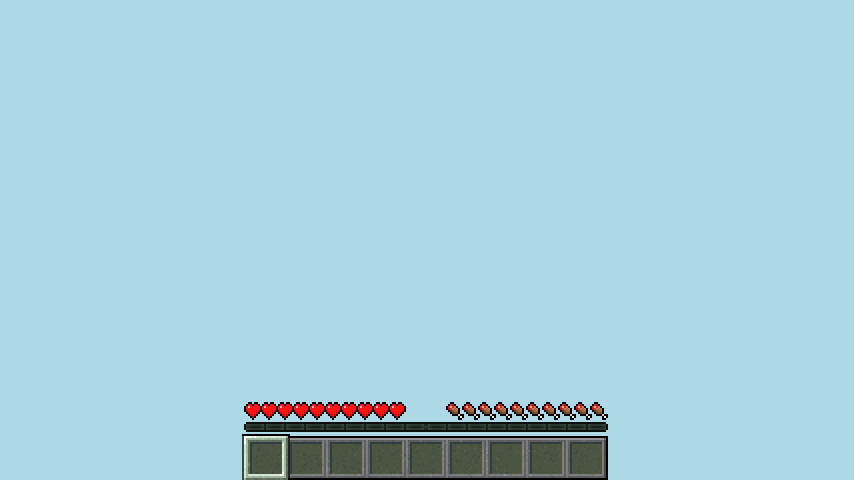

Regla (`tests-e2e/omnievents/capturas/acciones.yml`):

```yaml
cap_launch:
  trigger: call
  actions:
    - launch: 1.6
```

<a id="accion-give_item"></a>

### `give_item`

Ítem en mapa: `material`, `amount`, `name`, `lore`, `model`, `enchants`, `glow`, `unbreakable`, `hide_flags`; o en texto (`DIAMOND;2;nombre;lore`); o `saved:<nombre>`. La imagen es el inventario (tecla E) con el ratón sobre el ítem.

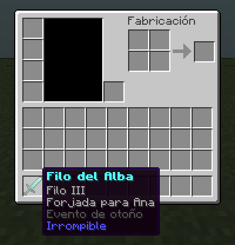

Regla (`tests-e2e/omnievents/capturas/acciones.yml`):

```yaml
cap_give_item:
  trigger: call
  actions:
    - give_item:
        material: DIAMOND_SWORD
        name: "<aqua><bold>Filo del Alba"
        lore: ["<gray>Forjada para {player.name}", "<dark_gray>Evento de otoño"]
        enchants: {SHARPNESS: 3}
        unbreakable: true
```

<a id="accion-drop_item"></a>

### `drop_item`

> **Solo texto.** Los ítems tirados en el suelo no se dibujan en estas imágenes (el visor 3D no tiene su modelo). La suite en el juego comprueba que el ítem aparece.

<a id="accion-remove_item"></a>

### `remove_item`

`MATERIAL;cantidad`, por material aunque el ítem tenga nombre. Ana tenía 8 diamantes; le quedan 3.

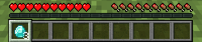

Regla (`tests-e2e/omnievents/capturas/acciones.yml`):

```yaml
cap_remove_item:
  trigger: call
  actions:
    - remove_item: DIAMOND;5
```

<a id="accion-clear_inventory"></a>

### `clear_inventory`

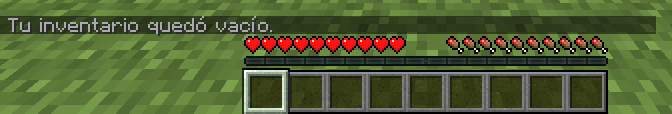

Regla (`tests-e2e/omnievents/capturas/acciones.yml`):

```yaml
cap_clear_inventory:
  trigger: call
  actions:
    - clear_inventory
    - message: "<gray>Tu inventario quedó vacío."
```

<a id="accion-close_inventory"></a>

### `close_inventory`

Ana tenía un cofre abierto; la acción lo cierra. (El visor 3D no dibuja cofres, camas, carteles ni mesas: los bloques con entidad propia no se ven en la vista del mundo.)

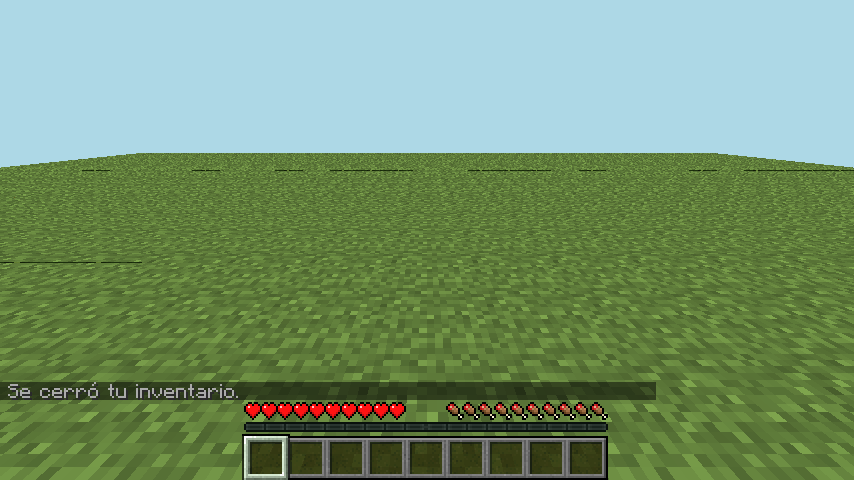

Regla (`tests-e2e/omnievents/capturas/acciones.yml`):

```yaml
cap_close_inventory:
  trigger: call
  actions:
    - close_inventory
    - message: "<gray>Se cerró tu inventario."
```

<a id="accion-give_exp"></a>

### `give_exp`

12 puntos de experiencia: nivel 1 y parte de la barra.

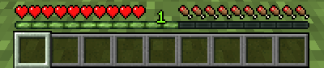

Regla (`tests-e2e/omnievents/capturas/acciones.yml`):

```yaml
cap_give_exp:
  trigger: call
  actions:
    - give_exp: 12
```

<a id="accion-give_level"></a>

### `give_level`

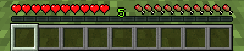

Regla (`tests-e2e/omnievents/capturas/acciones.yml`):

```yaml
cap_give_level:
  trigger: call
  actions:
    - give_level: 5
```

<a id="accion-kick"></a>

### `kick`

La pantalla que ve el jugador expulsado, con el motivo en MiniMessage.

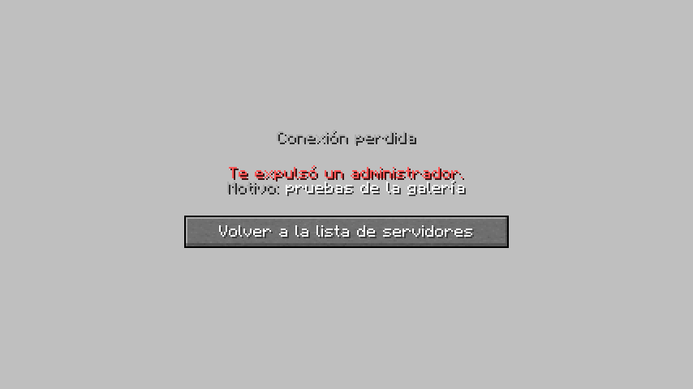

Regla (`tests-e2e/omnievents/capturas/acciones.yml`):

```yaml
cap_kick:
  trigger: call
  actions:
    - kick: "<red>Te expulsó un administrador.\n<gray>Motivo: <white>pruebas de la galería"
```

## Acciones · Mundo

<a id="accion-set_block"></a>

### `set_block`

`mundo;x;y;z;MATERIAL` (o solo el material, en un disparador con bloque).

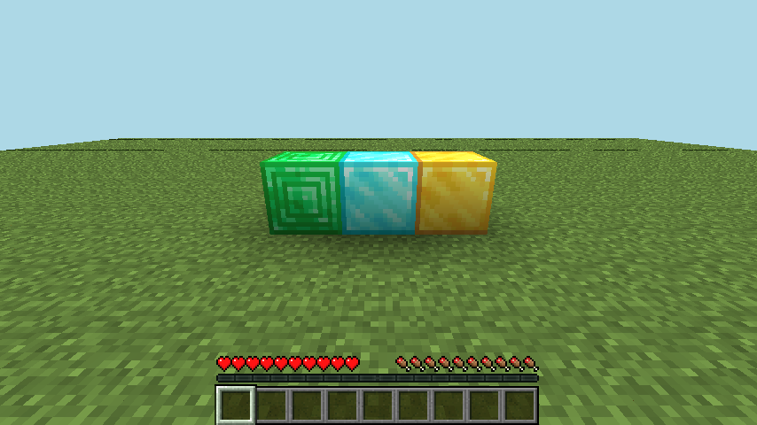

Regla (`tests-e2e/omnievents/capturas/acciones.yml`):

```yaml
cap_set_block:
  trigger: call
  actions:
    - set_block: "world;11;100;14;GOLD_BLOCK"
    - set_block: "world;12;100;14;DIAMOND_BLOCK"
    - set_block: "world;13;100;14;EMERALD_BLOCK"
```

<a id="accion-summon"></a>

### `summon`

`TIPO;mundo;x;y;z`. Varía: las criaturas se mueven.

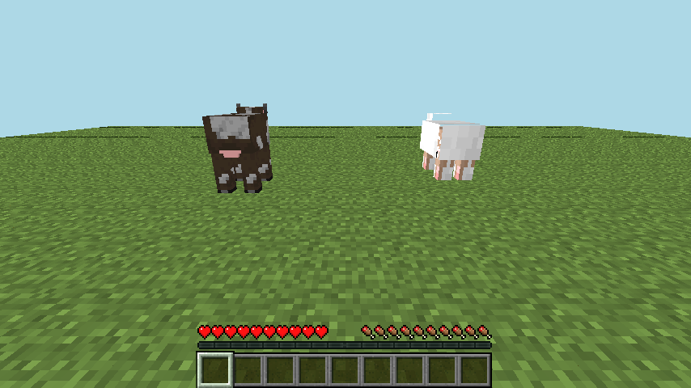

Regla (`tests-e2e/omnievents/capturas/acciones.yml`):

```yaml
cap_summon:
  trigger: call
  actions:
    - summon: "SHEEP;world;10.5;100;15.5"
    - summon: "COW;world;14.5;100;15.5"
```

<a id="accion-explosion"></a>

### `explosion`

`potencia;fuego;romper`. Por defecto no rompe bloques; aquí `romper` está en `true` y la explosión es en la posición de Beto (`to: "player:Beto"`, que está en creativo).

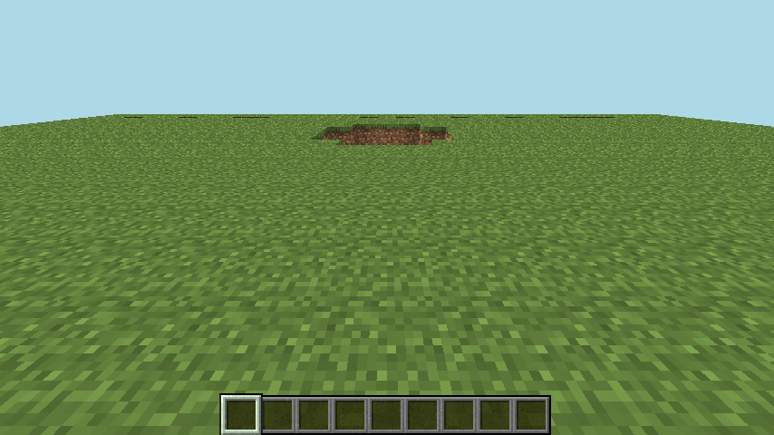

Regla (`tests-e2e/omnievents/capturas/acciones.yml`):

```yaml
cap_explosion:
  trigger: call
  actions:
    - explosion: "3;false;true"
      to: "player:Beto"
```

<a id="accion-lightning"></a>

### `lightning`

> **Solo texto.** El visor 3D no dibuja relámpagos. El jugador ve el rayo y oye el trueno; el relámpago de OmniEvents es solo visual (no hace daño ni prende fuego).

<a id="accion-particle"></a>

### `particle`

> **Solo texto.** El visor 3D no dibuja partículas, así que una imagen no puede mostrarlas con fidelidad. La suite en el juego comprueba que el paquete llega al jugador.

## Acciones · Evento

<a id="accion-set_join_message"></a>

### `set_join_message`

Lo que ve Beto cuando entra Ana: el mensaje de entrada cambiado por el ejemplo `bienvenida` y su anuncio.

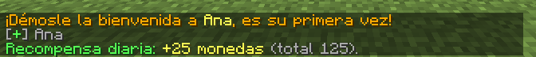

Regla (`plugins/omnievents/src/main/resources/rules/ejemplos/bienvenida.yml`):

```yaml
bienvenida:
  trigger: player_join
  actions:
    - set_join_message: "<gray>[<green>+</green>] {player.name}"
    - if: "first_join"
      then:
        - broadcast: "<gold>¡Démosle la bienvenida a <yellow>{player.name}</yellow>, es su primera vez!"
        - give_item: "BREAD;8;<yellow>Pan de bienvenida;<gray>Para el primer día"
        - set: "pvar.monedas = 100"
      else:
        - message: "<green>¡Hola de nuevo, {player.name}! Tienes <yellow>{default(pvar.monedas, 0)}</yellow> monedas."
    - delay: 2s
    - title: "<gold>Bienvenido;<gray>{online} jugadores en línea"
    - sound: ENTITY_PLAYER_LEVELUP;1;1.2
```

<a id="accion-set_damage"></a>

### `set_damage`

`10` fija el daño; `150%` lo multiplica. Un puñetazo de Ana con `set_damage: 1000` deja fuera de combate a la vaca.


Regla (`tests-e2e/omnievents/capturas/acciones.yml`):

```yaml
cap_golpe_letal:
  trigger: player_attack
  enabled: false
  conditions: "target.type == 'COW'"
  actions:
    - set_damage: 1000
    - actionbar: "<red>¡Golpe letal! <gray>{target.type} fuera de combate"
```

<a id="accion-set_message"></a>

### `set_message`

Lo que ve Beto cuando Ana escribe «!La subasta empieza en 5 minutos»: el mensaje cambiado. El texto del jugador nunca se interpreta como MiniMessage.


Regla (`tests-e2e/omnievents/capturas/acciones.yml`):

```yaml
cap_megafono:
  trigger: player_chat
  enabled: false
  conditions: "message startsWith '!'"
  actions:
    - set_message: "<gold>[megáfono]</gold> <white>{substr(message, 1)}"
```

<a id="accion-set_quit_message"></a>

### `set_quit_message` · `player_quit`

El ejemplo `despedida`: lo que ve Beto cuando Ana sale.


Regla (`plugins/omnievents/src/main/resources/rules/ejemplos/bienvenida.yml`):

```yaml
despedida:
  trigger: player_quit
  actions:
    - set_quit_message: "<gray>[<red>-</red>] {player.name}"
```

<a id="accion-set_death_message"></a>

### `set_death_message` · `player_death`

Lo que ve Beto cuando muere Ana (`none` oculta el mensaje).


Regla (`tests-e2e/omnievents/capturas/acciones.yml`):

```yaml
cap_muerte:
  trigger: player_death
  enabled: false
  actions:
    - set_death_message: "<red>☠ {player.name}</red> <gray>se rindió ante el vacío"
```

<a id="accion-keep_inventory"></a>

### `keep_inventory`

Ana muere con espada, pan y nivel 8 y reaparece con todo.


Regla (`tests-e2e/omnievents/capturas/acciones.yml`):

```yaml
cap_conservar:
  trigger: player_death
  enabled: false
  actions:
    - keep_inventory
    - message: "<green>Conservaste tu inventario y tu nivel."
```

<a id="accion-cancel_drops"></a>

### `cancel_drops` · `entity_death`

La gallina muere sin soltar nada. (Los ítems tirados no se dibujan en estas imágenes: lo que muestra es el aviso de la regla.)


Regla (`tests-e2e/omnievents/capturas/acciones.yml`):

```yaml
cap_sin_botin:
  trigger: entity_death
  enabled: false
  conditions: "entity.type == 'CHICKEN'"
  actions:
    - cancel_drops
    - actionbar: "<gray>La gallina no soltó nada"
```

<a id="accion-deny_join"></a>

### `deny_join` · `player_pre_login`

Antes de entrar (evento asíncrono, con `name`, `uuid` e `ip`): la pantalla que ve quien intenta conectarse.


Regla (`tests-e2e/omnievents/capturas/acciones.yml`):

```yaml
cap_portero:
  trigger: player_pre_login
  enabled: false
  conditions: "name == 'Intruso'"
  actions:
    - deny_join: "<red>El servidor está en mantenimiento.\n<gray>Vuelve en una hora."
```

## Acciones · Control de flujo

<a id="accion-if"></a>

### `if`

`if` / `then` / `else` dentro de las acciones. Ana tiene nivel 0.


Regla (`tests-e2e/omnievents/capturas/flujo.yml`):

```yaml
cap_if:
  trigger: call
  actions:
    - if: "player.level >= 10"
      then:
        - message: "<green>Tienes nivel {player.level}: puedes entrar a la mazmorra."
      else:
        - message: "<red>Necesitas nivel 10 para entrar <gray>(tienes {player.level})."
```

<a id="accion-repeat"></a>

### `repeat`

`repeat: n` con `var.i` (0, 1, 2…).


Regla (`tests-e2e/omnievents/capturas/flujo.yml`):

```yaml
cap_repeat:
  trigger: call
  actions:
    - repeat: 3
      do:
        - message: "<yellow>Cuenta regresiva: <white>{3 - var.i}"
    - message: "<green><bold>¡Ya!"
```

<a id="accion-while"></a>

### `while`

`while` con tope de vueltas para que un error de configuración no congele el servidor.


Regla (`tests-e2e/omnievents/capturas/flujo.yml`):

```yaml
cap_while:
  trigger: call
  actions:
    - set: "var.n = 1"
    - while: "var.n <= 64"
      do:
        - message: "<gray>Pila de <white>{var.n}</white> bloques"
        - set: "var.n = var.n * 4"
```

<a id="accion-for_each"></a>

### `for_each`

Sobre jugadores o entidades (`all`, `world:<w>`, `radius:<n>`, una expresión…). Con `as`, cada uno queda en esa variable y el jugador de la regla sigue siendo el mismo; sin `as`, cada uno pasa a ser `player` (y el original, `source`).


Regla (`tests-e2e/omnievents/capturas/flujo.yml`):

```yaml
cap_for_each:
  trigger: call
  actions:
    - message: "<gray>Jugadores en el evento:"
    - for_each: all
      as: jugador
      do:
        - message: "<gray> • <white>{jugador.name}</white> con {jugador.health} de vida"
```

<a id="accion-random"></a>

### `random`

Ramas con `weight`. Varía: sale una rama al azar.


Regla (`tests-e2e/omnievents/capturas/flujo.yml`):

```yaml
cap_random:
  trigger: call
  actions:
    - random:
        - weight: 60
          do: [{message: "<gray>Sacaste: <white>madera"}]
        - weight: 30
          do: [{message: "<gray>Sacaste: <aqua>hierro"}]
        - weight: 10
          do: [{message: "<gray>Sacaste: <gold>¡oro!"}]
```

<a id="accion-delay"></a>

### `delay`

Pausa solo esa ejecución; el servidor sigue.


Regla (`tests-e2e/omnievents/capturas/flujo.yml`):

```yaml
cap_delay:
  trigger: call
  actions:
    - message: "<gray>Abriendo el cofre del tesoro..."
    - delay: 2s
    - message: "<gold>¡Encontraste 3 esmeraldas!"
```

<a id="accion-wait_ticks"></a>

### `wait_ticks`

Como `delay`, en ticks (20 por segundo).


Regla (`tests-e2e/omnievents/capturas/flujo.yml`):

```yaml
cap_wait_ticks:
  trigger: call
  actions:
    - message: "<gray>Preparados..."
    - wait_ticks: 10
    - message: "<gray>Listos..."
    - wait_ticks: 10
    - message: "<green>¡Fuera!"
```

<a id="accion-stop"></a>

### `stop`

Corta la ejecución: «Adelante.» nunca llega (Ana tiene nivel 0).


Regla (`tests-e2e/omnievents/capturas/flujo.yml`):

```yaml
cap_stop:
  trigger: call
  actions:
    - message: "<gray>Revisando tu pase..."
    - if: "player.level < 10"
      then:
        - message: "<red>Necesitas nivel 10 para el pase del evento."
        - stop
    - message: "<green>Adelante."
```

<a id="accion-set"></a>

### `set`

`var.` (de la ejecución), `pvar.` (del jugador) y `gvar.` (del servidor), con `=`, `+=`, `-=`, `*=`.


Regla (`tests-e2e/omnievents/capturas/flujo.yml`):

```yaml
cap_set:
  trigger: call
  actions:
    - set: "pvar.visitas += 1"
    - set: "gvar.visitas_totales += 1"
    - message: "<gray>Tus visitas: <white>{pvar.visitas}</white> · del servidor: <white>{gvar.visitas_totales}"
```

<a id="accion-unset"></a>

### `unset`


Regla (`tests-e2e/omnievents/capturas/flujo.yml`):

```yaml
cap_set:
  trigger: call
  actions:
    - set: "pvar.visitas += 1"
    - set: "gvar.visitas_totales += 1"
    - message: "<gray>Tus visitas: <white>{pvar.visitas}</white> · del servidor: <white>{gvar.visitas_totales}"
```

Regla (`tests-e2e/omnievents/capturas/flujo.yml`):

```yaml
cap_unset:
  trigger: call
  actions:
    - unset: pvar.visitas
    - message: "<gray>Visitas borradas: ahora <white>{default(pvar.visitas, 0)}"
```

<a id="accion-no_cooldown"></a>

### `no_cooldown`

Ana no tiene nivel 30: el intento no gasta el enfriamiento de 1 hora y puede volver a probar.


Regla (`tests-e2e/omnievents/capturas/flujo.yml`):

```yaml
cap_no_cooldown:
  trigger: call
  cooldown: 1h
  actions:
    - message: "<gray>Intento de abrir el portal..."
    - if: "player.level < 30"
      then:
        - message: "<red>Te falta nivel: este intento no gasta el enfriamiento."
        - no_cooldown
```

<a id="accion-reset_cooldown"></a>

### `reset_cooldown` · `cooldown` · `on_cooldown`

El cofre diario tiene `cooldown: 1h`: el segundo intento cae en `on_cooldown`; `reset_cooldown` lo libera.


Regla (`tests-e2e/omnievents/capturas/flujo.yml`):

```yaml
cap_cofre:
  trigger: call
  cooldown: 1h
  on_cooldown:
    - message: "<red>El cofre diario vuelve en {round(var.cooldown_left / 60)} minutos."
  actions:
    - if: "player.inventory.first_empty < 0"
      then:
        - message: "<red>Tu inventario está lleno; vuelve a intentarlo."
        - no_cooldown
        - stop
    - message: "<green>Abriste el cofre diario."
```

Regla (`tests-e2e/omnievents/capturas/flujo.yml`):

```yaml
cap_reset_cooldown:
  trigger: call
  actions:
    - reset_cooldown: cap_cofre
    - message: "<green>El cofre diario está disponible otra vez."
```

## Opciones de una regla

<a id="opcion-limit"></a>

### `limit` · `on_limit`

Usos máximos por jugador (o globales) con reinicio `never`, `daily`, `weekly`, `monthly` o una duración.


Regla (`tests-e2e/omnievents/capturas/flujo.yml`):

```yaml
cap_premio_unico:
  trigger: call
  limit: 1
  limit_reset: never
  on_limit:
    - message: "<red>Ya reclamaste el premio de bienvenida."
  actions:
    - message: "<green>Reclamaste el premio de bienvenida."
```

## Disparadores · Jugador

<a id="disparador-player_respawn"></a>

### `player_respawn`


Regla (`tests-e2e/omnievents/capturas/disparadores.yml`):

```yaml
cap_t_player_respawn:
  trigger: player_respawn
  enabled: false
  actions:
    - message: "<green>Reapareciste en <white>{round(location.x)}, {round(location.y)}, {round(location.z)}</white> <gray>({reason})"
```

<a id="disparador-player_command"></a>

### `player_command`

Intercepta un comando escrito (aquí `/reglas`, que no existe) y lo cancela.


Regla (`tests-e2e/omnievents/capturas/disparadores.yml`):

```yaml
cap_t_player_command:
  trigger: player_command
  enabled: false
  conditions: "cmd.name == 'reglas'"
  actions:
    - cancel
    - message: "<gold>Reglas del servidor:"
    - message: "<gray>1. Respeta a los demás jugadores."
    - message: "<gray>2. Nada de trampas ni programas externos."
```

<a id="disparador-player_move"></a>

### `player_move`

`move_mode: block` (por defecto) solo dispara al cambiar de bloque; también `chunk` o `any`. Varía: dónde termina el paso.


Regla (`tests-e2e/omnievents/capturas/disparadores.yml`):

```yaml
cap_t_player_move:
  trigger: player_move
  enabled: false
  move_mode: block
  actions:
    - actionbar: "<gray>Caminas por <white>{to.block_x}, {to.block_y}, {to.block_z}"
```

<a id="disparador-player_teleport"></a>

### `player_teleport`


Regla (`tests-e2e/omnievents/capturas/disparadores.yml`):

```yaml
cap_t_player_teleport:
  trigger: player_teleport
  enabled: false
  actions:
    - message: "<light_purple>Teletransporte <gray>({cause})</gray> de {round(from.x)}, {round(from.z)} a {round(to.x)}, {round(to.z)}"
```

<a id="disparador-player_world_change"></a>

### `player_world_change`

Ana va al Nether y vuelve (por consola).


Regla (`tests-e2e/omnievents/capturas/disparadores.yml`):

```yaml
cap_t_player_world_change:
  trigger: player_world_change
  enabled: false
  actions:
    - message: "<gray>Llegaste a <white>{world.name}</white> desde <white>{from_world.name}"
```

<a id="disparador-player_sneak"></a>

### `player_sneak`


Regla (`tests-e2e/omnievents/capturas/disparadores.yml`):

```yaml
cap_t_player_sneak:
  trigger: player_sneak
  enabled: false
  conditions: "sneaking"
  actions:
    - actionbar: "<yellow>Modo sigilo activado"
```

<a id="disparador-player_sprint"></a>

### `player_sprint`

Varía: la foto se toma corriendo.


Regla (`tests-e2e/omnievents/capturas/disparadores.yml`):

```yaml
cap_t_player_sprint:
  trigger: player_sprint
  enabled: false
  conditions: "sprinting"
  actions:
    - actionbar: "<aqua>¡A toda velocidad!"
```

<a id="disparador-player_jump"></a>

### `player_jump`


Regla (`tests-e2e/omnievents/capturas/disparadores.yml`):

```yaml
cap_t_player_jump:
  trigger: player_jump
  enabled: false
  actions:
    - actionbar: "<green>¡Salto!"
```

<a id="disparador-player_level_change"></a>

### `player_level_change`


Regla (`tests-e2e/omnievents/capturas/disparadores.yml`):

```yaml
cap_t_player_level_change:
  trigger: player_level_change
  enabled: false
  conditions: "new_level > old_level"
  actions:
    - title: "<green>¡Nivel {new_level}!;<gray>Subiste desde el nivel {old_level};5;50;10"
```

<a id="disparador-player_gamemode_change"></a>

### `player_gamemode_change`


Regla (`tests-e2e/omnievents/capturas/disparadores.yml`):

```yaml
cap_t_player_gamemode_change:
  trigger: player_gamemode_change
  enabled: false
  actions:
    - message: "<gray>Modo de juego: <white>{new_mode}"
```

<a id="disparador-player_toggle_flight"></a>

### `player_toggle_flight`


Regla (`tests-e2e/omnievents/capturas/disparadores.yml`):

```yaml
cap_t_player_toggle_flight:
  trigger: player_toggle_flight
  enabled: false
  conditions: "flying"
  actions:
    - actionbar: "<aqua>Vuelo activado"
```

<a id="disparador-player_bed_enter"></a>

### `player_bed_enter`

Con `result` (`OK`, `NOT_POSSIBLE_NOW`…). La escena pone una cama y hace de noche. (El visor 3D no dibuja cofres, camas, carteles ni mesas: los bloques con entidad propia no se ven en la vista del mundo.)


Regla (`tests-e2e/omnievents/capturas/disparadores.yml`):

```yaml
cap_t_player_bed_enter:
  trigger: player_bed_enter
  enabled: false
  actions:
    - message: "<dark_aqua>Buenas noches, {player.name} <gray>({result})"
```

<a id="disparador-player_fish"></a>

### `player_fish`

Con `state` (`FISHING`, `CAUGHT_FISH`…) y `target` (lo que se pescó).


Regla (`tests-e2e/omnievents/capturas/disparadores.yml`):

```yaml
cap_t_player_fish:
  trigger: player_fish
  enabled: false
  conditions: "state == 'FISHING'"
  actions:
    - actionbar: "<aqua>Lanzaste la caña: espera a que piquen"
```

<a id="disparador-player_regain_health"></a>

### `player_regain_health`

Con `amount` y `reason`. Ana tenía 12 de vida y recibe Curación instantánea.


Regla (`tests-e2e/omnievents/capturas/disparadores.yml`):

```yaml
cap_t_player_regain_health:
  trigger: player_regain_health
  enabled: false
  actions:
    - actionbar: "<red>❤ <gray>+{round(amount, 1)} de vida <dark_gray>({reason})"
```

<a id="disparador-player_food_change"></a>

### `player_food_change`

Con `old_food` y `new_food`. La escena le da Hambre a Ana por consola. Varía: el hambre baja mientras se toma la foto.


Regla (`tests-e2e/omnievents/capturas/disparadores.yml`):

```yaml
cap_t_player_food_change:
  trigger: player_food_change
  enabled: false
  conditions: "new_food < old_food"
  actions:
    - actionbar: "<gold>Hambre: <white>{old_food} → {new_food}"
```

<a id="disparador-player_advancement"></a>

### `player_advancement`

Con `advancement` (los de recetas no cuentan). Arriba, el anuncio del propio juego.


Regla (`tests-e2e/omnievents/capturas/disparadores.yml`):

```yaml
cap_t_player_advancement:
  trigger: player_advancement
  enabled: false
  actions:
    - message: "<gold>+10 monedas</gold> <gray>por el logro <white>{advancement}"
```

<a id="disparador-player_swap_hands"></a>

### `player_swap_hands`

Tecla F: con `item` y `offhand`.


Regla (`tests-e2e/omnievents/capturas/disparadores.yml`):

```yaml
cap_t_player_swap_hands:
  trigger: player_swap_hands
  enabled: false
  actions:
    - actionbar: "<gray>Mano izquierda: <white>{offhand.type}"
```

<a id="disparador-player_armor_change"></a>

### `player_armor_change`

Con `item`, `old_item` y `slot`. Sobre la vida, la barra de armadura.


Regla (`tests-e2e/omnievents/capturas/disparadores.yml`):

```yaml
cap_t_player_armor_change:
  trigger: player_armor_change
  enabled: false
  conditions: "item != null && item.type != 'AIR'"
  actions:
    - message: "<gray>Te equipaste <white>{item.type}</white> en <white>{slot}"
```

<a id="disparador-player_portal"></a>

### `player_portal`

Con `from`, `to` y `cause`. La regla lo cancela: Ana no viaja.


Regla (`tests-e2e/omnievents/capturas/disparadores.yml`):

```yaml
cap_t_player_portal:
  trigger: player_portal
  enabled: false
  actions:
    - cancel
    - message: "<dark_purple>El Nether está cerrado durante el evento."
```

<a id="disparador-player_kick"></a>

### `player_kick`

Con `reason`. Lo que ve Ana cuando expulsan a Beto.


Regla (`tests-e2e/omnievents/capturas/disparadores.yml`):

```yaml
cap_t_player_kick:
  trigger: player_kick
  enabled: false
  actions:
    - broadcast: "<gray>{player.name} fue expulsado: <white>{reason}"
```

<a id="disparador-player_resource_pack"></a>

### `player_resource_pack`

> **Solo texto.** Dispara cuando el jugador acepta, rechaza o termina de bajar un paquete de recursos (`status`). El servidor de prueba no manda ninguno y OmniEvents no tiene una acción para mandarlo, así que no se puede provocar.

## Disparadores · Combate

<a id="disparador-player_damage"></a>

### `player_damage`

Con `cause`, `damage` y `damager` (quien pegó, también tras un proyectil).


Regla (`tests-e2e/omnievents/capturas/disparadores.yml`):

```yaml
cap_t_player_damage:
  trigger: player_damage
  enabled: false
  actions:
    - actionbar: "<red>-{round(damage, 1)} de vida <gray>({cause})"
```

<a id="disparador-player_attack"></a>

### `player_attack`

Con `target`, `damage` y `projectile`.


Regla (`tests-e2e/omnievents/capturas/disparadores.yml`):

```yaml
cap_t_player_attack:
  trigger: player_attack
  enabled: false
  actions:
    - actionbar: "<gray>Golpeaste a <white>{target.type}</white> <dark_gray>»</dark_gray> <red>{round(damage, 1)}"
```

<a id="disparador-player_kill"></a>

### `player_kill`

Cualquier criatura que mate el jugador (`target`). Aquí, una gallina.


Regla (`tests-e2e/omnievents/capturas/disparadores.yml`):

```yaml
cap_t_player_kill:
  trigger: player_kill
  enabled: false
  actions:
    - message: "<green>Cazaste un <white>{target.type}</white> <gray>(+5 monedas)"
```

<a id="disparador-player_shoot"></a>

### `player_shoot`

Con `item` (el arco), `projectile` y `force`. Varía: la flecha sale en vuelo.


Regla (`tests-e2e/omnievents/capturas/disparadores.yml`):

```yaml
cap_t_player_shoot:
  trigger: player_shoot
  enabled: false
  actions:
    - actionbar: "<gray>Disparo con fuerza <white>{round(force, 1)}"
```

<a id="disparador-projectile_hit"></a>

### `projectile_hit`

Con `target` (entidad) o `block`, y `projectile`.


Regla (`tests-e2e/omnievents/capturas/disparadores.yml`):

```yaml
cap_t_projectile_hit:
  trigger: projectile_hit
  enabled: false
  conditions: "block != null"
  actions:
    - message: "<gray>La flecha pegó en <white>{block.type}"
```

## Disparadores · Bloques

<a id="disparador-block_place"></a>

### `block_place`

Con `block`, `against` e `item`.


Regla (`tests-e2e/omnievents/capturas/disparadores.yml`):

```yaml
cap_t_block_place:
  trigger: block_place
  enabled: false
  actions:
    - actionbar: "<gray>Pusiste <white>{block.type}</white> sobre <white>{against.type}"
```

<a id="disparador-block_interact"></a>

### `block_interact`

Con `action` (`RIGHT_CLICK`, `LEFT_CLICK`, `SHIFT_RIGHT_CLICK`…), `block`, `face` e `item`.


Regla (`tests-e2e/omnievents/capturas/disparadores.yml`):

```yaml
cap_t_block_interact:
  trigger: block_interact
  enabled: false
  conditions: "block.type == 'LEVER'"
  actions:
    - message: "<gray>{action} en la palanca: <green>se abrió la puerta secreta"
```

<a id="disparador-sign_change"></a>

### `sign_change`

Con `lines` (lo que escribió el jugador, como texto literal). (El visor 3D no dibuja cofres, camas, carteles ni mesas: los bloques con entidad propia no se ven en la vista del mundo.)


Regla (`tests-e2e/omnievents/capturas/disparadores.yml`):

```yaml
cap_t_sign_change:
  trigger: sign_change
  enabled: false
  actions:
    - message: "<gray>Cartel escrito: <white>{join(lines, ' | ')}"
```

<a id="disparador-bucket_fill"></a>

### `bucket_fill`

Con `block` e `item` (el balde lleno).


Regla (`tests-e2e/omnievents/capturas/disparadores.yml`):

```yaml
cap_t_bucket_fill:
  trigger: bucket_fill
  enabled: false
  actions:
    - actionbar: "<aqua>Llenaste el balde: <white>{item.type}"
```

<a id="disparador-bucket_empty"></a>

### `bucket_empty`

Con `block` y `bucket`. Varía: el agua se mueve.


Regla (`tests-e2e/omnievents/capturas/disparadores.yml`):

```yaml
cap_t_bucket_empty:
  trigger: bucket_empty
  enabled: false
  actions:
    - actionbar: "<aqua>Vaciaste <white>{bucket}"
```

## Disparadores · Ítems

<a id="disparador-player_interact"></a>

### `player_interact`

Cualquier clic (`action`), con o sin bloque (`block`) e ítem (`item`).


Regla (`tests-e2e/omnievents/capturas/disparadores.yml`):

```yaml
cap_t_player_interact:
  trigger: player_interact
  enabled: false
  conditions: "action == 'RIGHT_CLICK' && block == null"
  actions:
    - actionbar: "<gray>Clic derecho al aire con <white>{item.type}"
```

<a id="disparador-item_interact"></a>

### `item_interact`

Como `player_interact`, pero solo con un ítem en la mano.


Regla (`tests-e2e/omnievents/capturas/disparadores.yml`):

```yaml
cap_t_item_interact:
  trigger: item_interact
  enabled: false
  conditions: "item.type == 'BLAZE_ROD'"
  actions:
    - actionbar: "<gold>La vara de fuego chisporrotea"
```

<a id="disparador-item_consume"></a>

### `item_consume`

Comida y pociones (`item`).


Regla (`tests-e2e/omnievents/capturas/disparadores.yml`):

```yaml
cap_t_item_consume:
  trigger: item_consume
  enabled: false
  actions:
    - message: "<gray>Comiste <white>{item.type}"
```

<a id="disparador-item_craft"></a>

### `item_craft`

Con `item` (el resultado) y `click`. Aquí, tablones en la cuadrícula del inventario.


Regla (`tests-e2e/omnievents/capturas/disparadores.yml`):

```yaml
cap_t_item_craft:
  trigger: item_craft
  enabled: false
  actions:
    - message: "<gray>Fabricaste <white>{item.amount} {item.type}"
```

<a id="disparador-item_drop"></a>

### `item_drop`

Con `item` y `entity` (el ítem en el suelo).


Regla (`tests-e2e/omnievents/capturas/disparadores.yml`):

```yaml
cap_t_item_drop:
  trigger: item_drop
  enabled: false
  actions:
    - actionbar: "<gray>Tiraste <white>{item.amount} {item.type}"
```

<a id="disparador-item_pickup"></a>

### `item_pickup`

Con `item` y `entity`. La escena suelta 3 esmeraldas a los pies de Ana.


Regla (`tests-e2e/omnievents/capturas/disparadores.yml`):

```yaml
cap_t_item_pickup:
  trigger: item_pickup
  enabled: false
  actions:
    - actionbar: "<green>+{item.amount} {item.type}"
```

<a id="disparador-item_held"></a>

### `item_held`

Cambiar de ranura en la barra: con `item`, `previous_item` y `slot`.


Regla (`tests-e2e/omnievents/capturas/disparadores.yml`):

```yaml
cap_t_item_held:
  trigger: item_held
  enabled: false
  conditions: "item != null"
  actions:
    - actionbar: "<gray>Ranura {slot + 1}: <white>{item.type}"
```

<a id="disparador-item_enchant"></a>

### `item_enchant`

Con `item`, `enchants` y `cost`.

> **Solo texto.** La escena no puede encantar con el bot: mineflayer 4.39 no logra poner el ítem ni el lapislázuli en la mesa de encantamientos en 1.21.4 (la ventana queda vacía). Con un jugador real, esta regla escribe en su chat «Encantaste IRON_SWORD por 1 niveles».

Regla (`tests-e2e/omnievents/capturas/disparadores.yml`):

```yaml
cap_t_item_enchant:
  trigger: item_enchant
  enabled: false
  actions:
    - message: "<light_purple>Encantaste <white>{item.type}</white> por {cost} niveles"
```

<a id="disparador-item_break"></a>

### `item_break`

Con `item` (el que se rompió). Un pico de madera a un uso de romperse pica una piedra.


Regla (`tests-e2e/omnievents/capturas/disparadores.yml`):

```yaml
cap_t_item_break:
  trigger: item_break
  enabled: false
  actions:
    - message: "<red>Se rompió tu <white>{item.type}"
```

## Disparadores · Inventario

<a id="disparador-inventory_open"></a>

### `inventory_open`

Con `title` e `inventory_type`. La foto es después de cerrar el cofre: con un inventario abierto el chat no se ve. (El visor 3D no dibuja cofres, camas, carteles ni mesas: los bloques con entidad propia no se ven en la vista del mundo.)


Regla (`tests-e2e/omnievents/capturas/disparadores.yml`):

```yaml
cap_t_inventory_open:
  trigger: inventory_open
  enabled: false
  conditions: "inventory_type == 'CHEST'"
  actions:
    - message: "<gray>Abriste un cofre: <white>{title}"
```

<a id="disparador-inventory_click"></a>

### `inventory_click`

Con `item`, `cursor`, `slot`, `raw_slot`, `click`, `title` e `inventory_type`. Arriba, el cofre con el ratón sobre las esmeraldas; abajo, el chat después de hacer clic y cerrar.


Regla (`tests-e2e/omnievents/capturas/disparadores.yml`):

```yaml
cap_t_inventory_click:
  trigger: inventory_click
  enabled: false
  conditions: "item != null"
  actions:
    - message: "<gray>Clic {click} en la ranura {slot}: <white>{item.type}"
```

<a id="disparador-inventory_close"></a>

### `inventory_close`

Con `title` e `inventory_type`. (El visor 3D no dibuja cofres, camas, carteles ni mesas: los bloques con entidad propia no se ven en la vista del mundo.)


Regla (`tests-e2e/omnievents/capturas/disparadores.yml`):

```yaml
cap_t_inventory_close:
  trigger: inventory_close
  enabled: false
  conditions: "inventory_type == 'CHEST'"
  actions:
    - message: "<gray>Cerraste el cofre"
```

## Disparadores · Entidades

<a id="disparador-entity_interact"></a>

### `entity_interact`

Clic derecho sobre una entidad (`target`).


Regla (`tests-e2e/omnievents/capturas/disparadores.yml`):

```yaml
cap_t_entity_interact:
  trigger: entity_interact
  enabled: false
  actions:
    - message: "<gray>Acariciaste a <white>{target.type}"
```

<a id="disparador-entity_spawn"></a>

### `entity_spawn`

Con `entity` y `reason` (`NATURAL`, `SPAWNER`, `COMMAND`…). Sin jugador: aquí la regla avisa a todos.


Regla (`tests-e2e/omnievents/capturas/disparadores.yml`):

```yaml
cap_t_entity_spawn:
  trigger: entity_spawn
  enabled: false
  conditions: "entity.type == 'SHEEP'"
  actions:
    - broadcast: "<gray>Apareció una oveja <dark_gray>({reason})"
```

<a id="disparador-entity_death"></a>

### `entity_death`

Con `entity` y `killer` (si lo mató un jugador).


Regla (`tests-e2e/omnievents/capturas/disparadores.yml`):

```yaml
cap_t_entity_death:
  trigger: entity_death
  enabled: false
  conditions: "entity.type == 'RABBIT'"
  actions:
    - message: "<gray>Atrapaste un conejo"
```

## Disparadores · Servidor

<a id="disparador-console_command"></a>

### `console_command`

Un comando escrito en la consola (`cmd.name`, `cmd.args`): aquí `anuncio …`, que no existe y la regla cancela.


Regla (`tests-e2e/omnievents/capturas/disparadores.yml`):

```yaml
cap_t_console_command:
  trigger: console_command
  enabled: false
  conditions: "cmd.name == 'anuncio'"
  actions:
    - cancel
    - broadcast: "<gold>[Anuncio]</gold> <white>{join(cmd.args, ' ')}"
```

<a id="disparador-timer"></a>

### `timer`

`every` (`30s`, `5m`…) y `per_player` (por defecto, una ejecución por jugador conectado).


Regla (`tests-e2e/omnievents/capturas/disparadores.yml`):

```yaml
cap_t_timer:
  trigger: timer
  enabled: false
  every: 2s
  actions:
    - actionbar: "<gold>Evento en curso <dark_gray>»</dark_gray> <gray>quedan 5 minutos"
```

<a id="disparador-clock"></a>

### `clock`

`at: ["08:00", "20:30"]` y `timezone`. La escena cambia la hora de la regla al minuto siguiente en el servidor de prueba y espera.


Regla (`tests-e2e/omnievents/capturas/disparadores.yml`):

```yaml
cap_t_clock:
  trigger: clock
  enabled: false
  at: ["20:00"]
  actions:
    - broadcast: "<dark_aqua>Es la hora del evento nocturno."
```

<a id="disparador-server_stop"></a>

### `server_stop`

Al apagar el servidor, sin jugadores conectados. **No lo ve un jugador**: la imagen es la consola.


Regla (`tests-e2e/omnievents/capturas/disparadores.yml`):

```yaml
cap_t_server_stop:
  trigger: server_stop
  actions:
    - log: "Guardando el evento antes de apagar: {online} jugadores conectados."
```
