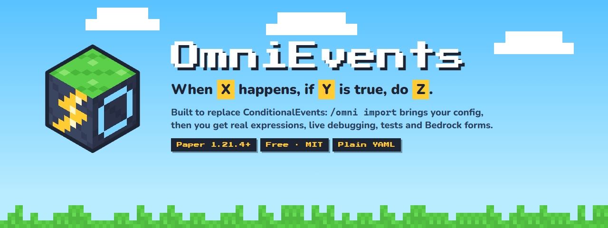
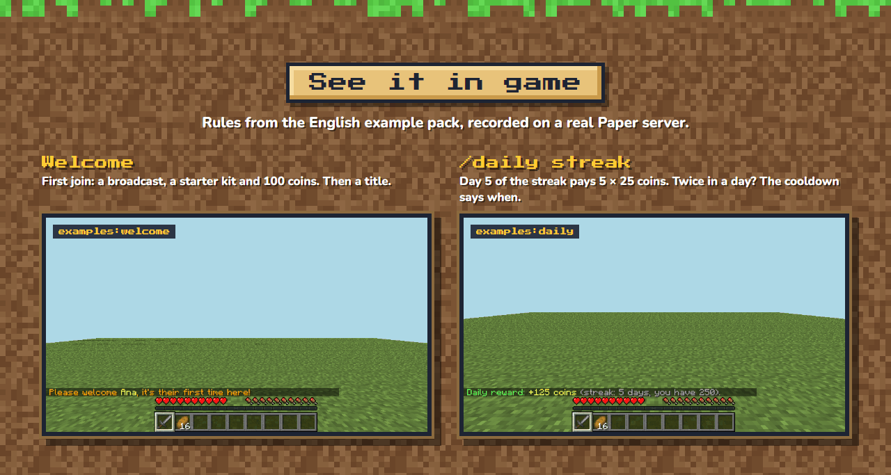
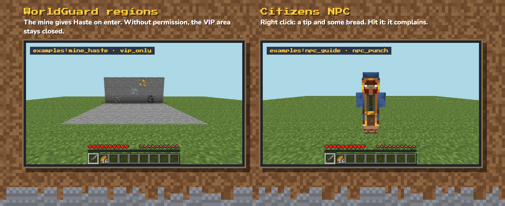
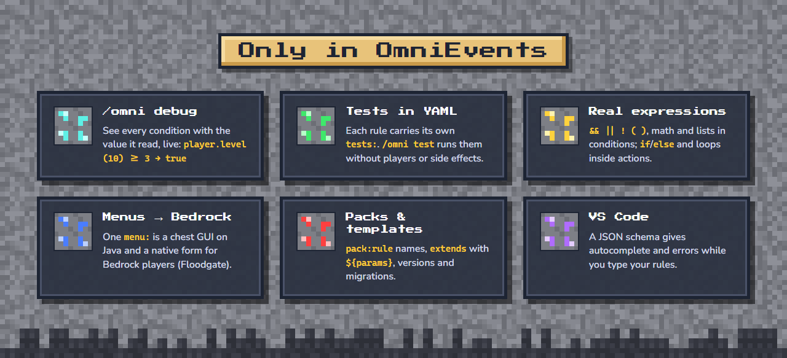
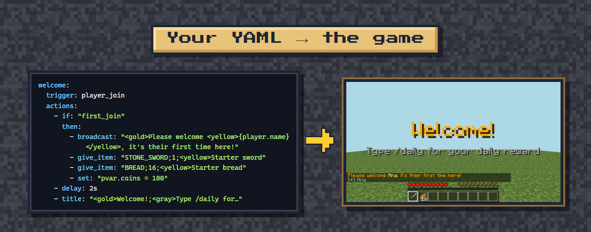
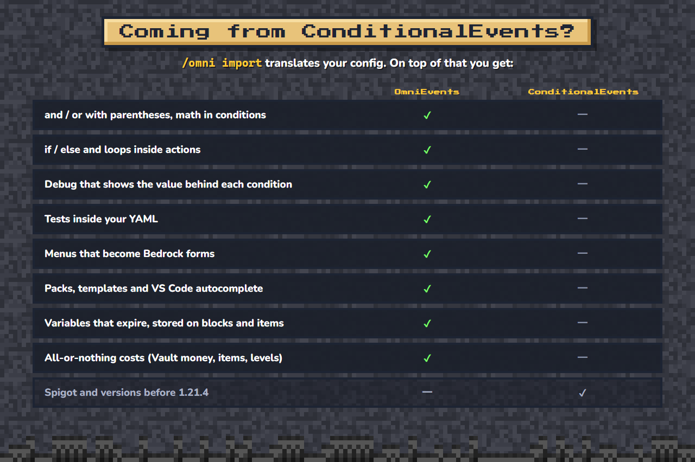
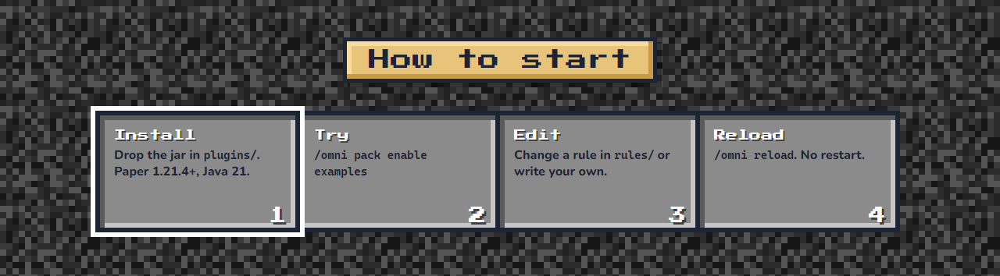

<!-- Descripción de OmniEvents para Modrinth y Hangar (spec 020). Las imágenes salen de docs/site/assets-src/presentacion.html
     con `npm --prefix tests-e2e run presentacion`; van pegadas, sin líneas en blanco, para que se lean como un solo póster. -->

 
 
 
 
 
 

**Script your Paper server in YAML:** when something happens, if your conditions are true, run your actions. No Java, no
Skript: plain YAML rules that are checked when they load, with the file, the path and a "did you mean?" when something is
wrong.

## Requirements
- **Paper** 1.21.4 or 26.1.x (or a Paper fork) and **Java 21+**. Verified on Paper 1.21.4 and 26.1.2.
- Not supported: Spigot/CraftBukkit and Folia (OmniEvents uses Paper's Adventure API).
- Optional: Vault, WorldGuard, Citizens, Floodgate/Geyser, ProtocolLib, PlaceholderAPI.

## Getting started
1. Drop the jar into `plugins/` and start the server.
2. Try the English example pack: `/omni pack enable examples` (it ships turned off and changes nothing until you enable it).
3. Edit a rule in `plugins/OmniEvents/rules/` or write your own. The plugin's own messages are in Spanish and can be
   translated in `messages.yml`.
4. Run `/omni reload`. No restart. Admin commands are OP-only by default.

## Links
- Documentation (English): https://leonardos4enz.gitbook.io/leonardos4enz-docs/
- Source (MIT): https://github.com/leonardos4enz/fabrica-de-plugins
- Bug reports: https://github.com/leonardos4enz/fabrica-de-plugins/issues

Code and documentation were written with the help of an AI coding assistant (Claude), directed and reviewed by the author
and verified with an automated in-game test suite.

Image transcription

**Header.** OmniEvents. When X happens, if Y is true, do Z. Built to replace ConditionalEvents: `/omni import` brings
your config, then you get real expressions, live debugging, tests and Bedrock forms. Paper 1.21.4+. Free, MIT. Plain YAML.

**See it in game.** Rules from the English example pack, recorded on a real Paper server.
- *Welcome* (`examples:welcome`): first join: a broadcast ("Please welcome Ana, it's their first time here!"), a starter
  kit and 100 coins. Then the title "Welcome!" with "Type /daily for your daily reward".
- */daily streak* (`examples:daily`): day 5 of the streak pays 5 × 25 coins ("Daily reward: +125 coins (streak: 5 days,
  you have 250)"). A second /daily the same day: "You already claimed today. Come back in 24h 0m."
- *WorldGuard regions* (`examples:mine_haste`, `examples:vip_only`): entering the mine shows "Mining boost on" and gives
  Haste. Without permission, the VIP area stays closed: "Only VIP players can enter this area."
- *Citizens NPC* (`examples:npc_guide`, `examples:npc_punch`): right click: "[Guide] Hi Ana! Try /daily, /shop and /coins."
  and 4 bread. Hit it: "Guide says: hey, that hurts!"

**Only in OmniEvents.**
- /omni debug: see every condition with the value it read, live: `player.level (10) >= 3 → true`.
- Tests in YAML: each rule carries its own `tests:`. `/omni test` runs them without players or side effects.
- Real expressions: `&& || ! ( )`, math and lists in conditions; `if`/`else` and loops inside actions.
- Menus → Bedrock: one `menu:` is a chest GUI on Java and a native form for Bedrock players (Floodgate).
- Packs & templates: `pack:rule` names, `extends` with `${params}`, versions and migrations.
- VS Code: a JSON schema gives autocomplete and errors while you type your rules.

**Your YAML → the game.** The `welcome` rule (trigger `player_join`; if `first_join`, a broadcast, a stone sword, 16
bread and `pvar.coins = 100`; after 2 seconds, the title) next to the screenshot of what the player sees.

**Coming from ConditionalEvents?** `/omni import` translates your config. On top of that you get, in OmniEvents and not
in ConditionalEvents: and / or with parentheses and math in conditions; if / else and loops inside actions; debug that
shows the value behind each condition; tests inside your YAML; menus that become Bedrock forms; packs, templates and VS
Code autocomplete; variables that expire, stored on blocks and items; all-or-nothing costs (Vault money, items, levels).
ConditionalEvents, and not OmniEvents, runs on Spigot and on versions before 1.21.4.

**How to start.** 1. Install: drop the jar in `plugins/`, Paper 1.21.4+, Java 21. 2. Try: `/omni pack enable examples`.
3. Edit: change a rule in `rules/` or write your own. 4. Reload: `/omni reload`, no restart.

