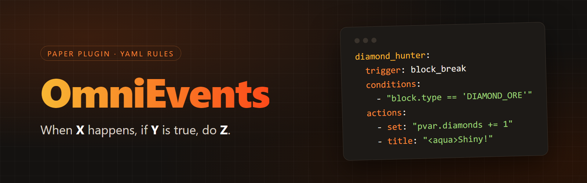

# OmniEvents



**OmniEvents** is a rule engine for Paper servers. You write rules in YAML: **when** something happens (a player
joins, breaks a block, types a command, enters a region…), **if** your conditions are true, **do** a list of actions.
No Java and no restarts: edit a file and run `/omni reload`.

```yaml
first_join_kit:
  trigger: player_join
  conditions: "first_join"
  actions:
    - broadcast: "<gold>Welcome <yellow>{player.name}</yellow> to the server!"
    - give_item: "STONE_SWORD;1;<gray>Starter sword"
    - title: "<gold>Welcome!;<gray>Type /spawn to begin"
```

## Start here
| | |
|---|---|
| **[Installation](omnievents/installation.md)** | Drop the jar in `plugins/`, start the server, and you are ready. |
| **[Your first rule](omnievents/first-rule.md)** | Write, reload and debug a rule in five minutes. |
| **[Examples](omnievents/examples.md)** | Ready-to-copy rules: rewards, custom commands, chat filters, zones, events. |
| **[Migrating from ConditionalEvents](omnievents/migrating-from-conditionalevents.md)** | `/omni import conditionalevents` converts your events for you. |

## What makes it different
- **A real expression language**: `&&`, `||`, `!`, parentheses, math and any game value
  (`player.location.block.type`, `event.damage`) in one condition.
- **Control flow in actions**: `if`/`else`, `repeat`, `for_each`, weighted `random`, `delay`, `call`.
- **Your own variables**, per player and server-wide, saved to disk, with optional expiry, and even stored on blocks,
  entities and items.
- **See why a rule did or did not run**: `/omni debug` shows every condition with its values.
- **Tests inside your YAML**, inventory **menus** (also as Bedrock forms), all-or-nothing **costs**, and optional
  Vault, WorldGuard, Citizens, ProtocolLib and PlaceholderAPI integrations.

Read the full list in [Why OmniEvents](omnievents/README.md).

## Learn the building blocks
| Page | What you will learn |
|---|---|
| [Rule options](omnievents/rule-options.md) | Cooldowns, limits, costs, worlds and permissions. |
| [Triggers](omnievents/triggers.md) | All 75 events a rule can react to. |
| [Conditions and expressions](omnievents/conditions.md) | How to write conditions, plus every function. |
| [Actions](omnievents/actions.md) | All 72 actions, from messages to explosions. |
| [Variables](omnievents/variables.md) | Remember things per player, per server or on objects. |
| [Commands and permissions](omnievents/commands.md) | `/omni` and everything it can do. |

> Works on **Paper 1.21.4** and **26.1.2** (verified with in-game bots) with Java 21 or newer. See
> [compatibility](omnievents/README.md#compatibility).
