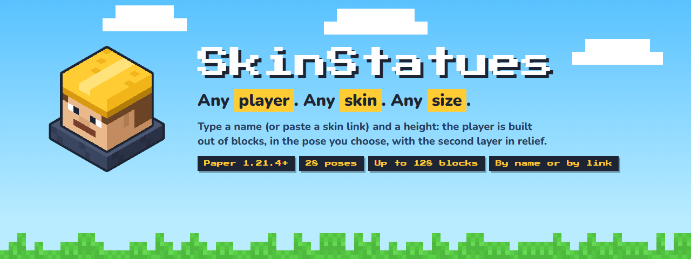
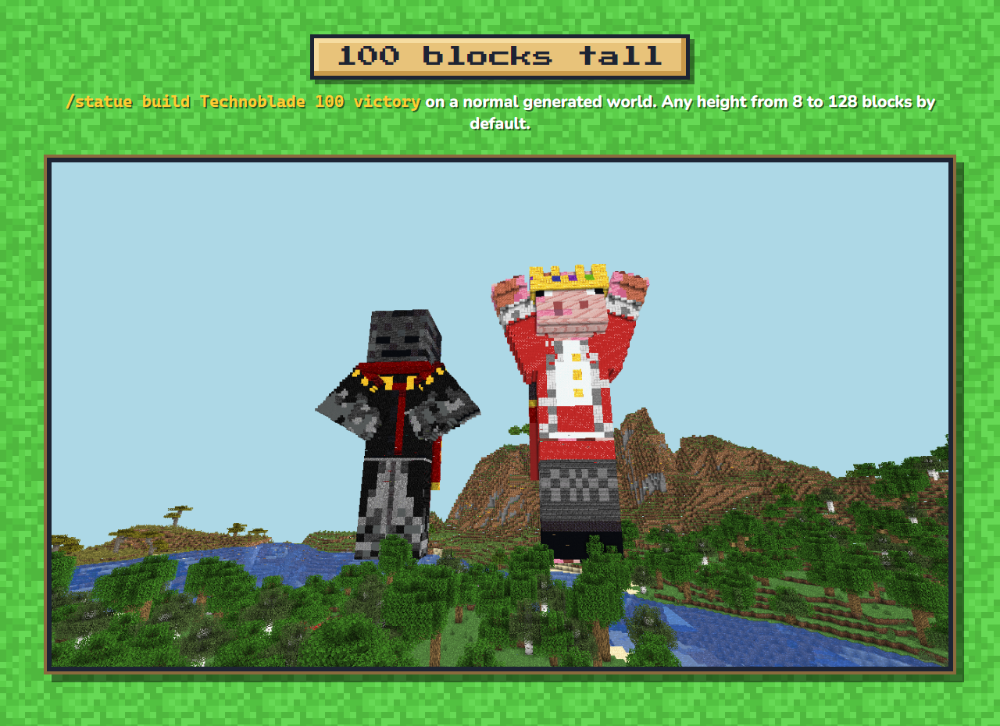
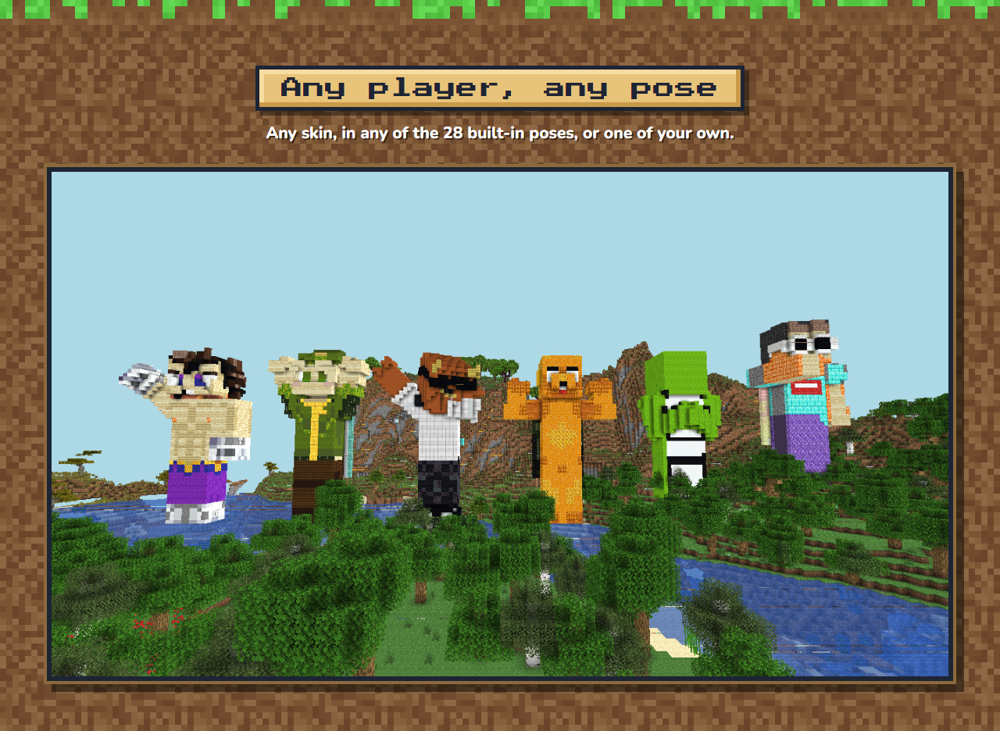
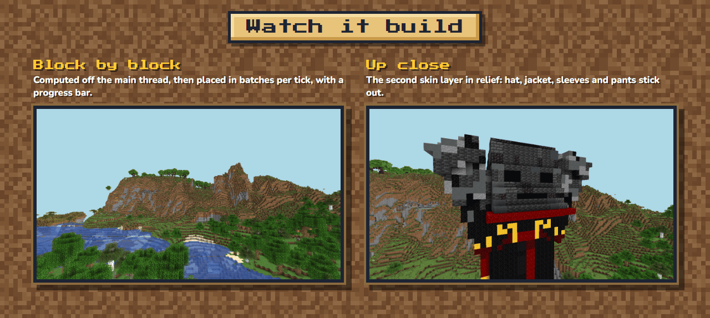
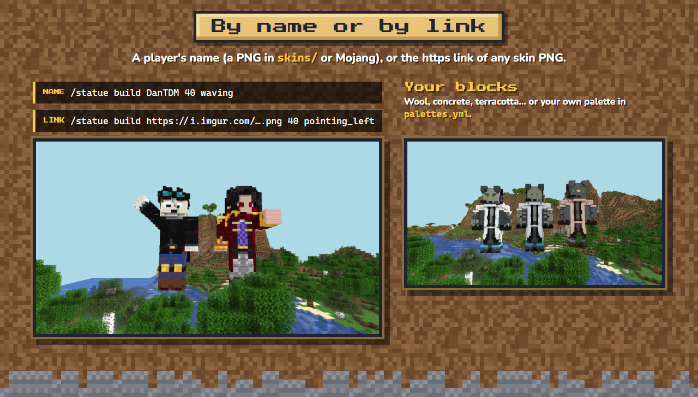
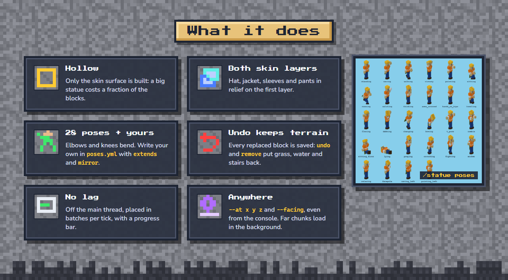
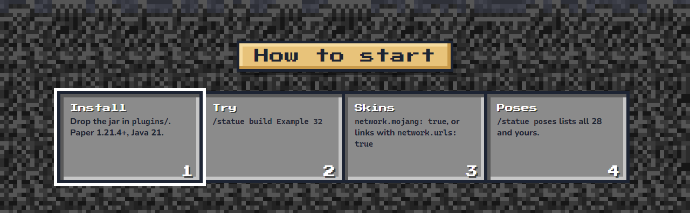

<!-- Descripción de SkinStatues para Modrinth y Hangar (spec 024). Las imágenes las genera tests-e2e/presentacion.mjs desde
     docs/site/assets-src/skinstatues.html; van pegadas, sin líneas en blanco, para que se lean como un solo póster.
     Mismas imágenes y en el mismo orden que spigotmc.bbcode (lo exige PresentacionTest). Si el póster cambia, cambiar
     también la transcripción de los dos archivos (una sección por imagen). -->

 
 
 
 
 
 

**Block statues of any player's skin:** type a name (or a skin link) and a height, and the player's figure is built in
the world out of blocks, in the pose you choose, with the second skin layer in relief and the cape on its back. From 8
to 128 blocks tall.

## Commands
- `/statue build <name|link> <height> [pose] [--at <x> <y> <z>] [--facing <dir>] [--world <w>] [--palette 
] [--slim|--classic] [--no-overlay] [--no-cape]`:
  build a statue. Without `--at` its feet go 2 blocks above you and it faces where you look.
- `/statue undo`, `/statue remove <id>`: take a statue away and put back the terrain that was there.
- `/statue cancel`, `/statue list`, `/statue info <id>`, `/statue poses`, `/statue palettes`.
- `/statue reload`, `/statue validate`, `/statue selftest` (admin).

Permissions (all **op** by default): `skinstatues.build`, `skinstatues.build.url` (skins from a link),
`skinstatues.remove`, `skinstatues.remove.others`, `skinstatues.admin`. Players without a permission do not see those
subcommands when they press Tab.

## Key settings (`config.yml`)
- `network.mojang: false`: turn it on to get skins by account name from Mojang. Without it, skins come from
  `plugins/SkinStatues/skins/<name>.png` (an original `Example` skin is included).
- `network.urls: false`: turn it on for skins from an https link. Only a real skin PNG (64×64 or 64×32, up to 1 MB) from
  a public site; `network.allowed_hosts` restricts the sites.
- `min_height` / `max_height` (8 / 128), `max_blocks`, `offset_up`, `build.blocks_per_tick`.
- `poses.yml`: your own poses with angles in degrees, `extends` and `mirror`. `palettes.yml`: whitelists of blocks
  (wool, concrete, terracotta…).

Every file is checked when it loads: a mistake names the file, the path and what is wrong, with a "did you mean…?".
Messages are in English (MiniMessage) and can be translated.

## Compatibility
- **Paper** 1.21.4 and 26.1.2: verified (in-game test suite). Other Paper 1.21.x and 26.x: not verified.
- **Java 21+** (Paper 26.x needs Java 25).
- Not supported: Spigot/CraftBukkit and Folia.
- No dependencies. Network access only if you turn on `network.mojang` or `network.urls`.
- Not yet: armor and items in the hands, filled statues, diagonal facing.

## Links
- Documentation: https://github.com/leonardos4enz/fabrica-de-plugins/blob/main/plugins/skinstatues/README.md
- Source (MIT): https://github.com/leonardos4enz/fabrica-de-plugins
- Bug reports: https://github.com/leonardos4enz/fabrica-de-plugins/issues

*Skins shown belong to their respective creators; SkinStatues is not affiliated with or endorsed by them or by Mojang.*

Code and documentation were written with the help of an AI coding assistant (Claude), directed and reviewed by the author
and verified with an automated in-game test suite.

Image transcription

**Header.** SkinStatues. Any player. Any skin. Any size. 28 poses · up to 128 blocks · by name or by link.

**100 blocks tall.** A 100-block statue of Technoblade standing in a generated world.

**Any player, any pose.** A row of statues of Vegetta777, Willyrex, elrubius, Mikecrack, Dream and GeorgeNotFound, each in
a different pose.

**Watch it build.** ElRichMC's statue appearing layer by layer, and a close-up of the second skin layer in relief.

**By name or by link.** `/statue build DanTDM 40 waving` and `/statue build https://i.imgur.com/….png 40 pointing_left`. Bobicraft
built in wool, in concrete and in terracotta.

**Features.**
- Hollow: only the skin surface is built, so a big statue costs a fraction of the blocks.
- Both skin layers: hat, jacket, sleeves and pants in relief, joined to the first layer.
- 28 poses + your own: `poses.yml`, `extends` and `mirror`.
- Undo restores the terrain: every replaced block is saved and put back.
- No lag: computed off the main thread, placed in batches per tick.
- Anywhere: `--at` and `--facing`, from the console, even in far chunks.

**How to start.** 1. Drop the jar in `plugins/`. 2. `/statue build Example 32`. 3. `network.mojang: true` for skins by
name, or `network.urls: true` for links. 4. `/statue poses` to see every pose.

