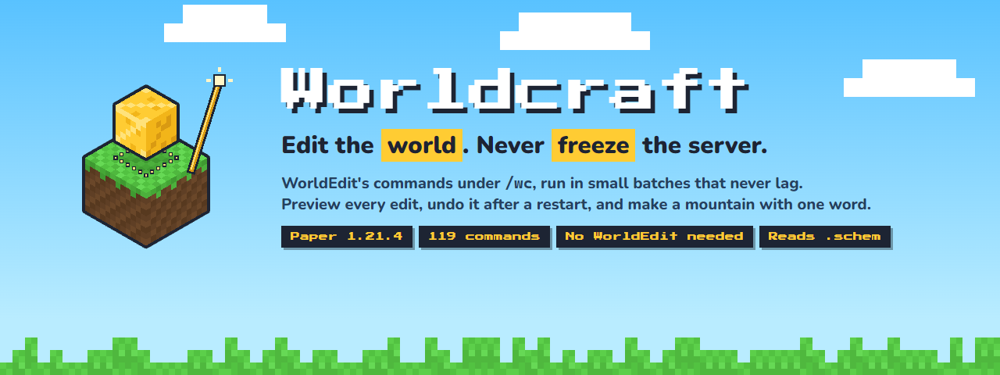
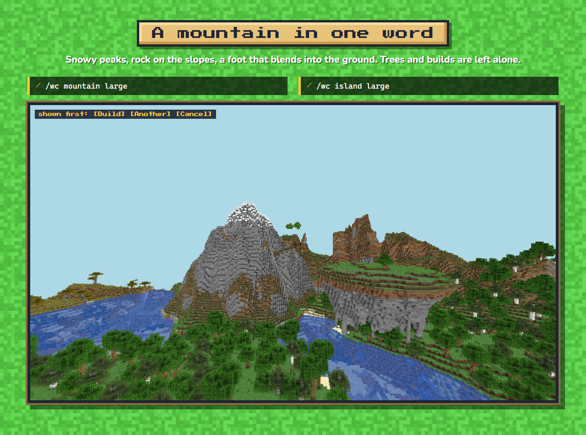
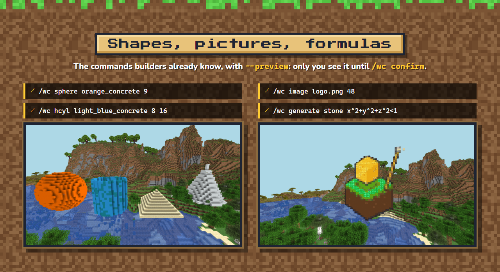
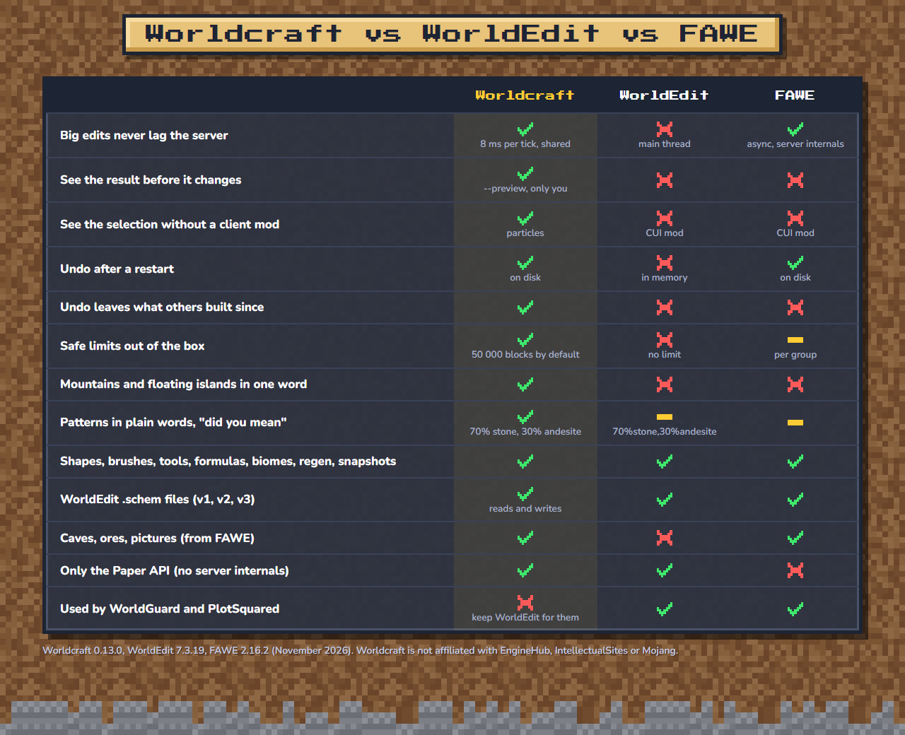
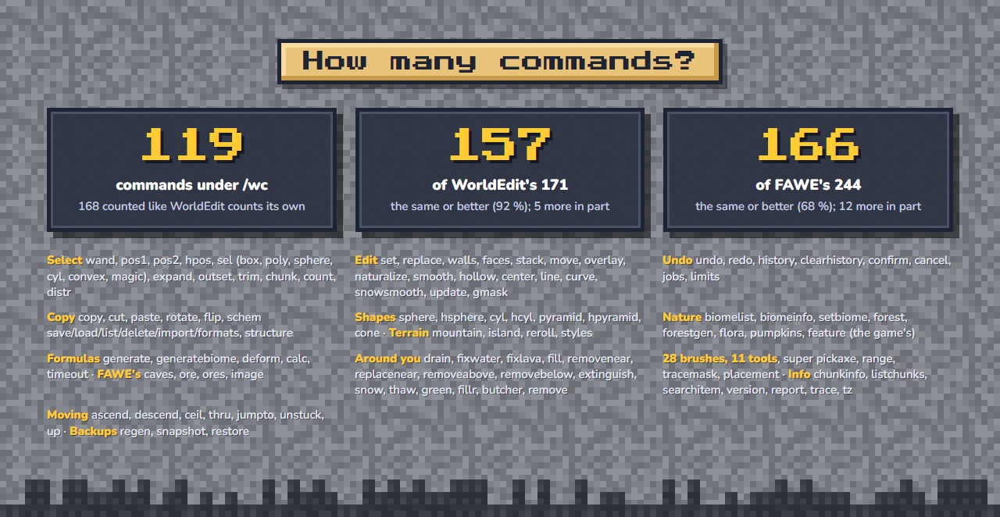
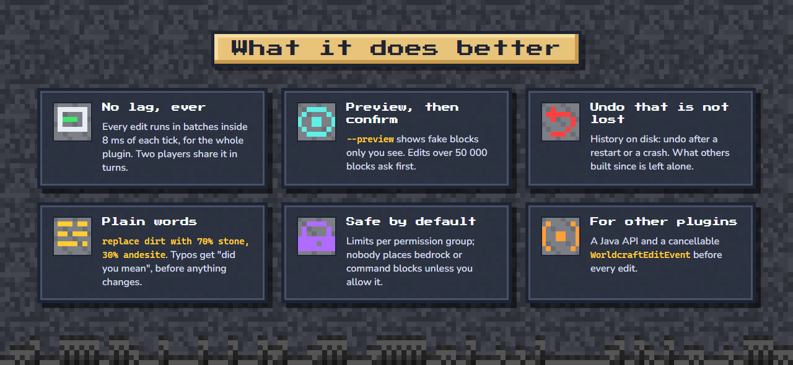
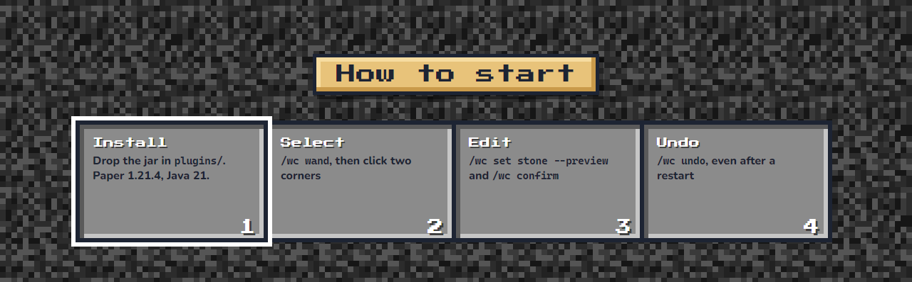

<!-- Descripción de Worldcraft para Modrinth y Hangar (spec 038). Las imágenes las genera tests-e2e/presentacion.mjs desde
     docs/site/assets-src/worldcraft.html; van pegadas, sin líneas en blanco, para que se lean como un solo póster.
     Mismas imágenes y en el mismo orden que spigotmc.bbcode, y la misma cantidad de comandos que el código (lo exige
     PresentacionTest). Si el póster cambia, cambiar también la transcripción de los dos archivos (una sección por imagen). -->
<p align="center">
<br>
<br>
<br>
<br>
<br>
<br>

</p>

**World editing for Paper that never lags the server.** Every edit, from ten blocks to ten million, runs in small
batches inside a time budget shared by the whole plugin. Preview it before it happens, undo it even after a restart
(without erasing what others built since), write patterns the way you would say them, and make a mountain or a
floating island with one word. You do not need WorldEdit: Worldcraft has its own engine, its own `.schem` reader and
writer, and **119 commands** under `/wc`, which also work the WorldEdit way: `//set`, `//copy -e`, `/brush`,
`//undo`.

*Worldcraft is not affiliated with or endorsed by EngineHub (WorldEdit), IntellectualSites (FastAsyncWorldEdit) or Mojang.*

## How it compares
Counted from the `@Command` annotations inside the WorldEdit 7.3.19 and FAWE 2.16.2 jars (sub-commands included), and
counting only what Worldcraft does the same or better:

| | Commands | Worldcraft has |
|---|---|---|
| WorldEdit 7.3.19 | 171 | **157** (92 %), 5 more in part |
| FastAsyncWorldEdit 2.16.2 | 244 | **166** (68 %), 12 more in part |
| Worldcraft 0.15.0 | **119** under `/wc` (168 counted like WorldEdit counts its own) | |

Every command, one by one, with its Worldcraft equivalent:
[commands.md](https://github.com/leonardos4enz/fabrica-de-plugins/blob/main/docs/worldcraft/presentacion/commands.md).

| | Worldcraft | WorldEdit | FAWE |
|---|---|---|---|
| Big edits never lag the server | yes (8 ms per tick, shared) | no (main thread) | yes (async, server internals) |
| See the result before it changes | yes (`--preview`, only you) | no | no |
| See the selection without a client mod | yes (particles) | no (CUI mod) | no (CUI mod) |
| Undo after a restart | yes (on disk) | no | yes |
| Undo leaves what others built since | yes | no | no |
| Safe limits out of the box | yes (50 000 blocks by default) | no limit | per group |
| Mountains and floating islands in one word | yes | no | no |
| Patterns in plain words, "did you mean" | yes | in part | in part |
| Shapes, brushes, tools, formulas, biomes, regen, snapshots | yes | yes | yes |
| WorldEdit `.schem` files (v1, v2, v3) | reads and writes | yes | yes |
| Caves, ores, pictures (from FAWE) | yes | no | yes |
| Only the Paper API (no server internals) | yes | yes | no |
| Used by WorldGuard and PlotSquared | no: keep WorldEdit for them | yes | yes |

## Commands (119)
Everything is `/wc <command>` (or `/worldcraft`); `/wc help <command>` shows how to use each one with an example.
- **Select (15):** `/wc wand`, `pos1`, `pos2`, `hpos1`, `hpos2`, `sel` (cuboid, extend, poly, ellipsoid, sphere, cyl,
  convex, magic), `expand`, `contract`, `shift`, `outset`, `inset`, `trim`, `chunk`, `count`, `distr`.
- **Edit a selection (16):** `set`, `replace`, `walls`, `faces`, `stack`, `move`, `overlay`, `naturalize`, `smooth`,
  `hollow`, `center`, `line`, `curve`, `snowsmooth`, `update`, `gmask`.
- **Preview, undo and jobs (8):** `confirm`, `cancel`, `undo`, `redo`, `history`, `clearhistory`, `jobs`, `limits`.
- **Copy and schematics (8):** `copy`, `cut`, `paste`, `rotate`, `flip`, `clearclipboard`, `schem`
  (save, load, list, delete, import, formats), `structure` (the game's own templates).
- **Shapes (7):** `sphere`, `hsphere`, `cyl`, `hcyl`, `pyramid`, `hpyramid`, `cone`.
- **Terrain (4):** `mountain`, `island`, `reroll`, `styles`.
- **Biomes, trees, plants and the game's features (8):** `biomelist`, `biomeinfo`, `setbiome`, `forest`, `forestgen`,
  `flora`, `pumpkins`, `feature`.
- **Formulas (5):** `generate`, `generatebiome`, `deform`, `calc`, `timeout`.
- **Caves, ores and pictures (4):** `caves`, `ore`, `ores`, `image`.
- **Fixes around you (13):** `drain`, `fixwater`, `fixlava`, `fill`, `fillr`, `removenear`, `replacenear`, `removeabove`,
  `removebelow`, `extinguish`, `snow`, `thaw`, `green`.
- **Entities (2):** `butcher`, `remove`.
- **Brushes and tools (5):** `brush` (28: sphere, cyl, set, clipboard, splatter, scatter, rock, gravity, extinguish,
  butcher, forest, deform, snow, snowsmooth, biome, morph, dilate, heightmap, feature, apply … item, paint … item, and
  the terrain brush: raise, lower, smooth, flatten, erode, paint), `tool` (11: repl, floodfill, info, cycler, deltree,
  farwand, lrbuild, navwand, tree, stacker, none), `superpickaxe` (single, area, recursive), `range`, `tracemask`.
- **Where things go (3):** `placement`, `toggleplace`, `toggleeditwand`.
- **Moving around (7):** `unstuck`, `ascend`, `descend`, `ceil`, `thru`, `jumpto`, `up`.
- **Back to the original (3):** `regen`, `snapshot`, `restore`.
- **Information (7):** `chunkinfo`, `listchunks`, `searchitem`, `version`, `report`, `trace`, `tz`.
- **Admin (4):** `help`, `reload`, `validate`, `selftest`.

```
/wc wand                                     left click = corner 1, right click = corner 2
/wc set 70% stone, 30% andesite --preview    see it first (only you), then /wc confirm
/wc replace dirt, grass_block with stone
/wc undo                                     works after a restart; leaves alone what others changed since
/wc mountain                                 a mountain where you look: [Build] [Another] [Cancel]
/wc schem load castles/tower                 a WorldEdit .schem into your clipboard, then /wc paste --preview
/wc generate stone x^2+y^2+z^2<1             a shape from a formula, written like in WorldEdit
```

## What it does better
- **No lag, ever.** 8 ms of each 50 ms tick for the whole plugin (`performance.max_ms_per_tick`); the clock is checked
  on every block. Two players' edits share the time in turns. Unloaded chunks load in the background.
- **See before you change.** `--preview` shows fake blocks only you see; `/wc confirm` then does exactly that. Edits
  over 50 000 blocks ask first.
- **Undo that is not lost.** Each player's history is on disk: undo after a restart or a crash. Blocks somebody changed
  after your edit are left alone, and you are told how many. Chests and signs come back with their contents.
- **Plain words.** `70% stone, 30% andesite`, `*_wool, !red_wool`, `replace dirt with stone`. Mistakes are found
  before anything changes, with "did you mean".
- **Safe limits.** Per permission group: biggest edit, edits at once, worlds and blocked blocks (bedrock, barriers,
  command blocks and portals are blocked by default except for `admin`).
- **For other plugins.** A Java API (`WorldcraftApi.get()`: selections, `set`, `replace`, `paste`, `undo` through the
  same engine) and a cancellable `WorldcraftEditEvent` before every edit, commands included.

## Permissions
All **op** by default: `worldcraft.use` (the wand and every edit on your own selection), `worldcraft.moderate` (see and
undo other players' edits), `worldcraft.admin`, `worldcraft.schematic`, `worldcraft.schematic.save`,
`worldcraft.schematic.delete`, `worldcraft.butcher`, `worldcraft.remove`, `worldcraft.navigate`,
`worldcraft.superpickaxe`, `worldcraft.image.link`, `worldcraft.regen`, `worldcraft.snapshot`, and
`worldcraft.limit.<group>` for the limits of a group in `config.yml`.

## Compatibility
- **Paper 1.21.4**: verified (unit tests, a real server and an in-game test suite with bots). Other Paper 1.21.x and
  26.x: not verified yet.
- **Java 21+.** Not supported: Spigot/CraftBukkit and Folia.
- **No dependencies.** It can run next to WorldEdit (different command and wand). WorldGuard and PlotSquared use
  WorldEdit's own API, so keep WorldEdit installed if you use them.
- No network access, unless you turn on picture links (`images.links`, off by default).

## Links
- Documentation: https://github.com/leonardos4enz/fabrica-de-plugins/blob/main/plugins/worldcraft/README.md
- Every command compared with WorldEdit and FAWE: https://github.com/leonardos4enz/fabrica-de-plugins/blob/main/docs/worldcraft/presentacion/commands.md
- Source (MIT): https://github.com/leonardos4enz/fabrica-de-plugins
- Bug reports: https://github.com/leonardos4enz/fabrica-de-plugins/issues

Code and documentation were written with the help of an AI coding assistant (Claude), directed and reviewed by the author
and verified with an automated in-game test suite.

<details>
<summary>Image transcription</summary>

**Header.** Worldcraft. Edit the world. Never freeze the server. WorldEdit's commands under `/wc`, run in small batches
that never lag. Preview every edit, undo it after a restart, and make a mountain with one word. Paper 1.21.4 · 119
commands · No WorldEdit needed · Reads .schem.

**A mountain in one word.** `/wc mountain large` and `/wc island large`: a mountain with snowy peaks and a floating
island with trees over a generated plain. Shown first: [Build] [Another] [Cancel].

**Shapes, pictures, formulas.** The commands builders already know, with `--preview`: only you see it until
`/wc confirm`. `/wc sphere orange_concrete 9`, `/wc hcyl light_blue_concrete 8 16`: a sphere, a hollow cylinder, a
pyramid and a cone. `/wc image logo.png 48`, `/wc generate stone x^2+y^2+z^2<1`: the Worldcraft logo built with blocks.

**Worldcraft vs WorldEdit vs FAWE.** The same table as above. Worldcraft 0.15.0, WorldEdit 7.3.19, FAWE 2.16.2
(November 2026).

**How many commands?** 119 commands under `/wc` (168 counted like WorldEdit counts its own). 157 of WorldEdit's 171:
the same or better (92 %), 5 more in part. 166 of FAWE's 244: the same or better (68 %), 12 more in part. Then the
command names by group, as in the list above.

**What it does better.** No lag, ever: every edit runs in batches inside 8 ms of each tick, for the whole plugin; two
players share it in turns. Preview, then confirm: `--preview` shows fake blocks only you see; edits over 50 000 blocks
ask first. Undo that is not lost: history on disk, undo after a restart or a crash; what others built since is left
alone. Plain words: `replace dirt with 70% stone, 30% andesite`; typos get "did you mean", before anything changes.
Safe by default: limits per permission group; nobody places bedrock or command blocks unless you allow it. For other
plugins: a Java API and a cancellable `WorldcraftEditEvent` before every edit.

**How to start.** 1. Drop the jar in `plugins/` (Paper 1.21.4, Java 21). 2. `/wc wand`, then click two corners.
3. `/wc set stone --preview` and `/wc confirm`. 4. `/wc undo`, even after a restart.
</details>
