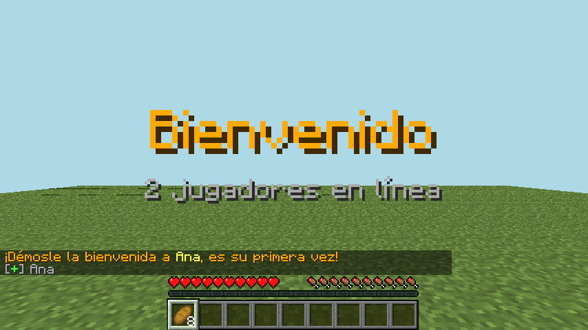
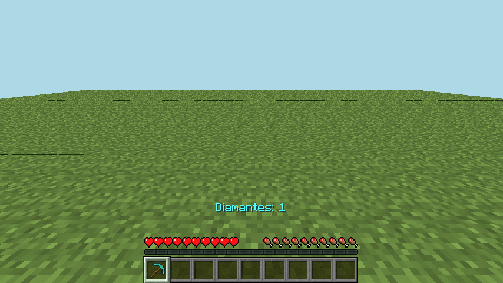
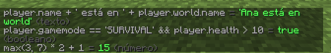
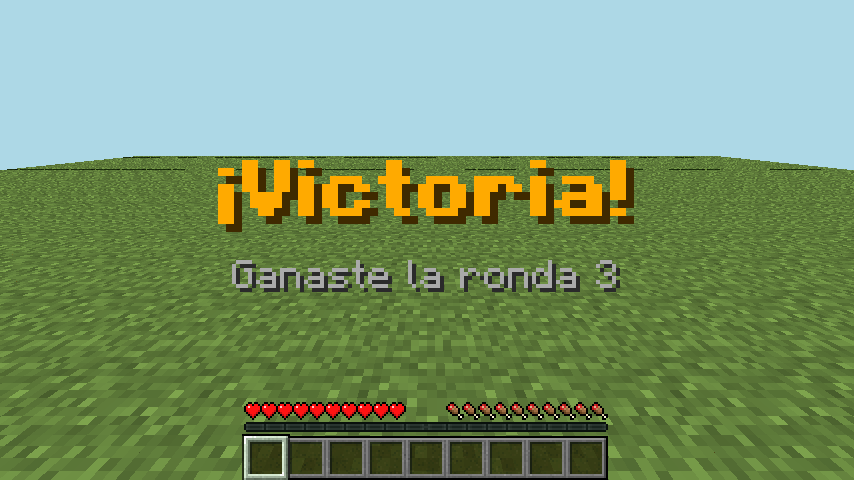
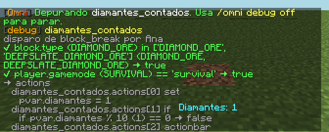
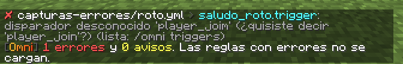

# OmniEvents

Eventos condicionales para **Paper 1.21.4 y 26.1** (ver [Compatibilidad](#compatibilidad)): «cuando pase X, si se cumple Y, haz Z», declarado en YAML.
Es la versión propia de la fábrica de *ConditionalEvents*, con un lenguaje de expresiones real, control de flujo,
variables persistentes y herramientas de diagnóstico. Specs: [001](../../docs/sdd/specs/001-omnievents-nucleo/spec.md) (núcleo) y
[006](../../docs/sdd/specs/006-omnievents-herramientas-de-autor/spec.md) (herramientas de autor),
[007](../../docs/sdd/specs/007-omnievents-esquema-y-referencia/spec.md) (esquema para el editor y referencia generada),
[008](../../docs/sdd/specs/008-omnievents-disparador-de-estado/spec.md) (disparador de estado, sin sondeo) y
[009](../../docs/sdd/specs/009-omnievents-variables-caducidad-y-objetos/spec.md) (variables que caducan y variables en bloques, entidades e ítems).

**[Referencia completa](../../docs/omnievents/referencia.md)**: cada opción, disparador, acción y función, generada del
código (nunca queda desactualizada). **[Autocompletado en VS Code](#editor-autocompletado-y-errores-en-vs-code)** con
el esquema JSON.



**[Galería](../../docs/omnievents/galeria.md)**: una imagen por disparador, acción, subcomando y ejemplo, generada en el juego. No son capturas del
cliente oficial: son un render de lo que recibió un cliente real (un bot) del servidor, con la fuente y el HUD de
Minecraft 1.21.4 ([spec 004](../../docs/sdd/specs/004-fabrica-capturas-en-juego/spec.md)).

## Compatibilidad
| Servidor | Estado | Evidencia |
|---|---|---|
| **Paper 1.21.4** (build 232, Java 24) | Verificada (1.4.0) | Compuertas 1, 2 y 3a: 113 unitarias, servidor real y 37/37 escenarios en el juego dos veces (2026-10-25, specs [001](../../docs/sdd/specs/001-omnievents-nucleo/verify.md), [002](../../docs/sdd/specs/002-fabrica-pruebas-en-juego/verify.md), [005](../../docs/sdd/specs/005-omnievents-comandos-sin-resync/verify.md), [006](../../docs/sdd/specs/006-omnievents-herramientas-de-autor/verify.md), [007](../../docs/sdd/specs/007-omnievents-esquema-y-referencia/verify.md), [008](../../docs/sdd/specs/008-omnievents-disparador-de-estado/verify.md) y [009](../../docs/sdd/specs/009-omnievents-variables-caducidad-y-objetos/verify.md)) |
| **Paper 26.1.2** (build 74, Java 25) | Verificada (1.4.0) | 37/37 escenarios en el juego dos veces con el mismo jar (2026-10-25, specs [002](../../docs/sdd/specs/002-fabrica-pruebas-en-juego/verify.md), [005](../../docs/sdd/specs/005-omnievents-comandos-sin-resync/verify.md), [006](../../docs/sdd/specs/006-omnievents-herramientas-de-autor/verify.md), [007](../../docs/sdd/specs/007-omnievents-esquema-y-referencia/verify.md), [008](../../docs/sdd/specs/008-omnievents-disparador-de-estado/verify.md) y [009](../../docs/sdd/specs/009-omnievents-variables-caducidad-y-objetos/verify.md)) |
| Paper 1.21.5 – 1.21.11 | Sin verificar | Debería funcionar (misma API, sin NMS), pero no se probó |
| Paper 26.2 y 26.3 | Sin verificar | El bot de pruebas (mineflayer 4.39) llega hasta 26.1 |
| Paper 1.21.3 o anterior | No soportada | Se compila contra la API de 1.21.4 |
| Spigot, CraftBukkit | No soportada | Usa la API Adventure de Paper |
| Folia | No soportada | Planificada para una spec futura |

- **Java:** el jar necesita Java 21 o más; usa el Java que pida tu versión de Paper (las pruebas en 26.x usaron Java 25).
- **Opcional:** PlaceholderAPI. Probada a mano con la 2.12.3 en Paper 1.21.4 (2026-10-25): la expansión `omni` se
  registra y `%omni_state_<regla>%` y `%omni_var_<n>%` responden; no está en la suite automática.
- Para verificar otra versión: `npm --prefix tests-e2e test -- --paper <versión> --version-bot <versión> --java-servidor <JDK>`
  (ver [verificacion.md](../../docs/sdd/verificacion.md#3a-en-el-juego-automática)).

## Instalación
1. Copia `OmniEvents-x.y.z.jar` a `plugins/` (opcional: PlaceholderAPI).
2. Arranca el servidor: se crean `config.yml`, `messages.yml` y ejemplos en `plugins/OmniEvents/rules/ejemplos/`.
3. Edita o agrega archivos en `rules/` y usa `/omni reload`.

¿Vienes de ConditionalEvents? `/omni import conditionalevents` convierte tus eventos a `rules/importado/`.

## Editor: autocompletado y errores en VS Code
Con la extensión **YAML** de Red Hat, pon esta línea al inicio de cada archivo de reglas (los ejemplos ya la traen):
```yaml
# yaml-language-server: $schema=https://raw.githubusercontent.com/leonardos4enz/fabrica-de-plugins/main/docs/omnievents/omnievents.schema.json
```
Al escribir `trigger: blo` te sugiere `block_break`, `block_place`… con su descripción; lo mismo con las opciones de la
regla y las acciones (con su forma y sus claves: `then`, `do`, `as`…), y al pasar el ratón ves qué hace cada una. Se
marcan como error, antes de cargar: una opción o acción desconocida (`cooldwon`, `mesage`), un mapa de condición sin
`expr` ni `any`, `any: 0`, `budget: 5` sin unidad, un `timer` sin `every` o una hora `25:00`.
- Las **expresiones** dentro de los textos, los materiales, los sonidos y los efectos no se revisan en el editor
  (dependen de la versión de Paper): para eso sigue `/omni validate`.
- El editor espera los nombres en minúsculas (`message:`); el plugin también acepta `Message:`.
- `/omni schema` escribe `plugins/OmniEvents/omnievents.schema.json` y `referencia.md` con lo que tiene **tu**
  servidor, incluidas las acciones y funciones que agreguen otros plugins. Para usarlo en lugar del publicado:
  `# yaml-language-server: $schema=../omnievents.schema.json` (desde un archivo de `rules/`; en subcarpetas, agrega `../`).
  Solo escribe esos dos archivos: nunca toca tus reglas.
- Desarrollo: `./gradlew :omnievents:schema` regenera `docs/omnievents/`; una prueba falla si quedan desactualizados.

## Una regla
```yaml
diamantes:
  trigger: block_break                 # cuándo
  worlds: [world]
  conditions:                          # si (todas deben cumplirse)
    - "block.type in ['DIAMOND_ORE', 'DEEPSLATE_DIAMOND_ORE']"
    - "player.gamemode == 'survival' && !player.hasPermission('staff')"
  cooldown: 10s
  actions:                             # haz
    - set: "pvar.diamantes += 1"
    - if: "pvar.diamantes % 10 == 0"
      then:
        - broadcast: "<aqua>{player.name}</aqua> ya minó {pvar.diamantes} diamantes"
  else:
    - actionbar: "<gray>Solo cuentan los diamantes"
  on_cooldown:
    - message: "<red>Espera {var.cooldown_left}s"
```

Así se ve el ejemplo `diamantes_contados`, que hace lo mismo (cuenta los diamantes en `pvar` y los muestra en la barra):



## Opciones de una regla
Imágenes de `cooldown`, `on_cooldown`, `limit` y `on_limit`: [galería](../../docs/omnievents/galeria.md#opciones-de-una-regla).

| Opción | Qué hace |
|---|---|
| `trigger` | Disparador (`/omni triggers` los lista) |
| `enabled` | `false` la apaga sin borrarla |
| `priority`, `ignore_cancelled` | Prioridad del oyente; no correr si otro plugin canceló el evento |
| `worlds`, `permission`, `bypass_permission` | Filtros rápidos |
| `conditions` | Una expresión o una lista (todas); cada una puede llevar su `deny` y un grupo `any`/`of` pide «N de M» ([abajo](#condiciones-con-deny-y-n-de-m)) |
| `actions`, `else` | Qué hacer si se cumplen / si no |
| `cooldown`, `cooldown_scope` | `30s`, `5m`, `1h30m`, `2d`, `20t`; `player` o `global` |
| `limit`, `limit_scope`, `limit_reset` | Usos máximos; `never`, `daily`, `weekly`, `monthly` o una duración |
| `on_cooldown`, `on_limit` | Acciones cuando está en enfriamiento o sin usos |
| `every`, `per_player` | Para `timer` |
| `at`, `timezone` | Para `clock` (`["08:00", "20:30"]`) |
| `command` | Para `command`: `name`, `aliases`, `permission`, `description`, `usage`, `tab` |
| `event`, `player_from` | Para `custom`: clase del evento y ruta al jugador |
| `move_mode` | Para `player_move`: `block` (defecto), `chunk` o `any` |
| `args` | Para `call`: parámetros (llegan como `var.<nombre>`) |
| `when`, `on_enter`, `on_exit`, `check_every`, `watch`, `initial`, `per_player` | Para `state` ([abajo](#disparador-de-estado-trigger-state)) |
| `budget` | Presupuesto de tiempo: `0.5ms` o `200us`; avisa en consola si el promedio reciente lo pasa ([abajo](#rendimiento-omni-cpu-y-budget)) |

## Condiciones con deny y «N de M»
Cada condición puede ser un texto (como siempre) o un mapa con `expr` y sus propias acciones `deny`. Si falla, corren
solo sus `deny` (no el `else`); una condición sin `deny` que falla corre el `else` de la regla, como antes. Un grupo
`any: N` con `of: [...]` se cumple si al menos N de sus condiciones se cumplen (se puede anidar). Ejemplo completo:
[`rules/ejemplos/herramientas.yml`](src/main/resources/rules/ejemplos/herramientas.yml).
```yaml
tienda_espada:
  trigger: command
  command: {name: espada}
  conditions:
    - "player != null"                       # forma corta: si falla, corre el else
    - expr: "player.level >= 5"
      deny:
        - message: "<red>Necesitas nivel 5 (tienes {player.level})."
    - any: 2                                 # al menos 2 de estas 3
      of: ["perm(omnievents.vip)", "has_item(EMERALD, 1)", "player.world.time > 12000"]
      deny:
        - message: "<red>Necesitas 2 de 3: ser VIP, llevar una esmeralda o que sea de noche."
  actions: [...]
  else: [...]
```
`any` debe ser un entero entre 1 y el número de condiciones de `of`; un `deny` dentro de `of` no se usa (aviso al
cargar).

## Disparador de estado (`trigger: state`)
«Cuando X **pasa a ser** verdad» en lugar de «cada X segundos, revisa». `on_enter` corre una vez cuando `when` pasa a
ser verdad para un jugador, y `on_exit` una vez cuando deja de serlo; mientras no cambie, no corre nada. No hace
falta una variable de «ya avisé». Ejemplos completos: [`rules/ejemplos/estados.yml`](src/main/resources/rules/ejemplos/estados.yml).
```yaml
vida_baja:
  trigger: state
  when: "player.health <= 6"          # o una lista de condiciones (todas)
  cooldown: 20s                       # frena on_enter, y entonces tampoco corre su on_exit
  on_enter:
    - title: "<red>¡Peligro!;<gray>Busca refugio"
  on_exit:
    - actionbar: "<green>A salvo tras {var.state_seconds}s"
```
- **Sin sondeo.** Al cargar, el motor deduce de qué depende `when` y solo lo revisa con esos eventos: vida → daño,
  curación y reaparición; hambre; ubicación, bloque, bioma, mundo e `in_area()` → moverse **de bloque**,
  teletransporte y cambio de mundo; nivel y experiencia; modo de juego; agacharse, correr, volar; armadura; ítem en
  mano e inventario (`has_item()`); conectados (`online`); clima (`world.storm`); `pvar.x` y `gvar.x` cuando una
  acción o `/omni var` las cambian; e `in_state('otra')` cuando cambia la otra. Varios eventos del mismo jugador en
  un tick se juntan en **una** revisión, al final del tick (el daño ya restó la vida). `/omni info vida_baja` dice
  qué dedujo y qué eventos escucha.
- **Lo que no se puede deducir** (placeholders, `perm()`, la hora, `world.time`/`world.day`, `player.op`, métodos,
  funciones de otros plugins) hace que la regla **no cargue** hasta que declares `check_every: 5s`: el costo del
  sondeo queda a la vista. `watch: [player_interact]` agrega disparadores a los deducidos. El azar (`chance`,
  `random`) en `when` es error.
- Los cambios hechos por comandos de otros plugins o por `/give`, `/clear` no lanzan eventos: para el inventario
  y lo que cambie así, agrega `check_every` o `watch`.
- **Al entrar al servidor** con el estado ya verdadero, corre `on_enter`; `initial: silent` no avisa (y entonces
  tampoco su `on_exit`). Al salir se olvida, sin `on_exit`. `/omni reload` conserva el estado de las reglas cuyo
  `when`, `worlds` y `per_player` no cambiaron; una regla nueva o cambiada toma el estado actual sin disparar.
- `permission`, `bypass_permission`, `limit` y `cooldown` frenan `on_enter` como en cualquier regla; `on_exit`
  solo corre si corrió el `on_enter` de esa entrada. `worlds` es parte del estado (fuera de esos mundos es falso).
- **Estado del servidor:** `per_player: false` lleva un solo estado sin jugador (`gvar`, `online`, clima o
  `in_state` de otro estado del servidor), p. ej. `when: "gvar.evento == true && online >= 2"` con
  `on_enter: [broadcast: ...]`. Toma su valor al cargar, sin disparar.
- **Desde otras reglas:** `in_state('vida_baja')` (y `%omni_state_vida_baja%`) dice si el jugador está en el estado.
  Un nombre fijo que no es una regla `state` es error al cargar.
- **Diagnóstico:** `/omni debug vida_baja` muestra cada entrada o salida con los valores de `when`; `/omni check
  vida_baja Ana` da el valor ahora, el estado guardado y qué correría; `/omni state vida_baja` lista quién está dentro
  y desde cuándo; `/omni stats` cuenta revisiones y cambios. `/omni run vida_baja Ana [--simular]` corre su `on_enter`.
- El estado vive en memoria (una entrada por jugador dentro): no se guarda en disco ni cambia tus datos.

## Variables que caducan y variables de objetos
Desde la 1.4.0 ([spec 009](../../docs/sdd/specs/009-omnievents-variables-caducidad-y-objetos/spec.md)). Ejemplos
completos: [`rules/ejemplos/variables.yml`](src/main/resources/rules/ejemplos/variables.yml).
```yaml
racha_sube:
  trigger: player_kill
  conditions: "target.type == 'ZOMBIE'"
  actions:
    - set: "pvar.racha = default(pvar.racha, 0) + 1"
      expire: 2m                                  # se pierde tras 2 min sin matar otro
    - actionbar: "Racha x{pvar.racha} · {round(ttl(pvar.racha))}s"

racha_perdida:
  trigger: var_expire                             # corre cuando caduca
  variables: [racha]
  actions:
    - message: "<red>Perdiste tu racha de {value}."

cofre_con_dueno:
  trigger: block_place
  conditions: "block.type == 'CHEST'"
  actions:
    - set: "block.data.dueño = player.name"       # guardada en el bloque
```
- **`expire: <duración>`** en un `set` de `pvar`, `gvar` u `objeto.data`: la variable se borra sola pasado ese tiempo
  (`10m`, `1h`, o una plantilla como `"{gvar.minutos}m"`). Cada `set` con `expire` vuelve a contar; un `set` sin él
  quita la caducidad. Sobrevive a reinicios: lo que caducó con el servidor apagado ya no está al volver. En `var` es
  error (no vive lo bastante).
- **`ttl(pvar.x)`** (también `gvar.x` y `objeto.data.x`): segundos que le quedan; `-1` si no caduca; nulo si no existe.
- **`trigger: var_expire`** corre cuando caduca una `pvar` de un jugador conectado (con `player`) o una `gvar` (sin
  jugador). Raíces: `variable`, `value` (lo último que valía) y `scope` (`pvar`/`gvar`); `variables: [..]` lo limita.
  Los `trigger: state` que leen esa variable se revisan al caducar (su `on_exit` corre). No sondea a nadie: una cola
  ordenada por hora que se mira una vez por segundo. Una `pvar` de alguien desconectado caduca sin aviso.
- **`objeto.data.nombre`** lee y escribe una variable de cualquier bloque, entidad (también jugadores) o ítem:
  `block.data.dueño`, `target.data.marcado`, `player.item.data.ligada`; `unset: "block.data.dueño"` la borra. Vive en el
  `PersistentDataContainer` de Paper: la del ítem **viaja con el ítem** (si cambia de manos, la lleva), la de la
  entidad va con la entidad y la del bloque en su chunk. Guarda números, textos y booleanos (lo demás, como texto).
  Sobre algo que no es bloque, entidad ni ítem, `.data` sigue siendo la propiedad de antes. Para escribir en un ítem
  usa `player.item` (u `offhand`) o el `item` de un evento que sea el del inventario (romper, colocar, golpear, clic):
  en otros (consumir, craftear, tirar) el `item` del evento puede ser una copia y lo que guardes ahí se pierde (la
  suite solo probó `player.item`).
- Las de un bloque **se borran cuando el bloque deja de estar**: romperlo, explosiones, fuego, hojas que se secan,
  criaturas que lo cambian y pistones que lo mueven (después de las reglas del evento, que aún las leen). Esos oyentes
  solo se registran si alguna regla escribe `.data` (`/omni stats` dice si están activos).
- Las de objetos caducan al leerse (no avisan: no se puede recorrer cada chunk e ítem), y un estado que use `.data` o
  `ttl()` necesita `check_every`.
- **Cuidado con creativo:** un jugador en creativo puede fabricar un ítem con cualquier dato; no confíes en
  `item.data` para ellos. Guardar datos distintos en dos ítems iguales hace que dejen de apilarse.
- `/omni data [bloque|entidad|mano]` muestra las variables de lo que miras o de tu mano, con lo que les queda;
  `/omni var list Ana` también dice cuánto le queda a cada una, y `/omni var set Ana bono 2 --expire 1h` asigna con
  caducidad.
```yaml
# config.yml (claves nuevas en 1.4.0; si faltan se usan estos valores)
object-data:
  max-text-length: 256   # largo máximo de un texto guardado en un objeto
  max-vars: 32           # variables por objeto
```
- **Actualizar desde 1.3.0 o anterior:** la primera vez que arranca, la 1.4.0 copia `plugins/OmniEvents/data/` a
  `data/respaldo-formato1-<fecha>/` y desde entonces escribe los archivos con `format: 2` (una sección nueva,
  `expire`). Tus datos cargan igual; si vuelves a una versión anterior, usa ese respaldo. Un archivo de un formato
  más nuevo que el que entiende el plugin no se sobrescribe.

## Expresiones
- Lógica: `&&` `and`, `||` `or`, `!` `not`, paréntesis, `c ? a : b`.
- Comparación: `==` `!=` `<` `<=` `>` `>=`, `~=` (igual sin mayúsculas), `contains`, `startsWith`, `endsWith`,
  `matches` (regex), `in`; negaciones `!contains`, `not in`…
- Aritmética: `+ - * / %` (con texto, `+` concatena). Listas `[1, 2]`, índices `args[0]`.
- Datos: `player.health`, `player.location.block.type`, `item.name`, `target.type`, `event.damage`… Cualquier
  getter de la API sirve en estilo `snake_case` (`event.final_damage` → `getFinalDamage()`); los métodos que
  modifican están bloqueados.
- Variables: `var.x` (de la ejecución), `pvar.x` (del jugador, persistente), `gvar.x` (del servidor, persistente) y
  `objeto.data.x` (guardada en un bloque, entidad o ítem; ver [abajo](#variables-que-caducan-y-variables-de-objetos)).
  `ttl(pvar.x)` da los segundos que le quedan a una variable con `expire`.
- Placeholders: `%vault_eco_balance% > 100` (con PlaceholderAPI; si el resultado es un número, se compara como número).
- Funciones: `random(a,b)` `chance(p)` `min` `max` `abs` `round(x,d)` `floor` `ceil` `sqrt` `pow` `clamp` `len`
  `lower` `upper` `trim` `replace` `substr` `split` `join` `str` `num` `int` `bool` `strip` `format` `default(a,b)`
  `if(c,a,b)` `papi(t[,jugador])` `online(n)` `player(n)` `players()` `perm(p)` `now()` `hour()` `minute()`
  `weekday()` `date(patrón)` `cooldown(regla)` `uses(regla)` `distance(a,b)` `in_area(mundo,x1,y1,z1,x2,y2,z2)`
  `has_item(material[,n])` `pvar_of(jugador,nombre)` `in_state(regla)` `ttl(variable)` `size(x)`.

Firma y descripción de cada función: [referencia](../../docs/omnievents/referencia.md#funciones). Prueba cualquier expresión en el juego: `/omni eval player.location.biome`.



## Textos
`{expresión}` interpola, `%placeholder%` pasa por PlaceholderAPI, y se aceptan MiniMessage, `&a` y `&#RRGGBB`.
Lo que escribe el jugador e interpolas con `{}` nunca se interpreta como MiniMessage (no puede inyectar `<click>`),
y en comandos pierde los saltos de línea.

## Acciones
Dos formas equivalentes: `- message: "hola"` o `- "message: hola"`. Modificadores en cualquier acción:
```yaml
- message: "<gold>¡Evento!"
  to: all                  # self | target | all | world:<w> | radius:<n> | nearby:<n> | player:<nombre> | expresión
  where: "player.level >= 10"   # filtro por destinatario
  chance: 25               # porcentaje
  when: "hour() >= 20"     # guarda
```
Control de flujo: `if/then/else`, `repeat/do` (`var.i`), `while/do`, `for_each/as/do`, `random` (ramas con `weight`),
`delay`, `wait_ticks` (en ticks), `stop`, `call`, `set`, `unset`, `no_cooldown`, `reset_cooldown` ([imágenes](../../docs/omnievents/galeria.md#acciones--control-de-flujo)).

| Grupo (enlace a sus imágenes) | Acciones |
|---|---|
| [Mensajes](../../docs/omnievents/galeria.md#acciones--mensajes) | `message` `broadcast` `actionbar` `title` (`título;subtítulo;in;stay;out`) `bossbar` (`texto;segundos;color;progreso`) `sound` (`SONIDO;vol;tono`) `stop_sound` `console_message` `log` |
| [Comandos](../../docs/omnievents/galeria.md#acciones--comandos) | `console` `command` `chat` `send_to_server` |
| [Jugador](../../docs/omnievents/galeria.md#acciones--jugador) | `teleport` (`mundo;x;y;z;yaw;pitch`, `~` relativo) `heal` `damage` `feed` `set_food` `gamemode` `fly` `effect` (`EFECTO;segundos;nivel;partículas`) `remove_effect` `fire` `freeze` `velocity` `launch` `give_item` `drop_item` `remove_item` (`MATERIAL;cantidad`: por material, aunque el ítem tenga nombre) `clear_inventory` `close_inventory` `give_exp` `give_level` `kick` |
| [Mundo](../../docs/omnievents/galeria.md#acciones--mundo) | `set_block` `lightning` `explosion` (`potencia;fuego;romper`) `particle` (`PARTÍCULA;n;dx;dy;dz;vel[;r;g;b]`) `summon` |
| [Evento](../../docs/omnievents/galeria.md#acciones--evento) | `cancel` `set_event` (`propiedad = expresión`) `set_damage` (`10` o `150%`) `set_message` `set_join_message` `set_quit_message` `set_death_message` (`none` la oculta) `keep_inventory` `cancel_drops` `deny_join` |

| `title` | `bossbar` |
|---|---|
|  |  |

Descripción, forma del valor, claves y un ejemplo de cada acción: [referencia](../../docs/omnievents/referencia.md#acciones).

Ítems: `give_item: "DIAMOND;2;<aqua>Nombre;<gray>Lore 1|<gray>Lore 2"`, en mapa (`material`, `amount`, `name`,
`lore`, `model`, `enchants`, `glow`, `unbreakable`, `hide_flags`) o `saved:<nombre>` (guardado con `/omni item save`).

## Disparadores
| Grupo (enlace a sus imágenes) | Disparadores |
|---|---|
| [Jugador](../../docs/omnievents/galeria.md#disparadores--jugador) | `player_join` (`first_join`) `player_quit` `player_pre_login` (`name`, `uuid`, `ip`) `player_respawn` `player_death` (`killer`, `cause`) `player_chat` (`message`) `player_command` (`cmd`, `args`) `player_move` `player_teleport` `player_world_change` `player_sneak` `player_sprint` `player_jump` `player_level_change` `player_gamemode_change` `player_toggle_flight` `player_bed_enter` `player_fish` `player_regain_health` `player_food_change` `player_advancement` `player_swap_hands` `player_armor_change` `player_portal` `player_kick` `player_resource_pack` |
| [Combate](../../docs/omnievents/galeria.md#disparadores--combate) | `player_damage` (`cause`, `damager`) `player_attack` (`target`) `player_kill` (`target`) `player_shoot` `projectile_hit` |
| [Bloques](../../docs/omnievents/galeria.md#disparadores--bloques) | `block_break` `block_place` `block_interact` (`action`: `RIGHT_CLICK`, `SHIFT_LEFT_CLICK`…) `sign_change` (`lines`) `bucket_fill` `bucket_empty` |
| [Ítems](../../docs/omnievents/galeria.md#disparadores--ítems) | `player_interact` `item_interact` `item_consume` `item_craft` `item_drop` `item_pickup` `item_held` `item_enchant` `item_break` |
| [Inventario](../../docs/omnievents/galeria.md#disparadores--inventario) | `inventory_open` `inventory_close` `inventory_click` (`slot`, `click`, `title`, `cursor`) |
| [Entidades](../../docs/omnievents/galeria.md#disparadores--entidades) | `entity_interact` `entity_spawn` `entity_death` |
| [Servidor](../../docs/omnievents/galeria.md#disparadores--servidor) | `console_command` `server_start` `server_stop` `timer` `clock` `call` `command` `custom` `state` ([arriba](#disparador-de-estado-trigger-state)) |

Siempre disponibles: `player`, `event`, `world`, `location`, `item` (mano principal), `server`, `online`, `rule`.
Las raíces de cada disparador y si se puede cancelar: [referencia](../../docs/omnievents/referencia.md#disparadores).

## Comandos (`/omni`, alias `/oe`)
`reload` · `validate` · `list [filtro]` · `info <regla>` · `enable|disable <regla>` · `debug <regla|all|off|export>` ·
`check <regla> [jugador]` · `run <regla> <jugador> [--simular]` · `state <regla>` · `cpu [on|off|reset]` ·
`eval <expr>` · `call <regla> [jugador] [k=v…]` · `var get|set|del|list <jugador|global> [nombre] [valor] [--expire 10m]` ·
`data [bloque|entidad|mano]` ·
`cooldown reset <regla> [jugador|global]` · `limit reset <regla> [jugador|global]` · `stats` · `triggers` · `actions` ·
`item save|delete|list` · `import conditionalevents` · `selftest` · `schema` (esquema JSON y referencia, [arriba](#editor-autocompletado-y-errores-en-vs-code)).
Permisos: `omnievents.command.<sub>` (por defecto solo OP) o `omnievents.command.*`. Cómo se ve cada uno: [galería](../../docs/omnievents/galeria.md#comandos-de-omni).

`enable|disable` duran hasta el próximo `reload` y se pueden encadenar sin costo: si la regla no es un comando, no se
toca el árbol de comandos de los jugadores. Si es una regla `trigger: command`, su comando desaparece del
autocompletado y deja de funcionar («comando desconocido») sin desregistrarse, y vuelve al reactivarla
([spec 005](../../docs/sdd/specs/005-omnievents-comandos-sin-resync/spec.md)).

## Diagnóstico
- `/omni debug mi_regla`: en cada disparo ves cada condición con sus valores (`player.level (3) >= 10 → false`),
  la rama que se tomó y cada acción.
- `/omni check mi_regla Ana`: revisa la regla **ahora** para Ana sin ejecutar nada: mundo, permisos, **todas** las
  condiciones con sus valores (también las que vienen después de la que falla, y cuántas se cumplen de un grupo
  `any`), usos y enfriamiento, y la rama que correría (`→ correría: deny de conditions[1] (1 acciones)`). Si la regla
  usa datos de un evento (`block`, `message`…), avisa que valen nulo en la revisión.
- `/omni run mi_regla Ana --simular`: recorre la regla como un disparo real y **lista** cada acción, en orden, sin
  aplicarla (`• mi_regla.actions[0] message: …`). Los `if`, bucles, `when`, `to:` y `random` se evalúan con los
  valores actuales; `delay` no espera y `call` se simula por dentro. No cuenta usos ni enfriamientos ni cambia
  variables: una condición que dependa de un `set` anterior ve el valor de antes.
- `/omni run mi_regla Ana` (sin `--simular`): la dispara de verdad, como si la activara Ana, con cualquier disparador
  (queda en la consola quién la corrió).
- `/omni debug export`: guarda las últimas trazas de `debug` y simulaciones en `plugins/OmniEvents/trazas/<fecha-hora>.txt`,
  con las versiones, los problemas de la última carga y el YAML de cada regla que aparece. Sin red: compártelo tú si
  pides ayuda (revísalo antes: lleva nombres y mensajes de jugadores).
- `/omni stats`: disparos, aciertos, errores y tiempo promedio y máximo por regla; oyentes y tareas activos (también
  los de estado), y revisiones, cambios y jugadores dentro de cada regla `state`.
- Los errores de configuración dicen archivo, ruta y causa, con «¿quisiste decir…?».





## Rendimiento: /omni cpu y budget
- `/omni cpu on` enciende el perfilador; `/omni cpu` muestra, de mayor a menor, cada regla con su tiempo promedio por
  disparo (µs) y el % estimado del hilo principal, sus 3 condiciones o acciones más caras, y el costo por disparador.
  `off` lo apaga (lo medido se conserva) y `reset` lo reinicia. Mide 1 de cada `profiler.sample-every` disparos de cada
  regla (10 por defecto); apagado no mide nada.
- `budget: 0.5ms` en una regla: si su promedio reciente pasa el presupuesto, avisa en la consola, como mucho una vez
  cada `profiler.budget-warn-every` (5 min). No cuenta los primeros 10 disparos (calentamiento de Java) y avisa desde el
  disparo 20. `/omni cpu` lista las reglas con presupuesto y si lo pasan, aun con el perfilador apagado.
```yaml
# config.yml (claves nuevas en 1.1.0; si faltan se usan estos valores)
profiler:
  sample-every: 10
  budget-warn-every: 5m
debug:
  export-buffer: 200      # trazas que guarda /omni debug export
```

## PlaceholderAPI
`%omni_var_<n>%` · `%omni_gvar_<n>%` · `%omni_cooldown_<regla>%` · `%omni_uses_<regla>%` · `%omni_state_<regla>%` (`true`/`false`).

## API
```java
OmniEventsAPI.registerFunction("doble", 1, 1, (ctx, a) -> Values.num(a[0]) * 2);
OmniEventsAPI.registerAction("mi_accion", args -> Action.of(ctx -> ctx.requirePlayer().sendMessage("hola")));
// Con documentación para /omni schema (sin ella aparecen en «otros plugins» con una descripción genérica):
OmniEventsAPI.registerFunction("doble(x)", "El doble de x.", 1, 1, (ctx, a) -> Values.num(a[0]) * 2);
OmniEventsAPI.registerAction("saludar", new Actions.Doc("mi plugin", "Saluda al jugador.", "texto", Actions.Shape.SCALAR,
        Map.of(), Map.of(), "saludar: hola"), args -> Action.of(ctx -> ctx.requirePlayer().sendMessage("hola")));
OmniEventsAPI.registerProperty(Player.class, "clan", p -> MiPlugin.clanDe(p));
OmniEventsAPI.callRule("recompensa", jugador, Map.of("cantidad", 5));
```
