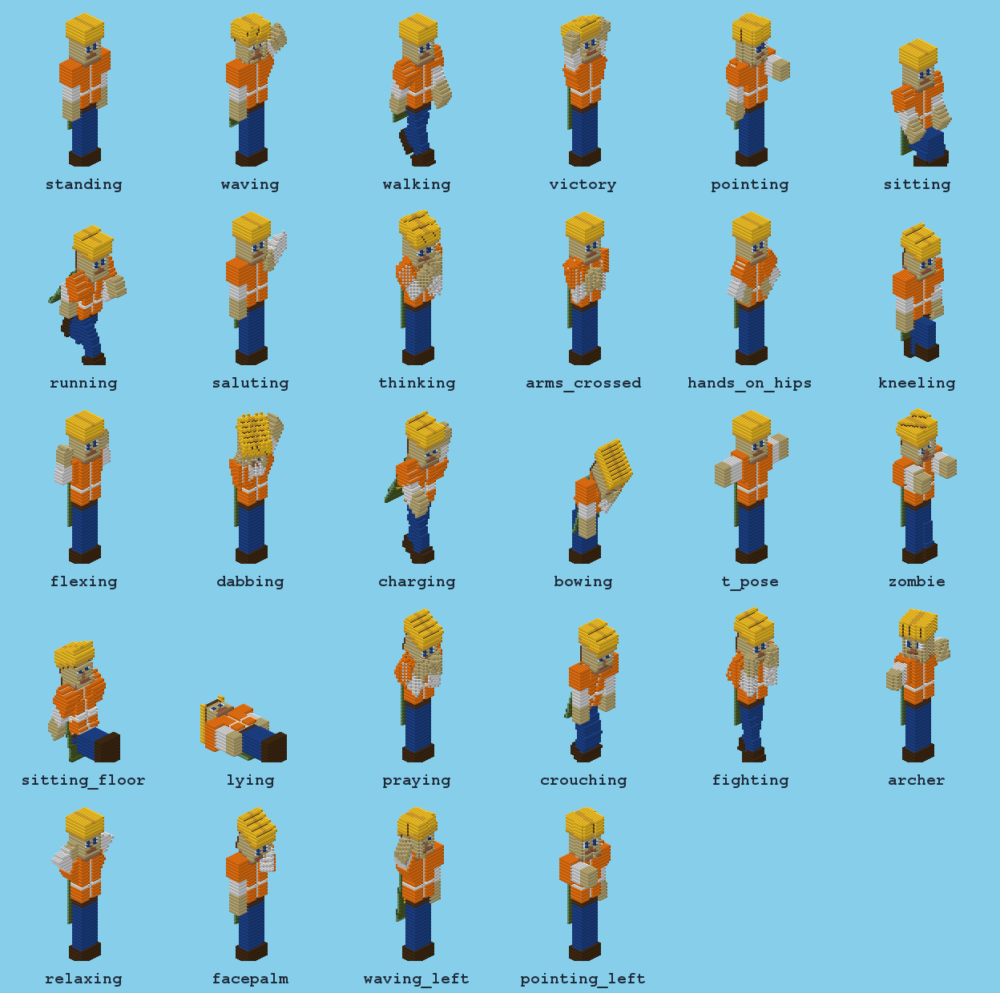

# SkinStatues

Block statues of any player's skin: type a name and a height, and the player's figure is built in the world out of
blocks, in the pose you choose, with the second skin layer in relief and the cape on its back.
Specs: [021](../../docs/sdd/specs/021-skinstatues-nucleo/spec.md) (core),
[022](../../docs/sdd/specs/022-skinstatues-poses-y-coordenadas/spec.md) (more poses, your own poses, coordinates),
[023](../../docs/sdd/specs/023-skinstatues-skin-por-link/spec.md) (skins from a link).

```
/statue build Example 32 waving
/statue build Example 48 t_pose --at 100 64 -20 --facing north
/statue build https://i.imgur.com/abc123.png 32 victory
```



## What it does
- **Any height.** A player is 32 skin pixels tall: height 32 is one block per pixel, 64 is two, 16 averages four
  pixels into each block. From `min_height` to `max_height` (8 to 128 by default). The height is the figure standing,
  hat included; raised arms can reach a few blocks higher and a sitting statue is lower.
- **Where you stand, or where you say.** By default the feet go 2 blocks above you (`offset_up`), so you are never
  trapped inside, and the statue faces the direction you are looking (rounded to north, south, east or west). With
  `--at x y z` (`~` works) and `--facing` it goes exactly where you want, even from the console.
- **Hollow.** Only the skin surface is built, so a big statue costs a fraction of the blocks and looks the same.
- **Both skin layers, joined.** The hat, jacket, sleeves and pants stick out in relief right on top of the first
  layer, like the *3D Skin Layers* mod. On small statues, where there is no room for relief, the second layer paints
  over the first. Transparent pixels add nothing.
- **28 poses with elbows and knees.** Arms and legs bend in the middle without gaps; head, body and cape turn too.
  Built in: `standing`, `waving`, `walking`, `victory`, `pointing`, `sitting`, `running`, `saluting`, `thinking`,
  `arms_crossed`, `hands_on_hips`, `kneeling`, `flexing`, `dabbing`, `charging`, `bowing`, `t_pose`, `zombie`,
  `sitting_floor`, `lying`, `praying`, `crouching`, `fighting`, `archer`, `relaxing`, `facepalm`, `waving_left`,
  `pointing_left`.
- **Skins from a link**, like SkinsRestorer: paste the https link of a skin PNG instead of a name. Only a real skin
  file is accepted (a PNG of 64×64 or 64×32), only from public sites, and only if you turn it on.
- **Your own poses, the easy way.** Write them in `poses.yml` with angles in degrees; start from another pose with
  `extends` and change only what is different, or flip one left to right with `mirror`.
- **The cape** of the account (or your own PNG), with its outside facing out.
- **You choose the blocks.** Palettes are whitelists of block ids with wildcards and exclusions: only wool, only
  terracotta, everything… Colors are matched the way the eye sees them.
- **No lag.** The figure is computed off the main thread and blocks are placed in batches per tick, with a progress
  bar. Statues queue up one after another.
- **Undo without losing terrain.** Every block that was there (grass, water, stairs with their facing…) is saved
  before it is replaced; `undo` and `remove` put it back. Blocks someone changed after the statue was built are left
  alone, and blocks with contents (chests, signs, furnaces…) are never replaced.

## Commands and permissions
| Command | What it does | Permission (all `op` by default) |
|---|---|---|
| `/statue build <name> <height> [pose] [--at <x> <y> <z>] [--facing <dir>] [--world <w>] [--palette <p>] [--slim|--classic] [--no-overlay] [--no-cape]` | Build a statue | `skinstatues.build` |
| `/statue build <link> <height> [pose] …` | The same, with the skin from an https link (see [Skins from a link](#skins-from-a-link)) | `skinstatues.build` **and** `skinstatues.build.url` |
| `/statue undo` | Remove your last statue (from the console, the console's last one) | `skinstatues.build` |
| `/statue cancel [id]` | Stop a statue being built (what was placed can be removed) | `skinstatues.build` |
| `/statue remove <id>` | Remove a statue and restore what was there | `skinstatues.remove` (`skinstatues.remove.others` for other players' statues) |
| `/statue list [page]`, `/statue info <id>` | Statues, where they are and who built them | `skinstatues.build` |
| `/statue poses`, `/statue palettes` | What is loaded (poses: built in and yours) | `skinstatues.build` |
| `/statue reload`, `/statue validate`, `/statue selftest` | Reload the files, list config problems, build and remove a test statue | `skinstatues.admin` |

Players without a permission do not see those subcommands when they press Tab. `/statues` is an alias.

## Where the statue goes
| You write | The statue |
|---|---|
| nothing | Centered on you, feet 2 blocks above you (`offset_up`), facing where you look |
| `--at 100 64 -20` | Feet **in** block 100 64 -20 (the lowest layer of blocks is at y = 64, so use the y just above the ground), centered on x and z, without `offset_up` |
| `--at ~ ~ ~8` | Relative to you, like Minecraft commands: here, 8 blocks south of you, at your feet |
| `--facing north` | Faces north (`north`, `south`, `east`, `west`); without it, where you look |
| `--world world_nether` | In that world (with `--at`) |

From the **console** (or a script), `--at` with plain numbers is required and `--world` defaults to the main world:
`statue build Example 32 victory --at 0 70 0 --world world --facing south`. Building far from every player is fine:
the chunks the statue needs are loaded (or generated) in the background first and kept loaded until the last block is
placed, so the server does not freeze. Coordinates outside the world border are refused.

## Where skins come from
1. **A file:** `plugins/SkinStatues/skins/<name>.png` (64×64, or the old 64×32). Optionally `skins/<name>.yml`:
   ```yaml
   model: slim            # 3-pixel arms (default: classic)
   cape: my-cape.png      # a 64x32 cape in the same folder
   ```
   The plugin comes with `Example.png`, an original skin (a builder with a hard hat and a safety vest, and a green
   cape), so `/statue build Example 32` works right away.
2. **Mojang, by account name**, only if you turn it on in `config.yml` (`network.mojang: true`). The plugin then asks
   Mojang's servers (and nothing else) for the skin, the arm model and the official cape, and keeps them in `cache/`
   for `network.cache_hours`. If Mojang does not answer, the last downloaded copy is used.
3. **A link** to the skin's PNG (below).

`--slim` or `--classic` forces the arm width for any of them (3 or 4 pixels).

## Skins from a link
```
/statue build https://i.imgur.com/abc123.png 32
/statue build https://textures.minecraft.net/texture/1a2b3c… 48 waving --at 0 70 0
/statue build https://example.com/my-skin.png 32 --slim
```
The link goes where the account name goes; everything else (height, pose, `--at`, palettes, the console) works the
same. Statues from a link have no cape.

- **Off by default.** Turn it on with `network.urls: true` in `config.yml` and `/statue reload`. Using a link also
  needs the `skinstatues.build.url` permission (`op` by default), so you can give `skinstatues.build` without links.
- **Only a real skin.** The file must be a PNG of 64×64 (or the old 64×32), up to 1 MB. Its size is read from the
  file header before the image is decoded, and the download stops at 1 MB. A web page, a JPG, a 128×128 image or a
  site that does not answer in 8 seconds gives a clear message and nothing is built. Use the link to the **image
  itself** (on Imgur, the `i.imgur.com/….png` one; on NameMC, the skin's download link), not to the page that shows it.
- **Arm model detected.** A 64×64 skin whose wide-arm-only columns are transparent is built with slim (3-pixel)
  arms; otherwise classic. `--slim` / `--classic` override it.
- **Only public sites.** Links must be `https` (an `http://` link is tried over `https`) on the standard port,
  without a user or password. The plugin never asks your own machine or network: `localhost`, private and LAN
  addresses (10.x, 172.16–31.x, 192.168.x, IPv6 local ones), link-local, CGNAT and reserved addresses are refused,
  whether written as an IP or as a name that points to one, and redirects (up to 3) are checked the same way.
- **Restrict the sites** with `network.allowed_hosts`, e.g. `["i.imgur.com", "textures.minecraft.net"]`;
  `"*.imgur.com"` allows every `….imgur.com`. Empty (the default) allows any public site.
- **Cached** in `cache/links/` for `network.cache_hours`; if the site stops answering, the last copy is used.
- **The link is not stored.** `/statue list` and `/statue info` show `url:<site>#<fingerprint>` (e.g.
  `url:i.imgur.com#3f9a1c2e`, the first 8 characters of the link's SHA-256), and neither `data/statues.yml`, the
  cache file names nor the plugin's log lines contain the full link. (Paper itself logs every command a player
  types, links included, as it does for any plugin.)

## Configuration
Five files in `plugins/SkinStatues/`, all checked when they load: a mistake names the file, the path inside it and
what is wrong, with a "did you mean…?"; the rest keeps working. `/statue reload` applies changes.

### config.yml
```yaml
min_height: 8
max_height: 128
max_blocks: 400000         # largest statue allowed
offset_up: 2               # feet this many blocks above the player
default_pose: standing
default_palette: all
overlay:
  enabled: true
  depth: 0.5               # skin pixels the second layer sticks out (at least one block)
  alpha_threshold: 128
cape: true
build:
  blocks_per_tick: 4000
  max_ms_per_tick: 10
network:
  mojang: false            # skins by account name from Mojang
  urls: false              # skins from a link (needs skinstatues.build.url)
  allowed_hosts: []        # sites allowed for links; empty = any public site
  cache_hours: 24
```

### poses.yml — your own poses
The 28 built-in poses live inside the plugin, so they update with it. `builtin-poses.yml` (next to `poses.yml`) is a
copy for reading their numbers: it is rewritten on every start, so copy a pose from it into `poses.yml` to change it.
A pose in `poses.yml` with a new name is added; one with the name of a built-in pose replaces it.

```yaml
waving:                     # how the built-in "waving" is written
  head: { pitch: -5, yaw: 10 }
  right_arm: { roll: 135, elbow: 40 }
  cape: { pitch: 8 }

my_wave:                    # yours: "waving" with the elbow bent more
  extends: waving
  right_arm: { elbow: 90 }  # only what changes, angle by angle: roll 135 is kept

my_point_left:              # "pointing" with the left hand
  extends: pointing
  mirror: true              # flip left <-> right first...
  head: { pitch: 10 }       # ...then apply what is written here
```
Parts: `head`, `body`, `right_arm`, `left_arm`, `right_leg`, `left_leg`, `cape` ("right" is the statue's own right).
Angles in degrees, from -180 to 180; leave out what does not move.

| Angle | Arms and legs | Head | Body | Cape |
|---|---|---|---|---|
| `pitch` | + forward / up, − backward | + looks down | + leans forward | + lifts it back |
| `yaw` | + turns toward the statue's left | + looks to its left | + turns to its left | + turns to its left |
| `roll` | + opens outward (to the side) | + tilts to its left | + tilts to its left | + tilts to its left |
| `elbow` | arms only, 0 to 150: bends the forearm forward | | | |
| `knee` | legs only, 0 to 150: bends the lower leg backward | | | |

Handy values: an arm straight forward is `{ pitch: 90 }`, straight up `{ roll: 180 }`, out to the side `{ roll: 90 }`;
a hand on the shoulder is `{ elbow: 150 }`; a sitting leg is `{ pitch: 90, knee: 90 }`. The body carries the head, the
arms and the cape with it; the legs stay where they are. Angles are applied pitch first, then yaw, then roll, so a
`yaw` on an arm hanging down only turns the direction its elbow bends: `right_arm: { yaw: 60, elbow: 100 }` brings the
hand across the belly (that is how `arms_crossed` and `hands_on_hips` are made).

`extends` can name a built-in pose or one of yours, written before or after it, up to 8 levels deep. Mistakes (a pose
that does not exist, a circle of `extends`, `mirror` without `extends`, a wrong angle…) are reported with the file, the
path and a "did you mean…?", and only that pose is skipped. `/statue poses` lists the built-in ones and yours (a
built-in one you replaced shows a `*`). To try a pose quickly: edit, `/statue reload`,
`/statue build Example 16 <pose> --at ~ ~ ~6`, look, `/statue undo`.

### palettes.yml
```yaml
wool: ["*_wool"]
wool_and_terracotta: ["*_wool", "*_terracotta", "-pink_wool"]
```
Each palette is a whitelist of block ids (`white_wool` or `minecraft:white_wool`), wildcards (`*_wool`) and
exclusions (`-pink_wool`), applied in order. Built in: `all` (the default), `wool`, `concrete`, `terracotta`.

### block-colors.yml
The color of each of the 145 blocks the palettes can use (wool, concrete, terracotta, planks, stones, ores, waxed
copper…), measured as the average of each block's side texture. Edit a color to change when a block is picked, or
remove a line to never use that block. Only solid, opaque blocks that do not fall are accepted.

### messages.yml
Every message, in English, with MiniMessage. Translate freely.

## Compatibility
| Server | Status | Evidence |
|---|---|---|
| Paper 1.21.4 (build 232, Java 24) | **Verified** (0.3.0) | Gate 2 and in-game suite 18/18 twice (2026-11-01) |
| Paper 26.1.2 (build 74, Java 25) | **Verified** (0.3.0) | In-game suite 18/18 twice (2026-11-01) |
| Other Paper 1.21.x and 26.x | Not verified | |
| Spigot, Folia | Not supported | |

- **Java:** 21 or newer (26.x needs Java 25).
- **Optional:** nothing. Network access only if you turn on `network.mojang` or `network.urls`.
- **Not yet:** armor and items in the hands, filled statues, diagonal facing (ideas in the [roadmap](../../docs/sdd/roadmap.md)).

## Installation
1. Copy `SkinStatues-x.y.z.jar` to `plugins/` and start the server.
2. Try `/statue build Example 32` (as an operator), and `/statue poses` to see every pose.
3. For your players' skins, put their PNGs in `plugins/SkinStatues/skins/`, set `network.mojang: true`, or set
   `network.urls: true` and use skin links.
