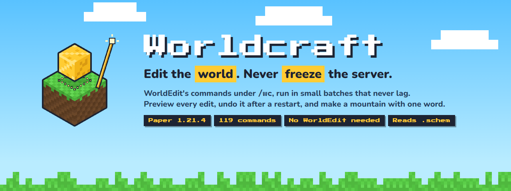

# Worldcraft

World editing for Paper that never lags the server: select with a wand and see the box, preview an edit before it
happens, undo even after a restart (without erasing what others built since), and write patterns and masks the way
you would say them. And terrain that is easy to make: a mountain or a floating island with one word, a terrain brush,
and full control for experienced builders. Specs: [025](../../docs/sdd/specs/025-worldcraft-nucleo/spec.md) (core),
[026](../../docs/sdd/specs/026-worldcraft-terreno-facil/spec.md) (terrain), [027](../../docs/sdd/specs/027-worldcraft-esquemas-schem/spec.md) (`.schem` schematics),
[028](../../docs/sdd/specs/028-worldcraft-paridad-worldedit/spec.md) (the WorldEdit commands builders use most),
[031](../../docs/sdd/specs/031-worldcraft-entidades/spec.md) (entities), [032](../../docs/sdd/specs/032-worldcraft-pinceles-y-herramientas/spec.md) (building brushes and one-click tools),
[033](../../docs/sdd/specs/033-worldcraft-biomas-arboles-estructuras/spec.md) (biomes, trees and the game's structures),
[034](../../docs/sdd/specs/034-worldcraft-formulas/spec.md) (formulas), [035](../../docs/sdd/specs/035-worldcraft-creacion-fawe/spec.md) (FAWE's caves, ores, pictures and color patterns),
[036](../../docs/sdd/specs/036-worldcraft-regen-snapshots/spec.md) (`regen` and restoring from backups), [037](../../docs/sdd/specs/037-worldcraft-api/spec.md) (an API for other plugins),
[038](../../docs/sdd/specs/038-worldcraft-publicacion/spec.md) (the public page).



**102 commands** under `/wc`. Counted from the WorldEdit 7.3.19 and FAWE 2.16.2 jars, Worldcraft has **129 of
WorldEdit's 171 commands** and **142 of FAWE's 244**, the same or better: every command, one by one, in
[commands.md](../../docs/worldcraft/presentacion/commands.md). Download it from
[SpigotMC](https://www.spigotmc.org/resources/worldcraft.140223/) or [Hangar](https://hangar.papermc.io/leonardos4enz/Worldcraft)
([Modrinth](https://modrinth.com/plugin/worldcraft-editor) is coming soon); the page sources are in
[docs/worldcraft/presentacion](../../docs/worldcraft/presentacion/).

```
/wc wand                                        left click = corner 1, right click = corner 2
/wc set 70% stone, 30% andesite --preview      see it first (only you), then /wc confirm
/wc replace dirt, grass_block with $castle_wall
/wc undo                                        works after a restart; leaves alone what others changed since
/wc mountain                                    a mountain where you look: [Build] [Another] [Cancel]
/wc island                                      a floating island in front of you
/wc brush smooth                                a terrain brush: right click to use it, left click for the next mode
/wc schem load castles/tower                     a WorldEdit .schem into your clipboard: then /wc paste --preview
/wc sphere glass 8 --preview                    shapes, stack, move, smooth, drain, ascend... with WorldEdit's names
/wc copy --entities                             the armor stands, item frames, paintings and mobs come too
/wc butcher 30                                  remove the hostile mobs around you (pets and villagers are safe; undo works)
/wc brush sphere stone 4                        the item in your hand becomes a sphere brush: right click where you look
/wc tool repl oak_planks                        one-click tools: replace, floodfill, info, cycler, deltree, farwand, navwand...
/wc setbiome cherry_grove                       change the biome of your selection (undo works; players see it at once)
/wc forest birch 10 --preview                   the game's own trees on the grass of your selection, previewed first
/wc structure load igloo/top                    a structure of the game into your clipboard: then /wc paste --preview
/wc generate stone x^2+y^2+z^2<1                a shape from a formula, written like in WorldEdit (it never lags the server)
/wc deform y-=0.2                               bend what you built with a formula
/wc caves --rooms                               tunnels and rooms through the rock of your selection (FAWE's //caves)
/wc ores                                        the game's ores in your selection, deepslate ones in the deepslate
/wc image logo.png 64                           a picture built with blocks, standing in front of you (or on the ground)
/wc replace red_wool with #darken               color patterns: #color[red], #darken, #lighten, #saturate[#ff0000]...
/wc regen                                       your selection back the way the world generator made it
/wc restore --preview                           your selection back the way it was in the newest backup
```

## Terrain: easy for beginners, precise for experts
With WorldEdit the hard part is not the command but *how to make it look good*: mountains need math in `//generate`,
`//smooth` melts trees and houses, and nothing makes a floating island. Worldcraft does the shaping for you.

**One word, a good result.** Every terrain edit is shown first, only to you, with buttons in the chat:
`[Build]` (`/wc confirm`), `[Another]` (`/wc reroll`, a new seed without aiming again) and `[Cancel]`.
- `/wc mountain [small|medium|large|huge|<radius>] [style]` puts a mountain **where you look** (or under your feet):
  ridged peaks, an irregular outline, a foot that blends into the ground already there. The default style `alpine` puts
  snow on top, rock on steep slopes and grass on the flat parts. It **only adds**: it fills air, plants and water,
  can bury trees, and leaves any build alone (its column is not touched).
- `/wc island [size] [style]` (or `/wc floating_island`) puts a floating island **in front of you**, above your head
  (at your feet if you are flying): an almost flat top, an irregular edge, a rough cone underneath with stalactites,
  hanging roots at the thin edge and small trees with leaves that do not decay. It only goes into the air.
- `/wc brush [raise|lower|smooth|flatten|erode|paint] [radius] [strength]` gives you the **terrain brush** (a golden
  shovel; only that brush works). Right click = one stroke where you look (up to 200 blocks away); left click = the next
  mode; while you hold it, a ring of particles shows where and how big it will be (only for you). Every mode works on the
  **natural ground** (`terrain.ground`): trees, plants and builds are left alone, so smoothing does not melt anything.
  Raising and lowering keep the grass on top and the dirt below; plants on lowered ground are cleared. `erode` collapses
  steps of more than one block downhill; `paint` repaints the surface by slope and height (`style=…`) or with a pattern
  (`/wc brush paint 70% grass_block, 30% podzol`). Each stroke is an edit: limits, history, `undo`.
- Sizes: `medium` (the default) fits the default group's limit of 50 000 blocks; `huge` needs a bigger group.

**Every knob, all optional (experts).** Options go as `key=value` in any order, with tab completion and "did you mean":
```
/wc mountain radius=70 height=90 peaks=3 roughness=0.7 ridges=0.8 sharpness=1.4 crater=0 seed=42 style=alpine
/wc island radius=24 depth=1.2 relief=0.1 spikes=1 roots=0.5 trees=6 seed=7 style=snowy
/wc mountain at=100,64,-20 world=world_nether style=volcano --now     (from the console too; --now skips the preview)
/wc brush paint style=desert mask=grass_block,dirt                    only where the surface is grass or dirt
```
Every message says the seed: the same seed and options give exactly the same result.

**Styles** live in `plugins/Worldcraft/terrain.yml`: layers of material from the surface inwards, each with rules by
relative height (0 = foot, 1 = top), slope in degrees and world height; every block is a Worldcraft pattern. Seven come
with the plugin (`alpine`, `hills`, `desert`, `volcano`, `snowy`, `meadow`, `end`; `/wc styles` lists them). Make your own:
```yaml
styles:
  my_peak:
    description: "Grey peaks with a snow cap"
    blend: 0.06                       # a ragged snow line instead of a straight one
    options: { peaks: 2, ridges: 0.8 } # generator options this style brings
    layers:
      - thickness: 1                  # the surface
        rules:
          - { block: snow_block, height_above: 0.8 }
          - { block: "70% stone, 30% andesite", slope_above: 50 }
          - { block: grass_block }
      - thickness: 3
        rules: [ { block: dirt } ]
      - rules: [ { block: stone } ]   # the rest
    hanging: hanging_roots            # islands: roots under the edge
    tree: { log: spruce_log, leaves: spruce_leaves }   # islands: small trees
```
`terrain.yml` also sets the sizes and the default value of every option. Mistakes are reported with the file, the path
and a suggestion (`styles.my_peak.layers[0].rules[1].slope_abve: unknown condition (did you mean 'slope_above'?)`); a
broken style is skipped and the rest keeps working.

**Safe like every other edit.** Mountains, islands and strokes run in batches inside the plugin's time budget, are
undoable after a restart, and follow the group limits and blocked blocks. Reading the ground also runs in batches,
and the noise is computed off the main thread. A request clearly too big for your group is refused before reading
anything.

## What it does (and what it does better)
- **No lag, ever.** Every edit runs in small batches inside a time budget shared by the whole plugin
  (`performance.max_ms_per_tick`, 8 ms of the 50 ms of a tick). The clock is checked on every block, so a tick never
  goes over by more than one block. Unloaded chunks load in the background. A huge edit and a small one from two
  players share the time in turns, so the small one is not stuck waiting. Progress shows in your action bar.
- **See before you change.** `--preview` shows the result with fake blocks that **only you see**; nothing changes
  until `/wc confirm` (and the edit then does exactly what you saw). Edits bigger than `confirm.above_blocks` (50 000)
  ask first, saying how many blocks and how long (`confirm.enabled: false` turns that off).
- **See your selection without a mod.** While you hold the wand, the selection is drawn with particles only you
  see, whatever its shape (box, polygon, sphere, cylinder, convex or magic). Only the wand that `/wc wand` gives
  selects: an ordinary golden axe stays an axe.
- **Undo that is not lost.** The history of every player is saved to disk: `undo` and `redo` work after a restart or a
  crash (a half-finished edit can be undone too). **Safe undo:** a block somebody changed after your edit is left
  alone, and you are told how many. Chest contents and sign text come back too. Moderators can see and undo other
  players' edits (`/wc history <player>`, `/wc undo --player <name>`).
- **Patterns and masks in plain words**, with errors that say what to fix (`Unknown block 'stnoe' (did you mean
  'stone'?)`), checked before anything changes. Tab completes blocks, tags and presets, even in the middle of a list.
- **Safe limits out of the box.** Per permission group: biggest edit, edits at once, worlds and blocked blocks
  (nobody places bedrock, barriers, command blocks or portals by default except `admin`). Over the limit, the edit is
  refused before it starts.
- **Copy, cut, paste, rotate and flip**, relative to where you stand. Stairs, logs and doors turn with the copy;
  copied air is not pasted (it does not erase what is around) unless `--air`.

## Selecting
| Command | What it does |
|---|---|
| `/wc wand` | The wand: left click a block = corner 1, right click = corner 2. Nothing breaks |
| `/wc pos1 [x y z]`, `/wc pos2 [x y z]` | A corner where you stand, or at coordinates (`~` works; `--world <w>` from the console) |
| `/wc sel` | Size, blocks, world and corners. `sel clear`, `sel hide`, `sel show` |
| `/wc expand <n> [direction]` | Grow towards where you look, or `up`, `down`, `north`, `south`, `east`, `west` (or `u`, `d`, `n`…). `expand vert` = whole world height |
| `/wc contract <n> [direction]`, `/wc shift <n> [direction]` | Shrink from that side; move without changing the size |
| `/wc hpos1`, `/wc hpos2` | A corner at the block you look at, however far (up to `terrain.reach`) |
| `/wc outset <n>`, `/wc inset <n>` | Grow or shrink to every side; `--horizontal` or `--vertical` for only those |
| `/wc chunk [--expand]` | The whole chunk you stand in, bottom to top (`--chunk-coords <x> <z>` another one; `--expand` adds it) |
| `/wc trim [mask]` | Shrink the selection to what matches (everything but air without a mask) |
| `/wc count <mask>`, `/wc distr [--states] [--clipboard]` | How many blocks match; the 10 most common blocks with their share (by state, or of your clipboard) |

### Selections that are not boxes
`/wc sel <shape>` chooses the shape (WorldEdit's names; it clears the points you had). Then the wand (or `/wc pos1`
for a left click and `/wc pos2` for a right click, also `hpos1`/`hpos2`) marks it, like in WorldEdit:

| Shape | Left click | Right click |
|---|---|---|
| `cuboid` (or `box`, the default) | Corner 1 | Corner 2 |
| `extend` | Start: a one-block box | Grow the box to include that block |
| `poly` | First point (starts over) | Another point. As tall as your lowest to highest point |
| `ellipsoid` | Center | Stretch each radius to reach that block |
| `sphere` | Center | The radius is the distance to that block |
| `cyl` | Center | Widen it to that block and make it tall enough to include it |
| `convex` (or `hull`) | First point (starts over) | Another point: the shape wraps around all of them (1 point is a block, 2 a line, points on a plane a flat sheet) |
| `magic` (or `fuzzy`) | Selects the connected blocks of the same kind (up to `selection.magic_radius`, 16) | Adds the connected blocks of another one |

- `/wc sel` tells the shape, its points and **how many blocks it really has** (not the box around it). The outline
  follows the shape: a polygon, three circles, two circles and four lines, the convex edges, or the border of a magic
  selection.
- **Everything works on any shape:** `set`, `replace`, `count`, `distr`, `copy`, `cut`, `stack`, `move`, `hollow`,
  `overlay`, `naturalize`, `smooth` and `gmask` only touch what is inside. `walls` is the side shell (a cylinder's walls
  are a tube) and `faces` the whole shell (with floor and roof); on a box both are what they always were. A copied
  sphere pastes as a sphere: the corners of its box are left alone, even with `--air`.
- `shift` moves any shape; `expand`/`contract` up or down and `expand vert` change the height of `poly` and `cyl`;
  `outset`/`inset` change the radius of `sphere`, `ellipsoid` and `cyl` (and the height of `poly` with `--vertical`).
  `trim`, `chunk` and `paste --select` leave a box. `line` needs two corners (`cuboid` or `extend`); `center` is the
  middle of the box around the shape.
- `selection.max_points` (64) limits the points of `poly` and `convex`.

## Editing
| Command | What it does |
|---|---|
| `/wc set <pattern>` | Fill the selection |
| `/wc replace <mask> with <pattern>` | Change only what matches (without `with`, the first word is the mask) |
| `/wc walls <pattern>` | The four side walls |
| `/wc faces <pattern>` | Walls, floor and roof: a hollow box |
| `/wc copy [--entities] [--mask <mask>]`, `/wc cut [--entities] [--mask <mask>]` | Copy (or copy and leave air), relative to where you stand. `--entities`: the entities inside too (see [Entities](#entities)). With a mask, only what matches is copied (and cut) |
| `/wc paste [--air] [--origin] [--select] [--only-select] [--no-entities] [--remove-entities]` | Paste relative to where you stand; copied air only with `--air`. `--origin`: where it was copied; `--select`: select what you pasted; `--only-select`: only select where it would go. Copied entities come too unless `--no-entities`; `--remove-entities` first removes the entities already there |
| `/wc clearclipboard`, `/wc clearhistory` | Empty your clipboard; delete your undo history from the disk (asks `/wc confirm`) |
| `/wc gmask <mask>`, `/wc gmask off` | A global mask: until `off` (or until you leave) every edit only changes what matches, and says so |
| `/wc rotate <90\|180\|270\|-90>`, `/wc flip [direction]` | Turn or mirror the clipboard (block states too) |
| `--preview` | On `set`, `replace`, `walls`, `faces`, `cut` and `paste`: show it to you first |
| `/wc confirm`, `/wc cancel` | Run the waiting edit; drop it (or stop your running edits: what was done can be undone) |
| `/wc undo [n]`, `/wc redo [n]`, `/wc history` | Undo and redo, also after a restart; your last edits |
| `/wc jobs` | Running edits, plugin time per tick and the longest tick of the last edit |
| `/wc limits` | Your limits |
| `/wc help [command]` | Every command you can use; with a command, an example |

## Shapes, region tools, fixes around you and moving around
The commands builders use every day in WorldEdit, with the same names (without the slashes) and everything Worldcraft
adds: `--preview`, the group limits, undo after a restart, no lag.

| Command | What it does |
|---|---|
| `/wc sphere <pattern> <radius>[,y,z] [--raised]`, `/wc hsphere …` | A sphere or ellipsoid centered on your feet (`--raised`: sitting on the ground); `h…` = hollow |
| `/wc cyl <pattern> <radius>[,z] [height]`, `/wc hcyl …` | A cylinder from your feet up (negative height: down); the hollow one is only the round wall, like WorldEdit's |
| `/wc pyramid <pattern> <size>`, `/wc hpyramid …`, `/wc cone <pattern> <radius> <height>` | A pyramid or a cone on your feet |
| `--thickness <n>` | How thick a hollow shape is (1 by default) |
| `/wc stack [copies] [direction] [--air] [--select] [--entities]` | Repeat the selection where you look; copied air is skipped unless `--air`; chests keep their items; `--entities` repeats the entities too |
| `/wc move [blocks] [direction] [pattern] [--select] [--entities]` | Move the selection's contents (far moves only touch the two places); what is left behind becomes air or the pattern; `--entities` moves the entities with it (the same ones, with everything they carry) |
| `/wc overlay <pattern>` | A layer on top of the ground (never on a tree trunk; flowers are covered) |
| `/wc naturalize` | Grass, 3 dirt, then stone, only on grass, dirt and stone |
| `/wc smooth [passes]` | Smooth the natural ground of the selection; trees and builds are left alone (WorldEdit's melts them) |
| `/wc hollow [thickness] [pattern]`, `/wc center <pattern>`, `/wc line <pattern> [thickness]` | Empty closed things keeping a shell; the middle block(s); a line from corner 1 to corner 2 |
| `/wc drain <radius> [--waterlogged]` | Remove the water or lava nearest to you and what is connected (`--waterlogged` dries stairs and slabs too) |
| `/wc fixwater <radius>`, `/wc fixlava <radius>` | Make the connected flowing water or lava still |
| `/wc fill <pattern> <radius> [depth]` | Fill the hole you stand in, never above your feet |
| `/wc removenear <mask> [radius]`, `/wc replacenear <radius> <mask> with <pattern>` | Remove or replace around you, without selecting |
| `/wc removeabove [size] [height]`, `/wc removebelow …`, `/wc extinguish [radius]` | Clear above or below you; put out fire |
| `/wc snow [radius]`, `/wc thaw [radius]`, `/wc green [radius]` | Snow on the ground (water freezes), melt it, dirt to grass; the top of every column is found even if you fly |
| `/wc ascend`, `/wc descend [floors]`, `/wc ceil`, `/wc thru`, `/wc jumpto`, `/wc unstuck`, `/wc up <blocks>` | Move around while building (permission `worldcraft.navigate`). `up` and `ceil`: if you can fly you fly; if not, a glass block goes under your feet as a normal edit, so `/wc undo` removes it |

From the console, shapes and the commands around you take `--at x,y,z [--world <w>]`. The biggest radius is
`shapes.max_radius` (200) and `utilities.max_radius` (64); your group's block limit always applies too.

## Entities
Armor stands, item frames, paintings, mobs, boats, minecarts and dropped items travel with your builds when you ask, and
every change to them can be undone, also after a restart.
```
/wc copy --entities              the entities whose block is inside the selection (any shape), with everything they carry
/wc paste                        they come with the blocks (rotated and flipped like them); --no-entities leaves them out
/wc paste --remove-entities      first remove the entities already where you paste (FAWE's -x)
/wc cut --entities               take them away too (nothing is dropped)
/wc move 10 east --entities      the same entities move with the blocks
/wc stack 3 up --entities        every copy gets its own
/wc butcher [radius]             the hostile mobs around you; --pets --npcs --golems --animals --ambient --water --named --armorstands --friendly add others
/wc remove <type> [radius]       items, arrows, projectiles, xp, boats, minecarts, tnt, falling, paintings, itemframes, armorstands, or a type like cow
```
- **Like WorldEdit:** `copy` and `cut` take no entities without `--entities` (WorldEdit's `-e`). You decide once, when you
  copy: `paste` then puts what the clipboard has (WorldEdit asks for `-e` again).
- **Whole entities:** an item frame keeps its item and hangs on the turned wall when you rotate; an armor stand keeps its
  armor, pose and name; a mob keeps its health, name and what rides it (a rider travels with its mount, never twice).
  Players are never copied, moved or removed.
- **`butcher` is careful by default:** only hostile mobs (zombies, skeletons, slimes…). Pets, villagers, wandering traders
  and Citizens NPCs, iron and snow golems, animals, bats, fish, anything with a name and armor stands are spared unless
  you add their option; `--friendly` adds all the friendly ones (not fish nor armor stands). Nothing is dropped, and
  `/wc undo` brings them back.
- **Undo:** entities an edit added are removed and the ones it removed come back (with everything they had); one that is
  gone already (killed, moved to another world) is skipped and counted.
- **Limits:** each group has `max_entities` (default 200, builder 2 000, admin 20 000) and `blocked_entities`: by default a
  player may not create command block minecarts, spawner minecarts, TNT and TNT minecarts, falling blocks, withers or
  the ender dragon, also when they ride something inside a schematic. A paste over the limit is refused before
  anything changes; `butcher` and `remove` stop at the limit and say so.
- **No lag:** entities are copied, created and removed in the same 8 ms per tick as the blocks; what is removed goes
  before the blocks change (an item frame never drops off its wall) and what is created goes after.
- The preview shows blocks only (it says how many entities will be added or removed).

## Building brushes and one-click tools
`/wc brush` and `/wc tool` turn **the item in your hand** into a brush or a tool: only that item (another one of the same
kind stays normal), and with an empty hand you get one (a blaze rod; a compass for `navwand`). The item says what it does;
`/wc brush none` (or `/wc tool none`) makes it a normal item again, as it was. A brush works with a **right click where
you look** (up to 200 blocks; a click in the air is fine) and shows a circle of particles there, only for you.
```
/wc brush sphere <blocks> [radius] [--hollow]                a sphere where you look (radius 2 by default, like WorldEdit)
/wc brush cyl <blocks> [radius] [height] [--hollow]          a cylinder that goes up from the block you look at
/wc brush set <cube|sphere|cyl> [radius] <blocks>            the shape you choose
/wc brush clipboard [--air] [--origin]                       your clipboard, centered where you look (--origin: where you stood when copying)
/wc brush splatter <blocks> [radius] [decay]                 change the surface, thinner toward the edge (decay 1 to 10)
/wc brush scatter <blocks> [radius] [points] [distance] [--overlay]   a few blocks at random on the surface (--overlay: on top)
/wc brush rock <blocks> [radius] [sphericity] [frequency] [amplitude] a rock with an uneven edge (also: blob)
/wc brush gravity [radius] [--height]                        floating blocks fall (--height: from the top of the world)
/wc brush extinguish [radius]                                put out the fire around where you look
/wc brush butcher [radius] [--animals ...]                   /wc butcher where you look (needs worldcraft.butcher)
/wc brush radius=6       /wc brush mask=air                  change only that on the brush in your hand
/wc tool repl <blocks>                                       right click places, left click picks the block you look at (with its state)
/wc tool floodfill <blocks> [range]                          the block you look at and the same blocks connected to it
/wc tool info                                                position, full state, biome and light of the block you look at
/wc tool cycler                                              right click: next value of a property (sneak: previous); left click: next property
/wc tool deltree                                             remove a floating tree (logs and leaves that touch nothing but air and plants)
/wc tool farwand                                             left and right click mark the corners from far away
/wc tool lrbuild <left> <right>                              each click places its blocks against the face you look at; air removes
/wc tool navwand                                             left click: jump to where you look; right click: through the wall
/wc superpickaxe single|area <radius>|recursive <radius>|off  break blocks instantly with any pickaxe (/wc sp alone turns it on or off)
```
- **Every click is an edit:** your group's limits, your `gmask`, the history and `/wc undo` (one click, one undo). Limits
  and permissions are checked on every click, for whoever clicks: a brush item that ends up with another player gives them
  nothing their group does not allow.
- **`mask=`** keeps a brush to some blocks (`/wc brush sphere moss_block 5 mask=stone`); `radius=` changes the size.
- **No lag:** what looks at the world first (splatter, scatter, gravity, floodfill, deltree, the area and recursive super
  pickaxe) reads it in the same 8 ms per tick and calculates off the main thread. Clicks while one is running are ignored.
- **The super pickaxe drops nothing**, so `/wc undo` never duplicates items. It never breaks bedrock, barriers, portals or
  command blocks (`tools.never_break`), needs `worldcraft.superpickaxe` and turns off when you log out.
- `gravity` moves every block except those with data (chests, signs): they stay, and the rest settles on top of them.
- `deltree` leaves a planted tree alone, and one that goes further than `tools.deltree_range` blocks too.

## Biomes, trees and the game's structures
```
/wc biomelist [page] [filter]                    the server's biomes (data pack biomes too)
/wc biomeinfo [--target | --here]                the biomes in your selection with their %; the one you look at; the one where you stand
/wc setbiome <biome> [--here]                    change the biome of your selection (any shape); --here: where you stand
/wc replace $desert and grass_block with sand    $<biome> is a mask, like in WorldEdit: combine it, negate it (!$plains)
/wc copy --biomes    /wc paste --biomes          the biomes come with the blocks only when you ask (like WorldEdit's -b)
/wc forest [tree] [density] [--preview]          the game's trees on the grass and dirt of your selection (oak, 5 % by default)
/wc forestgen [size] [tree] [density]            a forest around you
/wc flora [density]                              grass and flowers on grass, dead bushes and some cactus on sand
/wc pumpkins [size] [density]                    pumpkin patches with their leaves around you
/wc tool tree [tree]                             right click grows a tree on the block you look at
/wc brush forest [tree] [radius] [density]       right click: a forest in the circle where you look
/wc structure list [filter] [page]               the game's structure templates: igloo/top, village/plains/houses/..., shipwreck/...
/wc structure load <name> [--palette <n>]        one of them into your clipboard: rotate, flip, /wc paste --preview, undo
```
- **Biomes:** the game keeps one biome per **4×4×4 cell**, so `setbiome` changes every cell your selection touches (like
  WorldEdit) and says how many. It is an edit like any other: your group's limits, confirmation above `confirm.above_blocks`,
  8 ms per tick, the history, `/wc undo` and `/wc redo` (a cell someone changed afterwards is left alone and counted).
  Players see the new biome right away (the chunks are sent again). With a `gmask`, a cell changes if its middle block
  matches. A mask preset with a biome's name wins over the biome (`/wc validate` warns).
- **Biomes in schematics:** `/wc schem save` writes the clipboard's biomes (Sponge v3); `/wc schem load` reads them from
  v2 and v3 files and says so; `/wc paste --biomes` puts them. WorldEdit 7.3.19 pastes Worldcraft's with `//paste -b`.
  Biomes this server does not have are left out and listed.
- **Trees are the game's own** (the same that grow from a sapling): Worldcraft asks the game for each tree without placing
  it, then places all of it as one edit, so `--preview`, your limits (blocked blocks included), `gmask` and `/wc undo`
  work. Trees: `oak`, `big_oak`, `birch`, `tall_birch`, `spruce`, `tall_spruce`, `mega_spruce`, `mega_pine`, `jungle`,
  `small_jungle`, `jungle_bush`, `cocoa`, `swamp`, `acacia`, `dark_oak`, `cherry`, `azalea`, `mangrove`, `tall_mangrove`,
  `pale_oak`, `pale_oak_creaking`, `red_mushroom`, `brown_mushroom`, `crimson_fungus`, `warped_fungus`, `chorus` and
  `random` (WorldEdit's names work too: `redwood`, `bigtree`...). The density is a % per column (0 to 100); `pumpkins`
  also takes WorldEdit's 0.02. At most `nature.max_trees` trees in one edit; a tree that does not fit is skipped and counted.
- **Structures:** the list comes from the server jar and the worlds' data packs. A loaded template is a clipboard like a
  `.schem`: its empty spots (`structure_void`) do not overwrite what is there, its jigsaw blocks and data markers become
  air, and its chests keep their loot table (they fill when opened). Its entities (the igloo's villager) are not loaded.
- Not here: the game's *features* (`//feature`: a desert well, a geode) and whole jigsaw structures (a full village): Paper
  has no API for them, only the game's `/place` command.

## Formulas
```
/wc generate stone x^2+y^2+z^2<1                 a sphere that fills your selection (x, y, z go from -1 to 1 in it)
/wc generate --hollow glass x^2+y^2+z^2<1        only its shell (-h works too)
/wc generate stone (0.75-sqrt(x^2+z^2))^2+y^2<0.25^2     a torus
/wc generate --raw sandstone y < 70 + 4*sin(x/6) + 4*cos(z/6)   waves, with the world's coordinates (-r)
/wc deform y-=0.2                                every block takes the one a bit below: the build rises
/wc deform x*=2                                  stretch it
/wc generatebiome desert x<0                     half of your selection becomes desert (by 4×4×4 cells)
/wc replace =y<64 with stone                     a formula as a mask: x, y, z of the world
/wc gmask =x<100                                 ...or as your global mask
/wc set =(x+z)%2 -> white_wool, black_wool       a formula as a pattern: its number picks the block (0 the first)
/wc calc 2^10 + sqrt(16)                         a calculator (calculate, eval)
/wc timeout 5000                                 how long your formulas may work, in ms (default: the server's)
/wc brush deform 6 y-=0.2                        a deform brush: right click where you look (-r, -o like WorldEdit)
```
- **Written like WorldEdit:** a formula copied from a WorldEdit tutorial works. Numbers, `+ - * / %`, `^` (power), `< <=
  > >= == != ~=`, `&& || !`, `? :`, `=`, `+=`…, `++`, `--`, `;` between statements, `{ }`, `if`/`else`, `while`, `do …
  while`, `for (i = 0; i < 5; i++)` and `for (i = 1, 10)`, `break`, `continue`, `return`; `pi`, `e`, `true`, `false`; and the
  functions `abs acos asin atan atan2 cbrt ceil cos cosh exp floor ln log log10 max min rint round sin sinh sqrt tan tanh`,
  `random()`, `randint(n)`, `perlin`, `ridgedmulti`, `voronoi`, `megabuf`, `rotate`, `swap`, and `mod(a, b)` (a remainder
  that is never negative). True is more than 0. Variables you set keep their value from one block to the next.
- **Coordinates:** `generate`, `deform` and `generatebiome` see x, y and z from -1 to 1 in your selection, 0 in the
  middle (like WorldEdit). `--raw` (`-r`): the world's coordinates; `--offset` (`-o`): from your feet; `--center` (`-c`):
  from the middle of the selection, not scaled. Masks and patterns always see the world's coordinates.
- **It never lags the server:** the formula is worked out away from the server thread, and what it changes is an edit
  like any other: your group's limits, `gmask`, `--preview`, confirmation, 8 ms per tick, the history and `/wc undo`. A
  loop stops after `formulas.max_steps` rounds and a command's formula after your `/wc timeout` (the server sets the
  default and the most). Masks and patterns with a formula are worked out block by block inside the 8 ms per tick.
- **deform** reads everything first (also what is outside the selection, like WorldEdit), so a block already moved is
  never moved again; chests keep their items. What it has to read counts for your group's limit.
- **Mistakes are told before anything changes,** with where and a guess: `Unknown function 'sinn' at 1 (did you mean
  'sin'?)`. With spaces in a mask, use `with`: `/wc replace =y < 64 with stone`. The pattern of `generate` is one word
  (use a preset for a mix with spaces).
- Not here: WorldEdit's `query()` (reading a block from the formula, with old block numbers; use a mask instead),
  `gmegabuf`, `closest()`, `switch`, and `//generate`'s `type` and `data` variables (the `=… ->` pattern does that). The
  noise functions are used the same way but give other numbers than WorldEdit's.

## Caves, ores, pictures and colors (from FAWE)
```
/wc caves                                        tunnels through the rock of your selection (FAWE's //caves)
/wc caves 5 70 --rooms                           wider (size 1-10), more of them (frequency 1-100), with big rooms
/wc ores                                         coal, iron, copper, gold, redstone, lapis, diamond and emerald, like the game
/wc ores stone, andesite                         only in that rock (FAWE's //ores; -d and -b are not needed)
/wc ore stone gold_ore 9 4 100 -64 32            veins of anything: mask, pattern, size, tries per chunk, rarity %, heights
/wc image list                                   the pictures in plugins/Worldcraft/images
/wc image logo.png 64                            a picture 64 blocks on its long side (alias img)
/wc image logo.png --floor                       lying on the ground ahead of you (looking down does it too)
/wc set #color[light_blue]                       the block of the color table closest to that color
/wc replace *_wool with #darken                  a darker block of the same hue (#lighten: lighter)
/wc replace stone with #saturate[#ff8800]        tint what is there (#averagecolor[...] mixes half and half)
/wc replace *_concrete with #desaturate[50]      take away half of its color
```
- **Caves** are like the game's since 1.18: long tunnels that cross each other (and rooms with `--rooms`), different every
  time. They only cut rock, dirt, gravel, sand and ores (`caves.mask`), never your builds, water or bedrock; at
  `caves.lava_y` and below what is cut fills with lava. Worked out away from the server thread (within your `/wc timeout`).
- **Ores** go where the mask is (`ores.mask` for `/wc ores`): in deepslate and tuff the deepslate version goes. The sizes,
  amounts and heights of `/wc ores` are the game's, in the `ores` list of `config.yml` (add or change ores there). An ore
  outside its heights is not placed: in a selection from y 0 up there is no diamond.
- **Pictures:** PNG, JPG or GIF, each pixel the block of the color table closest to it (as the eye sees colors);
  transparent pixels are left as they are. Looking down (more than 45°) the picture lies on the ground from your feet
  forward; otherwise it stands like a wall 2 blocks in front of you, centered on you and from your feet up. It is never
  mirrored or upside down for you. Without a size it keeps its own size (at most `images.max_size`); a bigger one is
  shrunk by averaging its pixels.
- **Pictures from a link** (`/wc image https://...`) are **off** until you set `images.links: true`, and need
  `worldcraft.image.link` (op by default). The server downloads the file itself: only from public internet sites (never
  your own network or the server; checked again on every redirect), only `https`, at most `images.max_file_kb`, and only
  from `images.allowed_hosts` if you list some. The history keeps the site and a fingerprint, not the link.
- **Colors:** the table has the 145 blocks SkinStatues measured in Minecraft 1.21.4 (wool, concrete, terracotta, glazed
  terracotta, wood, stone, ores' blocks...). Remove blocks or add and change colors in the `colors` section of
  `config.yml`. A block blocked for your group is never placed. `#darken`, `#lighten`, `#saturate`, `#desaturate` and
  `#averagecolor` change the block that is there and leave alone a block that is not in the table. Colors: `#RRGGBB` or a
  dye name (`white`, `light_gray`, `red`, `light_blue`...).
- Not here: FAWE's `#anglecolor` (darker on slopes), dithering, picture and height-map brushes.

## Back to the original terrain, or to a backup
```
/wc regen                                        the selection as the world generator made it (WorldEdit's //regen)
/wc regen --biomes                               the biomes too (-b)
/wc regen random                                 with another seed (-r); or write one: /wc regen 12345
/wc regen desert                                 everything made as desert (and the biomes written)
/wc snapshot list                                the backups of your world, newest first (alias snap)
/wc snapshot before 2026-11-02 14:30             choose the newest backup before that moment (after: the oldest after it)
/wc snapshot use 2026-11-02-12-00                choose one by name (sel 3: by its number in the list)
/wc restore --preview                            the selection back the way it was in the chosen backup (or the newest)
/wc restore nightly.zip --biomes                 from that backup, biomes too
```
- **regen** makes the terrain again in a **temporary world** with your world's seed and generator (also a generator of
  another plugin, or the flat one): Paper can't regenerate chunks in place. The chunks are made away from the server
  thread; then the blocks go in like any edit (preview, limits, undo, at most 8 ms per tick). Chests of structures come
  back with their loot table. Mobs are not touched. Only one regen runs at a time on the server, at most
  `regen.max_chunks` chunks. Making the temporary world pauses the server once for a moment (40-140 ms measured): it
  stays loaded `regen.keep_seconds` for the next regen and is then deleted. Its folder is called
  `worldcraft_regen_<n>` (tell map or world-manager plugins to ignore it); one left by a crash is deleted at the next
  start, and Worldcraft never deletes a folder it did not make.
- **Backups:** set `snapshots.folder` in `config.yml` to the folder where your backup tool (or your host) leaves them.
  Each backup is a folder or a `.zip` with the world folders inside, like `backups/2026-11-02-14-30/world/region/`
  (in a `.zip`, one extra folder is fine: `nightly.zip` with `server/world/region/`). The date comes from the name
  (`2026-11-02`, `2026-11-02-14-30`, `2026-11-02_14-30-00`...) or else from the file. Worldcraft only reads them.
- **restore** reads the chunks of your selection from the backup (away from the server thread) and puts back the
  blocks, chests and signs with what they had, and other block data; `--biomes` the biomes too. Backups from Minecraft
  1.18 and newer: blocks renamed since are translated; blocks this server does not have, chunks the backup does not
  have, chunks not fully made yet, damaged ones and LZ4-compressed ones are **left as they are** and you are told how
  many. A damaged or huge file never stops the server: nothing changes and you are told why.
- Not here: the mobs of a backup (FAWE's `-e`), making backups (use your backup tool), backups from before 1.18, LZ4.

## For plugin developers
Other plugins (minigames that reset an arena, island plugins, protection plugins) can ask Worldcraft for edits and
hear about every edit. Everything goes through the same engine as the commands: the limits, a few milliseconds per
tick, the undo history on disk. Only `dev.leo.worldcraft.api` and `dev.leo.worldcraft.api.event` are the contract
(`WorldcraftApi.API_VERSION`, now 1); the rest of the jar may change in any release.

```yaml
# plugin.yml
depend: [Worldcraft]          # or softdepend, and check that Worldcraft is enabled
```
```kotlin
// build.gradle.kts: compile against the jar (it is not on a Maven repository yet)
dependencies { compileOnly(files("libs/Worldcraft-0.13.0.jar")) }
```
```java
WorldcraftApi wc = WorldcraftApi.get();

// The plugin's own edit: "#YourPlugin" in /wc history, the limit groups of api.plugin_groups, no chat messages.
wc.edit(this).in(world, new BlockVector(0, 60, 0), new BlockVector(20, 70, 20)).set("air")
  .thenAccept(r -> getLogger().info("Arena reset: " + r.changed() + " blocks (" + r.status() + ")"));
wc.edit(this).paste("arenas/castle", world, new BlockVector(0, 60, 0), 90, false);   // from the schematics folder
wc.edit(this).undo(1);                                                               // the plugin's last edit

// For a player: their limits, their history (/wc undo undoes it) and their messages.
Selection sel = wc.selection(player).orElseThrow();                             // any shape the player selected
wc.edit(this).as(player).in(sel).mask("#dirt").set("grass_block");
wc.edit(this).as(player).in(sel).replace("stone", "50% andesite, 50% cobblestone");
wc.select(player, world, a, b);                                                     // a box, with its outline

// A protection plugin: stop any Worldcraft edit (commands, brushes, tools, other plugins, undo) in an area.
@EventHandler
public void onEdit(WorldcraftEditEvent ev) {
    if (ev.overlaps(spawnWorld, spawnMin, spawnMax)) ev.setCancelReason("The spawn is protected");
}
@EventHandler
public void onDone(WorldcraftEditDoneEvent ev) { /* id, actor, kind, box, blocks changed */ }
```
- Every method returns a `CompletableFuture<EditResult>` that completes on the main thread when the edit ends (one
  tick after its last block, so the next edit can start right away). A misspelled pattern, mask or schematic completes
  it with an `IllegalArgumentException` (the same message as the commands, with "did you mean"); limits, a cancelled
  event or the API turned off give a `REFUSED` result with the reason. Edits may be asked from any thread;
  `selection` and `select` only from the main thread.
- `WorldcraftEditEvent` is fired after Worldcraft's own limits and before the preview or the `/wc confirm` question;
  the player sees "Another plugin stopped this edit: <your reason>".
- Not yet in the API: masks that look around (`above`, `exposed`...), shapes, terrain and the other commands as methods.
- A full example plugin is in [`plugins/worldcraft-api-example`](../worldcraft-api-example/README.md): `/wcx` edits
  through the API and protected areas in its `config.yml`.
- **WorldGuard and PlotSquared need WorldEdit itself** (they are built on WorldEdit's own API): Worldcraft does not
  replace it for them.

## Coming from WorldEdit
| WorldEdit | Worldcraft |
|---|---|
| `//wand`, `//pos1`, `//pos2`, `//expand`, `//contract`, `//shift`, `//size` | `/wc wand`, `/wc pos1`, `/wc pos2`, `/wc expand`, `/wc contract`, `/wc shift`, `/wc sel` |
| `//sel cuboid\|extend\|poly\|ellipsoid\|sphere\|cyl\|convex`, FAWE `//sel fuzzy\|magic\|hull\|polyhedral` | `/wc sel cuboid`, … (the same names; the wand clicks the same way) |
| `//hpos1`, `//hpos2`, `//chunk`, `//outset`, `//inset`, `//trim`, `//count`, `//distr` | `/wc hpos1`, … (`-h` is `--horizontal`, `-v` is `--vertical`, `-s` is `--expand`, `-d` is `--states`, `-c` is `--clipboard` or `--chunk-coords`) |
| `/clearclipboard`, `/clearhistory`, `/gmask` | `/wc clearclipboard`, `/wc clearhistory` (asks to confirm), `/wc gmask` |
| `//paste -o -s -n`, `//copy -m`, `//cut -m` | `/wc paste --origin --select --only-select`, `/wc copy --mask …`, `/wc cut --mask …` |
| `//copy -e`, `//cut -e`, `//paste -e`, FAWE `//paste -x`, `//stack -e`, `//move -e` | `/wc copy --entities`, `/wc cut --entities`, `/wc paste` (pastes what was copied; `--no-entities` to leave them), `/wc paste --remove-entities`, `/wc stack --entities`, `/wc move --entities` |
| `/butcher [radius] -p -n -g -a -b -t -f -r -w`, `/remove <type> <radius>` | `/wc butcher [radius] --pets --npcs --golems --animals --ambient --named --friendly --armorstands --water`, `/wc remove <type> [radius]` (both can be undone) |
| `>grass_block`, `<grass_block`, `#exposed`, `#surface`, `#solid`, `%50`, `^[waterlogged=true]` (masks) | `above grass_block`, `below grass_block`, `exposed`, `surface`, `solid`, `50% chance`, `^[waterlogged=true]` |
| `^stone_stairs`, `^[waterlogged=false]` (patterns) | the same |
| `//set`, `//replace`, `//walls`, `//faces` | `/wc set`, `/wc replace <mask> with <pattern>`, `/wc walls`, `/wc faces` (all with `--preview`) |
| `//copy`, `//cut`, `//paste`, `//rotate`, `//flip`, `//schem` | `/wc copy`, `/wc cut`, `/wc paste`, `/wc rotate`, `/wc flip`, `/wc schem` |
| `//undo`, `//redo` | `/wc undo`, `/wc redo` (on disk: they survive a restart) |
| `//sphere`, `//hsphere`, `//cyl`, `//hcyl`, `//pyramid`, `//hpyramid`, `//cone` | `/wc sphere`, `/wc hsphere`, … (same arguments) |
| `//stack`, `//move`, `//overlay`, `//naturalize`, `//smooth`, `//hollow`, `//center`, `//line` | `/wc stack`, `/wc move`, … (`-s` is `--select`, `-a` is `--air`) |
| `//drain`, `/fixwater`, `/fixlava`, `//fill`, `/removenear`, `/replacenear`, `/removeabove`, `/removebelow`, `/ex`, `/snow`, `/thaw`, `/green` | `/wc drain`, `/wc fixwater`, … |
| `/ascend`, `/descend`, `/ceil`, `/thru`, `/jumpto`, `/unstuck`, `/up` | `/wc ascend`, `/wc descend`, … |
| `//brush smooth`, `//brush raise` | `/wc brush smooth`, `/wc brush raise` (only natural ground) |
| `/brush sphere\|cylinder\|set\|clipboard\|splatter\|gravity\|extinguish\|butcher`, FAWE `/brush scatter\|rock\|blob`, `/brush none` | `/wc brush sphere`, … (the same arguments, `-h` too; `/wc brush clipboard` uses your clipboard at the moment you click and skips air unless `--air`, like `/wc paste`) |
| `/mask`, `/size` (on a brush) | `/wc brush mask=…`, `/wc brush radius=…` |
| `/tool repl\|floodfill\|info\|cycler\|deltree\|farwand\|lrbuild\|navwand`, `/tool none` | `/wc tool repl`, … (only the item in your hand, not every item of its kind) |
| `/superpickaxe single\|area\|recursive`, `//` | `/wc superpickaxe …`, `/wc sp` (nothing is dropped; undo works) |
| `/biomelist`, `/biomeinfo -t -p`, `//setbiome -p`, `$desert` (mask), `//copy -b`, `//cut -b`, `//paste -b` | `/wc biomelist`, `/wc biomeinfo --target --here` (`-t`, `-p` too), `/wc setbiome --here`, `$desert`, `/wc copy --biomes`, `/wc cut --biomes`, `/wc paste --biomes` |
| `//forest`, `/forestgen`, `//flora`, `/pumpkins`, `/tool tree`, `/brush apply … forest` | `/wc forest`, `/wc forestgen`, `/wc flora`, `/wc pumpkins`, `/wc tool tree`, `/wc brush forest` (all with preview and undo) |
| `//structure` (worldgen), FAWE `//placefeature`, `//feature` | `/wc structure load <template>` + `/wc paste` (templates only; features: not yet) |
| `//generate -h -r -o -c`, `//generatebiome`, `//deform -r -o -c`, `/brush deform -r -o`, `//calculate`, `//timeout` | `/wc generate --hollow --raw --offset --center` (`-h -r -o -c` too), `/wc generatebiome`, `/wc deform`, `/wc brush deform`, `/wc calc`, `/wc timeout` (the whole calculation of a command, not each block) |
| `=y<64` (mask), FAWE `=…` (pattern) | `=y<64` (the same), `=formula -> block, block, …` (the formula picks the block) |
| FAWE `//caves`, `//ore`, `//ores -d -b`, `//img <imgur link>` | `/wc caves [size] [frequency] [--rooms]` (tunnels like the game's since 1.18), `/wc ore` (the same arguments), `/wc ores` (deepslate goes by itself), `/wc image <file or link>` (alias `img`; any public site if you turn links on; standing or lying) |
| FAWE `#color[…]`, `#darken`, `#lighten`, `#saturate[…]`, `#desaturate[…]`, `#averagecolor[…]` (patterns) | the same (with the 145-block color table of `config.yml`) |
| `//regen [seed] [biome] -b`, FAWE `-r` | `/wc regen [seed\|random] [biome] --biomes` (`-b`, `-r` too; any selection shape, with preview and undo) |
| `/snapshot list\|use\|sel\|before\|after`, `//restore [snapshot]` (FAWE `-b`) | `/wc snapshot list\|use\|sel\|before\|after`, `/wc restore [backup] --biomes` (folders and `.zip`; the mobs of the backup: not yet) |
| — | `/wc mountain`, `/wc island`, styles, `/wc confirm`, `/wc history` |

Not yet (see the [command-by-command comparison](../../docs/investigacion/paridad-worldedit-fawe.md), checked
against the WorldEdit 7.3.19 and FAWE 2.16.2 jars): FAWE's `//sel list`, FAWE's
line and curve brushes, the game's features and whole jigsaw structures, `query()` in formulas, FAWE's `#anglecolor` and image brushes,
and the mobs of a backup. **WorldGuard and PlotSquared need WorldEdit itself** (they use WorldEdit's own API): keep it
installed next to Worldcraft (different command and wand, they work side by side).

### Patterns (what to place)
```
stone                                  one block (minecraft: is optional)
oak_stairs[facing=north,half=top]      a block state; the rest of its properties keep their defaults
70% stone, 30% andesite                a mix with weights (or no weights: equal parts)
^stone_stairs                          change the type and keep the state it accepts (stairs stay turned)
^[waterlogged=false]                   change only that property and keep the block
$castle_wall                           a preset from presets.yml
#color[red]                            the block of the color table closest to a color (#color[#3a7bd5] too)
#darken, #lighten                      a darker or lighter block of the same hue than the one there (FAWE's)
```
### Masks (what to change)
```
dirt, grass_block                      any of these
*_wool, !red_wool                      all wool except red ("not red_wool" works too)
#logs                                  a block tag of the game
oak_log[axis=y]                        only upright oak logs
!air                                   everything except air (air includes cave and void air)
$natural                               a preset from presets.yml
^[waterlogged=true]                    any block with that state
```
In `replace`, `replacenear`, `removenear`, `count`, `trim`, `copy --mask` and `cut --mask`, a mask can also look
around. Join parts with `and` (a comma is still "or"; `!` or `not` negates one part or the whole entry):
```
stone above grass_block                stone that has grass under it (below: above it)
exposed                                touches air on some side
surface                                not air, with air right above
solid                                  solid blocks (not plants, liquids or air)
dirt and 30% chance                    a random third of the dirt (the preview and the edit pick the same ones)
stone and !surface                     stone with something on top
```
What is around is read before the edit starts, so the order in which blocks change never matters. Terrain styles,
brushes and `gmask` take masks that only look at the block itself (`gmask` also takes `% chance`).

## Schematics (.schem): coming from WorldEdit
Worldcraft reads and writes the `.schem` files of WorldEdit and FAWE (the open Sponge format), so a server can switch
without losing its schematics, and a schematic made here works on a server that uses WorldEdit.
```
/wc schem list [page] [filter]          yours and WorldEdit's (marked [WorldEdit]); click a name to load it
/wc schem load castles/tower            into your clipboard; then /wc paste --preview, /wc rotate, /wc flip, /wc undo
/wc schem save gate                     your clipboard (already turned if you rotated it) as schematics/gate.schem
/wc schem save gate --overwrite         replace it (needs the permission to delete)
/wc schem import                        copy WorldEdit's and FAWE's schematics into Worldcraft's folder (the originals stay)
/wc schem delete gate                   moved to schematics/.trash/ for 7 days, in case you want it back
```
- **WorldEdit's folder is read where it is:** `plugins/WorldEdit/schematics` and `plugins/FastAsyncWorldEdit/schematics`
  (`schematics.extra_folders`), subfolders included. Worldcraft never writes or deletes there, and it keeps working if
  you remove WorldEdit and leave its folder. Your own folder is searched first.
- **Reads Sponge v1, v2 and v3** (WorldEdit 6 and 7, FAWE); **writes v3**. It pastes in the same place relative to you as
  WorldEdit does.
- **Chests, barrels, furnaces, hoppers, shulker boxes and signs keep their contents** (items from older game versions are
  upgraded by the game). Other block data (heads, banners, spawners…) is not pasted yet, but it is kept if you save the
  schematic again; the message says how many. **Entities come too** (spec 031): `save` writes the clipboard's entities
  (copied with `--entities`) and `load` reads the ones of a v2 or v3 file (upgraded by the game if the file is older);
  `/wc paste` puts them (`--no-entities` leaves them) and your group's entity limits apply. Biomes are not loaded.
- **Old or unknown blocks:** renamed blocks are translated (`grass` → `short_grass`, `grass_path` → `dirt_path`,
  `chain` ↔ `iron_chain`), a property this server does not have is dropped, and a block it does not know (from a mod)
  becomes air, with the names in the message.
- **Safe with anybody's files:** names are letters, numbers, `_`, `-` and `.` with up to 3 folders (never `..`, and a
  link that points outside the folder is refused); a file bigger than `max_file_kb`, a schematic bigger than
  `max_blocks` (read from the header, before using any memory), a zip bomb or a damaged file is refused with the
  reason and your clipboard does not change. Loading never skips your limits: pasting still checks your biggest edit,
  your worlds and the blocked blocks (the `default` group cannot paste the command blocks of a schematic).
- **No lag:** reading, writing and compressing run on their own thread; the block data that needs the game is converted
  in small steps inside the same 8 ms per tick as every edit.

## Configuration
`config.yml` (every value is checked on load; `/wc validate` lists problems, `/wc reload` applies changes):
```yaml
wand: { item: minecraft:golden_axe }
selection: { show: true, show_every_ticks: 10, max_particles: 400, max_points: 64, magic_radius: 16 }
performance: { max_ms_per_tick: 8, max_blocks_per_tick: 200000 }
confirm: { enabled: true, above_blocks: 50000, expire_seconds: 120 }
preview: { max_blocks: 50000 }
history: { max_per_player: 30, keep_days: 7 }
limits:
  default: { max_blocks: 50000, max_jobs: 2, worlds: ["*"], blocked_blocks: [bedrock, barrier, command_block, …] }
  builder: { max_blocks: 1000000, max_jobs: 3 }                 # permission worldcraft.limit.builder
  admin:   { max_blocks: 10000000, max_jobs: 5, blocked_blocks: [] }
terrain:
  preview_first: true    # mountains and islands show a preview first (--now skips it)
  reach: 200             # how far the crosshair looks for the ground
  max_radius: 160        # the biggest mountain or island
  ground: "#dirt, #sand, #base_stone_overworld, …"   # natural ground (the only thing brushes move)
  cover: "air, #replaceable, #flowers, #saplings"    # what may be covered or cleared
  buryable: "#logs, #leaves"                         # what a mountain may bury
  brush: { item: minecraft:golden_shovel, max_radius: 16, range: 200, show: true }
schematics:
  max_file_kb: 10240     # the biggest .schem that is loaded
  max_blocks: 5000000    # the biggest schematic that is loaded (pasting still uses your limits)
  trash_days: 7          # deleted schematics wait this long in schematics/.trash/
  extra_folders: [plugins/WorldEdit/schematics, plugins/FastAsyncWorldEdit/schematics]   # read-only
shapes: { max_radius: 200 }       # the biggest sphere, cylinder, pyramid or cone (your group limit still applies)
utilities: { max_radius: 64 }     # drain, fixwater, fill, removenear, snow, thaw, green...
entities: { butcher_radius: 32, max_radius: 128 }
tools:
  item: minecraft:blaze_rod        # what /wc brush and /wc tool give with an empty hand
  navwand_item: minecraft:compass
  range: 200                       # how far a brush or tool reaches
  show: true                       # the brush circle, only for you
  brush_max_radius: 16             # 0..64
  max_range: 32                    # the biggest floodfill range
  deltree_range: 24                # how far deltree looks around a floating tree
  superpickaxe_max_radius: 5
  tree_blocks: "#logs, #leaves, vine, cocoa, bee_nest, mangrove_roots"
  never_break: "bedrock, barrier, end_portal_frame, end_portal, end_gateway, nether_portal, command_block, …"
nature:                            # /wc forest, forestgen, flora, pumpkins, /wc tool tree, /wc brush forest
  max_trees: 300                   # trees in one edit at most (1..5000)
  max_size: 32                     # the biggest forestgen and pumpkins size (1..64)
  soil: "grass_block, dirt, podzol, coarse_dirt, rooted_dirt, mycelium, moss_block, mud"   # where trees grow
  flora_grass: "80% short_grass, 5% dandelion, 5% poppy, 4% cornflower, 3% oxeye_daisy, 3% azure_bluet"
  flora_sand: "90% dead_bush, 10% cactus"
formulas:                          # /wc generate, deform, generatebiome, calc, "=..." masks and patterns, /wc brush deform
  timeout_ms: 2000                 # how long one command's formula may work by default (each player: /wc timeout)
  max_timeout_ms: 10000            # the most /wc timeout can set (100..60000)
  max_steps: 100000                # loop rounds (while, for, do) in one evaluation (1000..10000000)
  max_length: 1000                 # characters in one formula (32..10000)
  megabuf_size: 65536              # cells of megabuf() (0..10000000)
colors:                            # /wc image and #color, #darken... (145 blocks built in)
  remove: []                       # blocks never to use, like [gold_block, diamond_block]
  add: {}                          # block: "#RRGGBB" - a new block, or another color for one in the table
ores:                              # /wc ore and /wc ores
  mask: "stone, deepslate, andesite, diorite, granite, tuff"   # where /wc ores goes when no mask is given
  deepslate_in: "deepslate, tuff"  # where the deepslate version goes instead
  max_size: 64                     # the biggest vein of /wc ore (1..256)
  list:                            # name: block, deepslate version, blocks per vein, tries per chunk, heights
    coal: { block: coal_ore, deepslate: deepslate_coal_ore, size: 17, per_chunk: 20, min_y: 0, max_y: 192 }
    # ... iron, copper, gold, redstone, lapis, diamond, emerald: the game's
caves:
  mask: "#base_stone_overworld, #dirt, gravel, sand, sandstone, calcite, *_ore"   # what caves may cut through
  lava_y: -55                      # at this height and below a cave fills with lava (-2048 = never)
images:
  folder: images                   # under plugins/Worldcraft/
  max_size: 256                    # most blocks on the long side (1..1024)
  max_file_kb: 2048                # biggest file, from the folder or a link (1..20480)
  links: false                     # /wc image https://... (the server downloads it): OFF by default
  allowed_hosts: []                # sites allowed for links; empty = any public site; "*.imgur.com" allows i.imgur.com
regen:
  max_chunks: 256                  # most chunks one regen may make (1..4096)
  keep_seconds: 60                 # the temporary world stays loaded this long for the next regen (0..600)
snapshots:
  folder: ""                       # your backups (a folder or .zip each, with the world folders inside); empty = off
  max_chunks: 1024                 # most chunks one restore may read (1..16384)
api:
  enabled: true                    # other plugins may edit through Worldcraft (false: refused; the events still fire)
  plugin_groups: []                # limit groups for a plugin's own edits ("default" always applies)
```
With several groups the most generous value wins: the biggest number, every world of every group, and a block is
blocked only if every group blocks it. `presets.yml` names patterns and masks; `terrain.yml` has the terrain sizes,
defaults and styles; `messages.yml` has every text (MiniMessage, translatable). Updating from 0.1.0: `terrain.yml` is
created on the next start and a `config.yml` without the `terrain` section uses the values above. Updating from 0.2.0: a
`config.yml` without `schematics` uses the values above and `schematics/` is created on the next start. Updating from
0.3.0: a `config.yml` without `shapes` and `utilities` uses the values above. **Updating from 0.4.0:** saving schematics now
needs `worldcraft.schematic.save` (op by default): give it to whoever saved with `worldcraft.schematic` only. Updating
from 0.5.0: a `config.yml` without `selection.max_points` and `selection.magic_radius` uses the values above; nothing
else changes (the default shape is still the box). Updating from 0.6.0: a `config.yml` without `entities` and without
`max_entities`/`blocked_entities` in its groups uses the values above (200 entities and the blocked list for `default`);
`/wc butcher` and `/wc remove` need `worldcraft.butcher` and `worldcraft.remove` (op by default). Updating from 0.7.0: a
`config.yml` without `tools` uses the values above; the super pickaxe needs `worldcraft.superpickaxe` (op by default).
Updating from 0.8.0: a `config.yml` without `nature` uses the values above; no new permission (all of it is
`worldcraft.use`). Updating from 0.9.0: a `config.yml` without `formulas` uses the values above; the formula commands
need only `worldcraft.use`. Updating from 0.10.0: a `config.yml` without `colors`, `ores`, `caves` and `images` uses the
values above (links stay off); `images/` is created on the next start; `/wc caves`, `ore`, `ores` and `image` need
`worldcraft.use`, and pictures from links also `worldcraft.image.link`. Updating from 0.11.0: a `config.yml` without
`regen` and `snapshots` uses the values above (backups stay off until you set `snapshots.folder`); `/wc regen` needs
`worldcraft.regen` and `/wc snapshot` and `/wc restore` need `worldcraft.snapshot` (op by default). Updating from 0.12.0: a
`config.yml` without `api` uses the values above (the API is on; a plugin's own edits use the `default` limits). A
`messages.yml` from an older version keeps its old texts (they are yours to change): to see the new `/wc help brush`,
delete the `brush:` line under `help:` (missing lines come from the plugin). Undo histories written by older versions
keep working.

## Permissions
| Permission | Default | What it allows |
|---|---|---|
| `worldcraft.use` | op | The wand and every edit on your own selection and history |
| `worldcraft.moderate` | op | See and undo other players' edits; see and cancel everybody's running edits |
| `worldcraft.admin` | op | `reload`, `validate`, `selftest` |
| `worldcraft.schematic` | op | `/wc schem list` and `load` (pasting also needs `worldcraft.use`) |
| `worldcraft.schematic.save` | op | `/wc schem save` and `import` (they write to the disk) |
| `worldcraft.schematic.delete` | op | `/wc schem delete`, `save --overwrite` and `import --overwrite` |
| `worldcraft.navigate` | op | `/wc ascend`, `descend`, `ceil`, `thru`, `jumpto`, `unstuck`, `up` |
| `worldcraft.butcher` | op | `/wc butcher` (like `worldedit.butcher`) |
| `worldcraft.remove` | op | `/wc remove` (like `worldedit.remove`) |
| `worldcraft.superpickaxe` | op | `/wc superpickaxe`, `/wc sp` (brushes and tools need only `worldcraft.use`; `brush butcher` also `worldcraft.butcher`, `tool navwand` also `worldcraft.navigate`) |
| `worldcraft.image.link` | op | `/wc image https://...` when `images.links` is on (the server downloads the picture) |
| `worldcraft.regen` | op | `/wc regen` (makes a temporary world for a moment) |
| `worldcraft.snapshot` | op | `/wc snapshot` and `/wc restore` (reads the backups folder) |
| `worldcraft.limit.<group>` | — | The limits of that group in `config.yml` |

## Compatibility
| Server | Status | Evidence |
|---|---|---|
| Paper 1.21.4 (build 232, Java 24) | **Verified** (0.13.0) | 0.13.0 again before publishing (2026-11-02, spec 038): gate 2 (configuration OK, every selftest, no errors) and the in-game suite 43/43 twice in a row. 0.13.0 (2026-11-02): gate 2 with WorldEdit 7.3.19 and the API example plugin with a protected area (selftest of the API: the service registered, a plugin edit made and undone, one stopped by a listener that changed nothing; from the console: a plugin edit in its own history, a misspelled pattern, the `default` limit, undo, `/wc set` and a plugin edit stopped in the protected area; no errors in either start); in-game suite 43/43 twice in a row (the example plugin reads and sets Ana's selection, fills as Ana and her `/wc undo` undoes it, edits and pastes a schematic as itself and undoes it, a misspelled pattern and schematic, the `default` limit, the API turned off; a protected area stops `/wc set`, `--preview`, another plugin and an undo, and outside everything works). 0.12.0 (2026-11-02): gate 2 with WorldEdit 7.3.19 and two backups made by hand, a folder and a `.zip` (selftest of backups: the spawn chunk read from the region file Paper wrote is the world block by block, and a temporary world for regen made in 138 ms with the same bottom layer and deleted; from the console: regen in the air and on the ground, regen with a seed and with a biome, snapshot list, use with a misspelled name, sel, before, after, restore from the folder and from the `.zip` with biomes, undo 7 back to nothing; every temporary world folder deleted; no errors in either start); in-game suite 41/41 twice in a row (regen brings back air, the grass, dirt and bedrock and with --biomes the plains, a seed and a biome, undo; restore from a folder and from a `.zip` brings back stone and a chest with its diamonds, with preview and confirm, undo; list, use, sel, before, after; off by default; a player without the permissions). 0.11.0 (2026-11-02): gate 2 with WorldEdit 7.3.19 and a fresh `config.yml` (selftest of creation: 145 block colors with the real registry, #color[red] and #darken, 40 ore veins, a cave and a 2×2 picture through ImageIO; from the console: caves --rooms, ores, ore, #color[red], #darken, a misspelled color pattern, image list, undo 7 back to nothing; no errors in either start); in-game suite 39/39 three times in a row (ores in rock with deepslate versions only in the deepslate, ore only where the mask is, #color, #lighten, caves that leave glass alone and fill with lava at caves.lava_y, a picture standing in front of the player without mirroring and lying on the ground when looking down, transparent pixels left alone, bad names, links off by default and on: downloaded from a local HTTPS server, a 404 told; undo for all). 0.10.0 (2026-11-02): gate 2 with WorldEdit 7.3.19 (selftest of formulas: a sphere of 485 blocks, the mask =y<0, a loop cut by its rounds and a calculation cut by its time; from the console: generate and generate --hollow, calc, a misspelled function, timeout 30 cutting a slow formula, an endless loop cut, a checkerboard pattern, replace =y<-45, deform --raw, generatebiome on 12 of 36 cells, undo 6 back to nothing; no errors in either start); in-game suite 36/36 twice (generate makes exactly as many blocks as WorldEdit's //generate with the same formula, hollow, calc, timeout and the loop limit; the checkerboard pattern, =y<-59 in replace and =x<43 as gmask; deform reads below the selection; generatebiome on half the cells; brush deform raises the ground; undo for all). 0.9.0 (2026-11-02): gate 2 with WorldEdit 7.3.19 and a `config.yml` without `nature` («Configuration OK»; selftest with the real registry: 65 biomes, an oak captured without touching the world, the game template igloo/top and 1201 templates listed; from the console: setbiome on 36 cells, biomeinfo, undo, village houses, a pillager tower, a shipwreck and a ruined portal loaded); in-game suite 33/33 twice (setbiome, biomeinfo, `$desert` in replace, undo and redo, the new biome reaches the player; copy and paste --biomes, a schematic with biomes saved, loaded and pasted by WorldEdit with `//paste -b`; forest with preview, flora, pumpkins, forestgen, tool tree, brush forest and undo; structure list and load, the igloo pasted and undone, a ruined portal chest with its loot table). 0.8.0 (2026-11-02): gate 2 updating from 0.7.0 with WorldEdit 7.3.19 (`config.yml` without `tools`: «Configuration OK»; selftest with the cycler on the real block registry: every facing, half and shape of a stair, the 8 ages of wheat); in-game suite 29/29 twice (a sphere brush on the item in the hand with an empty hand, its circle only for the editor, another blaze rod stays normal, `mask=air`, undo, `none` leaves a plain item, a cylinder on an ordinary blaze rod; gravity with a chest that stays, clipboard, extinguish, butcher with and without `--animals` and undo; repl picks and places a turned log, cycler, info, farwand, floodfill only on the connected blocks, lrbuild, deltree on a floating tree and not on a planted one, navwand; the super pickaxe drops nothing, undo, area, bedrock is never broken, a player without the permission). 0.7.0 (2026-11-02): gate 2 updating from 0.6.0 with WorldEdit 7.3.19 (selftest with real entities: an armor stand with a helmet and a name through a schematic, an item frame turned onto another wall with its apple, a pig with a chicken riding it; from the console: butcher spares a named husk and a cow, `--named` and `--friendly`, undo brings them back, remove cow, copy --entities, paste and paste --remove-entities, undo, a rotated schematic with entities saved, loaded and pasted); in-game suite 25/25 twice (copy --entities, rotate and paste: the frame hangs on the turned wall with its apple, the armor stand keeps its helmet; undo; cut --entities without dropping the frame and undo; --no-entities; move and stack --entities; paste --remove-entities; butcher spares a tamed wolf and a villager, --animals and undo; remove items; a schematic with entities pasted by WorldEdit with `//paste -e` and one from WorldEdit's `//copy -e` pasted by Worldcraft). 0.6.0 (2026-11-02): gate 2 updating from 0.5.0 with WorldEdit 7.3.19 (every shape from the console: sphere, cyl, poly, convex, extend and magic with set, walls, faces, count, outset, a sphere copied and pasted with --air without its corners, stack, move and undo); in-game suite 22/22 twice (a cylinder marked with the wand and its outline only for the editor, walls as a tube, a polygon, a magic selection that grows with a right click, a sphere copied, pasted, stacked and moved, a convex shape). 0.5.0 (2026-11-02): gate 2 updating from 0.4.0 with WorldEdit 7.3.19 (count, distr, masks that look around, `^stone_stairs`, `gmask`, outset/inset/trim/chunk, copy --mask and paste --origin/--select, clearhistory with confirm, schem import, from the console); in-game suite 20/20 twice (hpos at the block you look at, count, `^` keeps the stairs turned, `and !surface`, gmask, paste --select and --origin, clearhistory, import, and a player without `worldcraft.schematic.save` cannot save). 0.4.0 (2026-11-01): gate 2 updating from 0.3.0 (every shape, hollow, center, stack with a chest, move, line, drain and undo, fixwater, fill, removenear, snow, thaw, green, naturalize, overlay, extinguish, removebelow from the console: 31 checks); in-game suite 18/18 twice (a sphere previewed only for the editor, a pyramid and unstuck, stack and move with undo, drain, ascend, descend, thru, up with a glass block for a player who cannot fly). 0.3.0 (2026-11-01): 0.3.0 (2026-11-01): gate 2 updating from 0.2.0 (save, load and paste a rotated chest and sign from the console, damaged files and unsafe names refused); in-game suite 15/15 twice with WorldEdit 7.3.19 on the server (WorldEdit's v3 and v2 files loaded and pasted by Worldcraft, Worldcraft's loaded and pasted by WorldEdit). 0.2.0: gate 2 (2026-11-01): updating from 0.1.0, mountains (up to 811 675 blocks), an island and undo from the console. In-game suite 12/12 twice (2026-11-01), terrain included. 0.1.0: gate 2 with a 100 000-block edit and undo after a restart, suite 8/8 twice |
| Paper 26.1.2 and other 1.21.x / 26.x | Not verified | |
| Spigot, Folia | Not supported | |

- **Java:** 21 or newer.
- **Optional:** nothing. Other plugins can use its API (see *For plugin developers*). No server internals (only the Paper API; `/wc regen` uses a temporary world, `/wc restore` reads
  the region files of your backups itself). No network access unless you turn on
  `images.links` (then only `/wc image https://...`, to public sites).
- **Not yet:** FAWE's `//sel list`, entities and biomes in the preview, the game's features and whole jigsaw structures,
  `query()` in formulas, `.schematic` (MCEdit) and `.litematic` files, the mobs of a backup, rivers, height maps from images, a
  brush menu, WorldGuard regions, rollback by area and time (ideas in the [roadmap](../../docs/sdd/roadmap.md)). Running next to WorldEdit works: different command and wand.

## Installation
1. Copy `Worldcraft-x.y.z.jar` to `plugins/` and start the server.
2. As an operator: `/wc wand`, click two corners, `/wc set stone --preview`, `/wc confirm`, `/wc undo`.
3. Give your builders `worldcraft.use` (and `worldcraft.limit.builder` for bigger edits).
